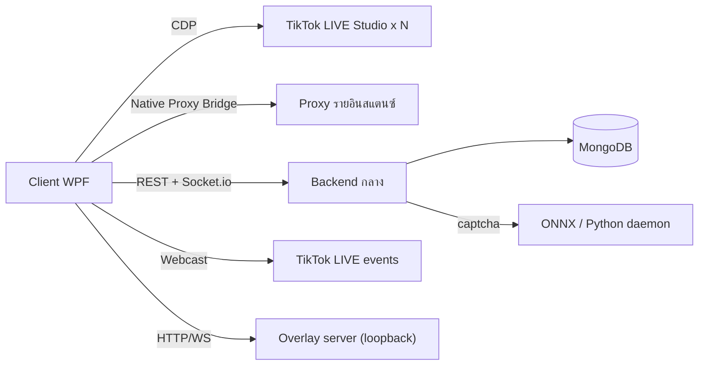

# FlowUltraTech

แอป Windows (WPF, .NET 8) สำหรับรัน **TikTok LIVE Studio หลายบัญชีพร้อมกัน** แยก profile และ proxy รายอินสแตนซ์ ควบคุมผ่าน CDP รองรับตอบแชทอัตโนมัติ, Overlay, การแก้ Captcha ด้วย backend กลาง และระบบ Login/โควต้าจอ

เวอร์ชันปัจจุบัน: **1.7.0** · อัปเดตเอกสารล่าสุด: 2026-10-20

## ส่วนประกอบของระบบ

| ส่วน | ตำแหน่ง | เทคโนโลยี |
| :--- | :--- | :--- |
| Client (repo นี้) | `src/FlowUltraTech.Core` (ตรรกะ), `src/FlowUltraTech.App` (UI) | C#, WPF, PuppeteerSharp, TikTokLive_Sharp |
| Backend กลาง | `d:\Script\java-script\FlowUltraTech` | Node.js, TypeScript, Express, MongoDB, Socket.io, Python (captcha solver) |
| Backoffice | build อยู่ใน `backoffice/dist` ของ backend | เว็บแอดมิน |
| Tests | `tests/FlowUltraTech.Tests`, `tests/FlowUltraTech.Captcha.E2E` | xUnit |

## สารบัญเอกสาร

เอกสารทั้งหมดอยู่ใน [docs/](docs/) เขียนจากโค้ดจริงของเวอร์ชัน 1.7.0 ฉบับเก่าที่ล้าสมัยเก็บไว้ที่ [docs/archive/](docs/archive/)

| เอกสาร | เนื้อหา |
| :--- | :--- |
| [01 Architecture Overview](docs/01_architecture_overview.md) | โครงสร้างโซลูชัน, service map, flow สตาร์ท/วงจรชีวิตอินสแตนซ์, ที่เก็บ config/log |
| [02 Instance Launch & Window Control](docs/02_instance_launch_and_window_control.md) | เปิดหลายอินสแตนซ์, profile isolation, ซ่อน/แสดงหน้าต่าง |
| [03 Network & Proxy](docs/03_network_and_proxy.md) | Native Proxy Bridge และ Proxifier |
| [04 UI & User Guide](docs/04_ui_and_user_guide.md) | หน้าจอและวิธีใช้งาน |
| [05 CDP Automation](docs/05_cdp_automation.md) | การควบคุม Studio ผ่าน CDP, ส่งแชท, network/storage |
| [06 Captcha System](docs/06_captcha_system.md) | Jigsaw/Symbol solver ตั้งแต่ตรวจจับถึงคลิก |
| [07 Captcha Testing & Debugging](docs/07_captcha_testing_and_debugging.md) | mock server, test, debug log |
| [08 Live Events & Auto-Reply](docs/08_live_events_and_auto_reply.md) | Live listener, Rule Engine, Auto-Reply Studio 5 โหมด |
| [09 Overlay System](docs/09_overlay_system.md) | Clock & Anti-Rebroadcast overlay |
| [10 Notifications & Alerts](docs/10_notifications_and_alerts.md) | Telegram, เสียงเตือน |
| [11 Auth, License & Security](docs/11_auth_license_and_security.md) | Login, slot lease, realtime, update, กลไกป้องกัน |
| [12 Build, Release & Testing](docs/12_build_release_and_testing.md) | build, installer, release, วิธีรันเทสต์ |
| [13 Status & Known Issues](docs/13_status_and_known_issues.md) | สถานะฟีเจอร์, บั๊ก, ความเสี่ยงด้านความปลอดภัย, งานที่ควรทำต่อ |

เอกสารฝั่ง Backend: [README](file:///d:/Script/java-script/FlowUltraTech/docs/README.md) · [API Reference](file:///d:/Script/java-script/FlowUltraTech/docs/api_reference.md) · [Data Model](file:///d:/Script/java-script/FlowUltraTech/docs/data_model.md) · [Operations & Backoffice](file:///d:/Script/java-script/FlowUltraTech/docs/operations_and_backoffice.md)

## เริ่มต้นอย่างเร็ว

- รันแอป: `run_app.bat` หรือ build `FlowUltraTech.slnx` ด้วย `dotnet build`
- สร้างตัวติดตั้ง: `build_installer.ps1` (รายละเอียดใน [เอกสาร 12](docs/12_build_release_and_testing.md))
- ทดสอบ Captcha ด้วย mock: `start_mock_jigsaw.ps1`, `start_mock_symbol.ps1` (ดู [เอกสาร 07](docs/07_captcha_testing_and_debugging.md))
- ที่ตั้ง config/log: `%APPDATA%\FlowUltraTech\` (ดู [เอกสาร 01](docs/01_architecture_overview.md))

> [!WARNING]
> พบ credential ฝังในสคริปต์และไฟล์ทดสอบที่ track ใน git ดูรายละเอียดและข้อเสนอแก้ไขใน [เอกสาร 13](docs/13_status_and_known_issues.md)
