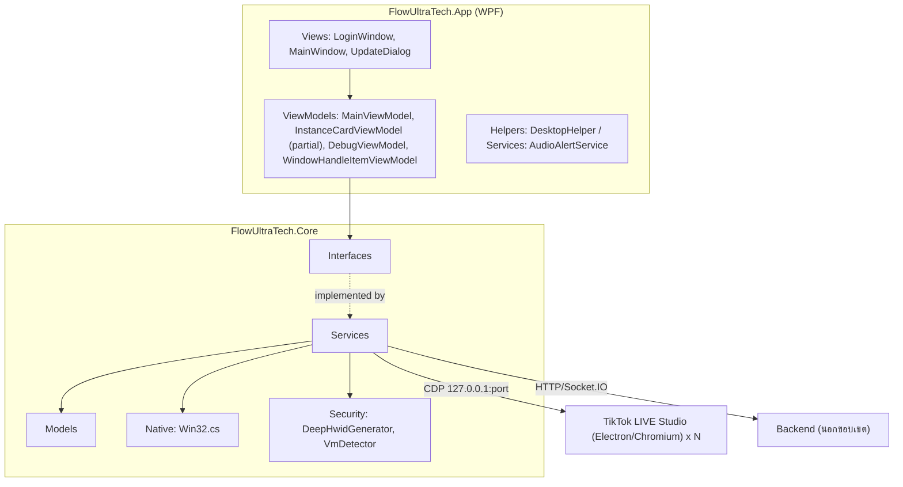
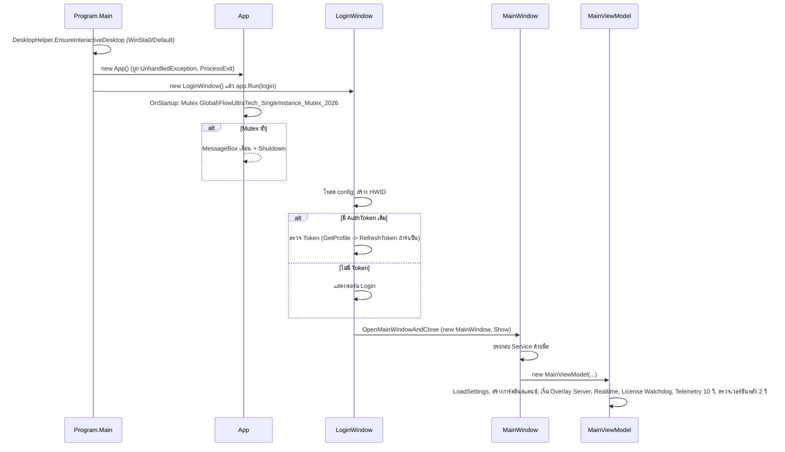
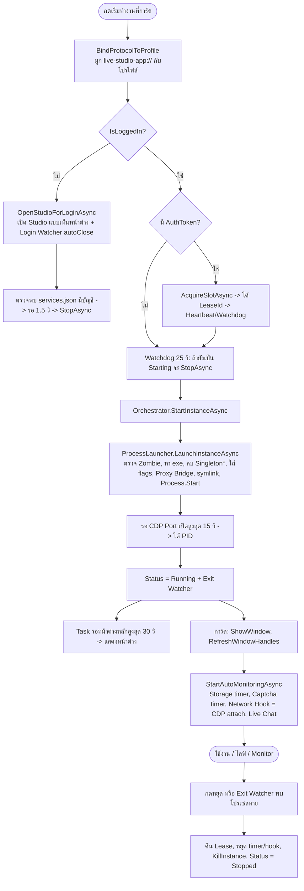

# 01. ภาพรวมสถาปัตยกรรม FlowUltraTech (Client)

อัปเดตล่าสุด: 2026-10-20 · เวอร์ชันแอป: 1.7.0 (อ่านจาก [FlowUltraTech.App.csproj](../src/FlowUltraTech.App/FlowUltraTech.App.csproj) และ [FlowUltraTech.Core.csproj](../src/FlowUltraTech.Core/FlowUltraTech.Core.csproj); เวลารันอ่านผ่าน `AppConstants.CurrentVersion`)

เอกสารนี้อธิบายฝั่ง Client (C# WPF, .NET 8) ตามโค้ดจริง ส่วนที่เกี่ยวกับ Backend (Node/TS) อยู่นอกขอบเขต

เอกสารที่เกี่ยวข้อง: [02 การเปิดอินสแตนซ์และการควบคุมหน้าต่าง](02_instance_launch_and_window_control.md) · [03 Network และ Proxy](03_network_and_proxy.md) · [04 UI และคู่มือใช้งาน](04_ui_and_user_guide.md)

---

## 1. โครงสร้างโซลูชัน

| โปรเจกต์ | ชนิด / Framework | หน้าที่ |
|---|---|---|
| [FlowUltraTech.Core](../src/FlowUltraTech.Core/FlowUltraTech.Core.csproj) | Class library, `net8.0` | Service, Model, Interface, Win32 interop, Security ทั้งหมด (ไม่มี UI) |
| [FlowUltraTech.App](../src/FlowUltraTech.App/FlowUltraTech.App.csproj) | WinExe, `net8.0-windows`, WPF | UI (WPF-UI 4.3.0, WebView2), ViewModel (CommunityToolkit.Mvvm 8.4.2), จุดเริ่มโปรแกรม |
| [FlowUltraTech.Tests](../tests/FlowUltraTech.Tests/FlowUltraTech.Tests.csproj) | xUnit | ชุดทดสอบ (Core ให้สิทธิ์ `InternalsVisibleTo`) |
| [FlowUltraTech.Captcha.E2E](../tests/FlowUltraTech.Captcha.E2E/Program.cs) | Console | เครื่องมือทดสอบ Captcha แบบ E2E (นอกขอบเขตเอกสารนี้) |
| [installer/setup.iss](../installer/setup.iss) | Inno Setup | สคริปต์ติดตั้งปัจจุบัน (AppVersion 1.7.0, `PrivilegesRequired=lowest`, ติดตั้งไปที่ `{autopf}\FlowUltraTech`) |

หมายเหตุ: [installer/setup_script.iss](../installer/setup_script.iss) เป็นสคริปต์รุ่นเก่า (AppVersion 0.1.0, ชื่อ "TikTok LIVE Studio Sandbox Manager") ยังอยู่ในรีโปแต่ไม่ตรงกับ `setup.iss`

แพ็กเกจหลักของ Core: PuppeteerSharp 25.10.0 (CDP), SocketIOClient 4.0.5 (Realtime), TikTokLive_Sharp 1.2.3 (Live Listener), System.Management, Microsoft.Win32.Registry

### Layer

---

## 2. การประกอบ Service (ไม่มี DI Container)

โค้ดจริง **ไม่ได้ใช้ DI Container** (ไม่มี `ServiceCollection`) แต่ประกอบ Object ด้วยมือใน Constructor ของ [MainWindow.xaml.cs](../src/FlowUltraTech.App/MainWindow.xaml.cs):

1. สร้าง `ConfigStorageService`, `WindowController`, `ProcessLauncher(windowCtrl)`, `CdpAutomationService`
2. `InstanceOrchestrator(launcher, windowCtrl, cdp)`
3. `ProxifierService`, `ProfileManagerService`, `TelegramNotificationService`, `TikTokLiveListenerService`, `OverlayServerService`
4. `MainViewModel(storage, orchestrator, proxifier, cdp, profileManager, telegram, tikTokLive, overlayService)`
5. `MainViewModel` สร้างต่อเอง (ถ้าไม่ถูกส่งเข้ามา): `RealtimeClientService`, `SlotLeaseClientService`, `AuthClientService`, `DebugViewModel`
6. `InstanceCardViewModel` สร้างต่อ 1 การ์ดต่อ 1 `StudioInstanceProfile` และสร้าง `RuleEngine` ภายในเอง

ทุก Constructor มี Parameter เป็น `null` ได้ แล้ว fallback ไปสร้างค่าเริ่มต้นเอง จึงทดสอบแบบแยกส่วนได้ ([MainViewModelNavigationTests.cs](../tests/FlowUltraTech.Tests/MainViewModelNavigationTests.cs))

Singleton แบบ static ที่มีในโค้ด: `InstanceLogManager.Shared` ([InstanceLogManager.cs](../src/FlowUltraTech.Core/Services/InstanceLogManager.cs)) และ `LocalProxyBridgeService.Shared` ([LocalProxyBridgeService.cs](../src/FlowUltraTech.Core/Services/LocalProxyBridgeService.cs))

### ตาราง Service ใน Core

| Service | หน้าที่ (1 บรรทัด) | อ้างอิง |
|---|---|---|
| `ProcessLauncher` | เปิด/ปิด/ตรวจโปรเซส TikTok LIVE Studio, ใส่ Chromium flags, ผูก Proxy Bridge, ผูก Protocol `live-studio-app://`, Clone session | [ProcessLauncher.cs](../src/FlowUltraTech.Core/Services/ProcessLauncher.cs) |
| `ProcessTreeHelper` | สร้าง Snapshot โปรเซสด้วย Toolhelp32 แล้วหา Root และลูกหลานของอินสแตนซ์ | [ProcessTreeHelper.cs](../src/FlowUltraTech.Core/Services/ProcessTreeHelper.cs) |
| `TikTokStudioPathResolver` | หา `TikTok LIVE Studio.exe` ตัวจริง (ข้าม Launcher) | [TikTokStudioPathResolver.cs](../src/FlowUltraTech.Core/Services/TikTokStudioPathResolver.cs) |
| `InstanceOrchestrator` | ควบคุมวงจรชีวิตอินสแตนซ์ (Start/Stop/Show/Hide/Exit Watcher) โดยเรียก Launcher + WindowController | [InstanceOrchestrator.cs](../src/FlowUltraTech.Core/Services/InstanceOrchestrator.cs) |
| `WindowController` | ค้นหาหน้าต่างจริงของ Studio และซ่อน/แสดง/ดึงขึ้นหน้าสุดด้วย Win32 | [WindowController.cs](../src/FlowUltraTech.Core/Services/WindowController.cs) |
| `ProfileManagerService` | หา Path โปรไฟล์, อ่าน `TTStore\services.json` เพื่อรู้บัญชีที่ล็อกอิน, เฝ้าไฟล์เปลี่ยน | [ProfileManagerService.cs](../src/FlowUltraTech.Core/Services/ProfileManagerService.cs) |
| `ConfigStorageService` | อ่าน/เขียน `config.json` พร้อมเข้ารหัสค่าลับด้วย DPAPI | [ConfigStorageService.cs](../src/FlowUltraTech.Core/Services/ConfigStorageService.cs) |
| `InstanceLogger` / `InstanceLogManager` | Log รายอินสแตนซ์ (หน่วยความจำ + ไฟล์ + หมุนไฟล์ 10 MB) | [InstanceLogger.cs](../src/FlowUltraTech.Core/Services/InstanceLogger.cs), [InstanceLogManager.cs](../src/FlowUltraTech.Core/Services/InstanceLogManager.cs) |
| `LocalProxyBridgeService` | Proxy Bridge ภายในเครื่อง (127.0.0.1) รองรับ HTTP/HTTPS/SOCKS5 + Auth และทดสอบ Proxy | [LocalProxyBridgeService.cs](../src/FlowUltraTech.Core/Services/LocalProxyBridgeService.cs) |
| `ProxifierService` | สร้าง/อัปเดตไฟล์ `.ppx` ของ Proxifier และสั่งโหลด (ทางเลือก) | [ProxifierService.cs](../src/FlowUltraTech.Core/Services/ProxifierService.cs) |
| `CdpAutomationService` (partial 5 ไฟล์) | เชื่อม CDP ผ่าน PuppeteerSharp: Script, Network Hook, Cookie/Storage, HTML, Captcha, Live Chat, Overlay inject | [CdpAutomationService.cs](../src/FlowUltraTech.Core/Services/CdpAutomationService.cs) |
| `AuthClientService` | เรียก Auth/Profile/Proxy/Cloud Settings ของ Backend (นอกขอบเขตเอกสารนี้) | [AuthClientService.cs](../src/FlowUltraTech.Core/Services/AuthClientService.cs) |
| `SlotLeaseClientService` | ขอ/ต่ออายุ/คืน Slot Lease ต่ออินสแตนซ์ + Watchdog (นอกขอบเขต) | [SlotLeaseClientService.cs](../src/FlowUltraTech.Core/Services/SlotLeaseClientService.cs) |
| `RealtimeClientService` | Socket.IO Client รับ Event สิทธิ์/อัปเดต และส่งรายงานอินสแตนซ์ (นอกขอบเขต) | [RealtimeClientService.cs](../src/FlowUltraTech.Core/Services/RealtimeClientService.cs) |
| `OverlayServerService` | เซิร์ฟเวอร์ Overlay ในเครื่อง (`127.0.0.1`, พอร์ตเริ่มต้น 19450) | [OverlayServerService.cs](../src/FlowUltraTech.Core/Services/OverlayServerService.cs) |
| `TelegramNotificationService` | ส่งข้อความ/รูปแจ้งเตือนผ่าน Telegram Bot | [TelegramNotificationService.cs](../src/FlowUltraTech.Core/Services/TelegramNotificationService.cs) |
| `TikTokLiveListenerService` | รับ Event ห้องไลฟ์ผ่านไลบรารี TikTokLive_Sharp | [TikTokLiveListenerService.cs](../src/FlowUltraTech.Core/Services/TikTokLiveListenerService.cs) |
| `RuleEngine`, `AutoReplyEngineService` | ประเมินกฎตอบกลับอัตโนมัติ (นอกขอบเขต) | [RuleEngine.cs](../src/FlowUltraTech.Core/Services/RuleEngine.cs), [AutoReplyEngineService.cs](../src/FlowUltraTech.Core/Services/AutoReplyEngineService.cs) |
| `DeepHwidGenerator` | สร้างรหัสเครื่อง (HWID) ที่ใช้ตอน Login/ขอ Lease | [DeepHwidGenerator.cs](../src/FlowUltraTech.Core/Security/DeepHwidGenerator.cs) |
| `VmDetector` | ตรวจสภาพแวดล้อม VM (ยังไม่ได้ตรวจว่าถูกเรียกใช้จุดใด) | [VmDetector.cs](../src/FlowUltraTech.Core/Security/VmDetector.cs) |
| `Win32` (static) | P/Invoke: user32, kernel32 (หน้าต่าง, Toolhelp32) | [Win32.cs](../src/FlowUltraTech.Core/Native/Win32.cs) |
| `AppConstants`, `VersionHelper` | Endpoint เริ่มต้น + เวอร์ชันปัจจุบัน / เปรียบเทียบเวอร์ชัน | [AppConstants.cs](../src/FlowUltraTech.Core/AppConstants.cs), [VersionHelper.cs](../src/FlowUltraTech.Core/VersionHelper.cs) |

ฝั่ง App: [AudioAlertService.cs](../src/FlowUltraTech.App/Services/AudioAlertService.cs) (เสียงเตือน Captcha), [DesktopHelper.cs](../src/FlowUltraTech.App/Helpers/DesktopHelper.cs) (ผูก Process เข้ากับ WinSta0 / Desktop `Default` ก่อนสร้าง UI)

### AppConstants และเวอร์ชัน

- `DefaultServerEndpoint` = `https://api.flowultratech-captcha.shop` (ค่าคงที่ในโค้ด; `MainViewModel` และ `SaveSettingsAsync` เขียนทับ `AuthApiEndpoint`/`CaptchaSolverEndpoint` ด้วยค่านี้ทุกครั้ง)
- `CurrentVersion` อ่านจาก `AssemblyInformationalVersion` ของ Assembly (ตัดส่วนหลัง `+`), ไม่มีค่าจึงใช้ `Version`, ถ้าล้มเหลว fallback เป็น `"0.1.7"`
- `VersionHelper.ShouldPromptUpdate` ไม่แสดง Dialog อัปเดตเมื่อเวอร์ชันปัจจุบัน ≥ เวอร์ชันล่าสุดและไม่ต่ำกว่า `minRequiredVersion` แม้ `IsMandatory = true`

---

## 3. Flow การสตาร์ทแอป

รายละเอียดจากโค้ด:

- [Program.cs](../src/FlowUltraTech.App/Program.cs): `StartupObject` = `FlowUltraTech.App.Program`; ถ้าเกิด Exception ที่ `Main` จะแสดง Win32 `MessageBox` และเขียน `app_debug.log`
- [App.xaml.cs](../src/FlowUltraTech.App/App.xaml.cs): `ShutdownMode = OnExplicitShutdown`; `App.Log` เขียนไฟล์ `app_debug.log` ในโฟลเดอร์ที่ติดตั้ง (`AppDomain.CurrentDomain.BaseDirectory`) และกลืน Exception ถ้าเขียนไม่ได้
- Single-instance: Mutex ชื่อ `Global\FlowUltraTech_SingleInstance_Mutex_2026` (ข้อความเตือนยังเรียกชื่อเดิมว่า "TikTok LIVE Studio Sandbox")
- Manifest ([app.manifest](../src/FlowUltraTech.App/app.manifest)): `requestedExecutionLevel = highestAvailable` (ถ้าผู้ใช้เป็น Admin แอปจะรันแบบยกระดับ)
- [LoginWindow.xaml.cs](../src/FlowUltraTech.App/Views/LoginWindow.xaml.cs): ปิด LoginWindow โดยไม่ผ่านการยืนยัน = ปิดแอปทั้งตัว (logic Auth อยู่นอกขอบเขตเอกสารนี้)
- `MainWindow.Closing` เรียก `ProcessLauncher.KillAllStudioProcesses()` และ `MainViewModel.Cleanup()` (Dispose Overlay Server) แล้ว `Application.Shutdown()` เว้นแต่เป็นการ Logout
- `App.OnExit` และ `AppDomain.ProcessExit` เรียก `KillAllStudioProcesses()` ซ้ำอีกชั้น

---

## 4. Flow วงจรชีวิตอินสแตนซ์

ประเด็นที่ตรวจจากโค้ด:

- **CDP attach** ไม่ใช่ขั้นตอนแยก เกิดตอนมีการเรียก `GetOrConnectBrowserAsync` ครั้งแรก (เช่น `StartNetworkHookAsync` จาก `StartAutoMonitoringAsync`): `Puppeteer.ConnectAsync` ไปที่ `http://127.0.0.1:{cdpPort}`, ลองสูงสุด 3 ครั้ง ครั้งละ Timeout 4 วิ, `ProtocolTimeout` 8 วิ แล้วตั้ง `navigator.webdriver` เป็น `undefined` ในทุกหน้า ([CdpAutomationService.cs](../src/FlowUltraTech.Core/Services/CdpAutomationService.cs))
- ปุ่ม "เริ่มทำงาน" จะแสดงเฉพาะบัญชีที่ล็อกอินแล้ว (`LoggedInVisibility`); บัญชีที่ยังไม่ล็อกอินจะเห็นปุ่ม "เข้าสู่ระบบ" แทน
- สถานะ `Starting` ไม่ถูกบันทึกลงดิสก์ ([ConfigStorageService.cs](../src/FlowUltraTech.Core/Services/ConfigStorageService.cs) แปลงเป็น `Stopped` ทั้งตอน Load และ Save)
- ตอนเปิดแอป การ์ดจะตรวจ `netstat` ว่ามีโปรเซสฟังพอร์ต CDP อยู่แล้วหรือไม่ ถ้ามีจะตั้งเป็น `Running` และเริ่ม Auto Monitor ต่อทันที (`InstanceCardViewModel` Constructor)
- รายละเอียดขั้นตอนใน Launcher/Window ดู [เอกสาร 02](02_instance_launch_and_window_control.md)

---

## 5. ที่เก็บข้อมูล Config และ Log บนดิสก์

| รายการ | Path จริง | ผู้เขียน |
|---|---|---|
| Config หลัก | `%APPDATA%\FlowUltraTech\config.json` | `ConfigStorageService` |
| Config เก่า (ย้ายครั้งเดียว) | `%APPDATA%\TiktokStudioSandbox\config.json` ถูกคัดลอกเมื่อยังไม่มีโฟลเดอร์ `FlowUltraTech` | `ConfigStorageService` Constructor |
| Log รายอินสแตนซ์ | `%APPDATA%\FlowUltraTech\Logs\<ProfileFolderName>_debug.log` (+ `.bak` เมื่อเกิน 10 MB) | `InstanceLogger` |
| Log ระดับแอป | `<โฟลเดอร์ติดตั้ง>\app_debug.log` | `App.Log` |
| โปรไฟล์ Studio แบบ Direct | `%LOCALAPPDATA%\TikTokStudioProfiles\<ProfileFolderName>\` (หรือ `UserDataDir` ถ้ากำหนด) | Studio + `ProfileManagerService.ResolveProfileDirectoryStatic` |
| โปรไฟล์บัญชีหลัก (Default) | `%APPDATA%\TikTok LIVE Studio` | โหมด `DefaultProfile` และแหล่ง Clone session |
| ข้อมูลบัญชีที่ล็อกอิน | `<โปรไฟล์>\TTStore\services.json` (+ `avatar*.png`) | Studio, อ่านโดย `ProfileManagerService` |
| Symlink ต่อโปรไฟล์ | `<โฟลเดอร์ Studio>\TikTok LIVE Studio_<folder>.exe` | `ProcessLauncher` |
| Registry Protocol | `HKCU\Software\Classes\live-studio-app\shell\open\command` | `ProcessLauncher.BindProtocolToProfile` |
| Proxifier Profile (ถ้าไม่ได้ตั้ง Path) | `%APPDATA%\Proxifier\Profiles\TikTokSandbox.ppx` | `MainViewModel.GenerateProxifierConfig` |
| WebView2 พรีวิว Overlay | `%LOCALAPPDATA%\FlowUltraTech\WebView2_OverlayPreview` | `MainWindow` |
| ภาพ Captcha (ค่าเริ่มต้น) | `Environment.SpecialFolder.CommonPictures\TikTokStudioCaptures` | `MainViewModel` (ตั้งใหม่ได้ใน Settings) |

### รูปแบบ `config.json` ([AppSettings.cs](../src/FlowUltraTech.Core/Models/AppSettings.cs))

- JSON แบบ Indent, ชื่อ Property ไม่สนตัวพิมพ์
- รายการหลัก: `Instances` (`StudioInstanceProfile`), `Proxies` (`ProxyItem`), `Rules` (`AutomationRule`) + ค่าตั้งต่างๆ (Path ของ Studio/Proxifier, Captcha, Telegram, `MaxTiktokAccounts`, `OverlayServerPort` ฯลฯ)
- ค่าที่เข้ารหัสด้วย Windows DPAPI (ขอบเขตผู้ใช้ปัจจุบัน, Prefix `enc:dpapi:`): `AuthToken`, `RefreshToken`, `CaptchaSolverJwtToken`, `TelegramBotToken`, `ProxyItem.Password`
- ค่าที่ **ไม่** ผ่านการเข้ารหัสตามโค้ด: `StudioInstanceProfile.ProxyPassword` (Proxy รายอินสแตนซ์) และ `InstanceAutoReplyConfig.AiApiKey`
- ถ้า Load ไม่ได้/ไม่มีไฟล์ จะสร้าง Config เริ่มต้น (Proxy SOCKS5 ตัวอย่าง 2 ตัว, อินสแตนซ์ `Acc01` พอร์ต 9221 และ `Acc02` พอร์ต 9222, กฎตัวอย่าง 2 ข้อ) แล้วบันทึกทันที
- Migration: ล้าง `DefaultChromiumFlags` ที่มี `--disable-background-timer-throttling=false` และบันทึกค่าที่เคยเป็นข้อความธรรมดาใหม่เป็นแบบเข้ารหัส

### Log

- `InstanceLogger` เก็บ 1,000 รายการล่าสุดในหน่วยความจำ (ตัดทีละ 200) และเขียนไฟล์ต่อท้ายทุกรายการ; ระดับ Debug/Info/Warn/Error; ชื่อไฟล์ใช้ `ProfileFolderName`
- `InstanceLogManager.GetLogger` ผูก Logger กับทั้งโฟลเดอร์และพอร์ต CDP; `TryGetLoggerByPort` ลองหาแบบตรงตัวแล้วลอง `port - 100` เป็น Fallback
- การ์ดอินสแตนซ์เก็บ Log ใน UI ได้สูงสุด 1,500 รายการ

---

## 6. ข้อสังเกต/ช่องว่าง

- ไม่มี DI Container จริง ทำให้ `InstanceLogManager.Shared` และ `LocalProxyBridgeService.Shared` เป็น Global state ที่ทุกส่วนเรียกตรง
- `MainWindow.Closing` เรียก `KillAllStudioProcesses()` แม้ผู้ใช้ Logout: Studio ทุกตัวที่ชื่อโปรเซสขึ้นต้นด้วย `TikTok LIVE Studio` จะถูกปิดด้วย
- `AppSettings.AutoConnectCdp` มีใน Model แต่ไม่พบจุดที่อ่านค่านี้ในโค้ด (ยังไม่ยืนยันว่ามีผลต่อการทำงาน)
- `VmDetector` ยังไม่ได้ตรวจว่าถูกเรียกใช้ที่ใด (อยู่นอกขอบเขตที่อ่านรอบนี้)
- ชื่อที่ผู้ใช้เห็นยังปะปน: Title Bar แสดง "TikTok LIVE Studio" + `Sandbox v{version}`, `UpdateDialog` แสดง "TikTok LIVE Studio Sandbox", Window Title ใช้ `FlowUltraTech v{version}`
- ข้อความ Fallback ใน XAML (`Sandbox v0.1.4`, `CDP Core v0.1.4`) เป็นค่า Design-time เท่านั้น ที่รันจริงใช้เวอร์ชัน Assembly
