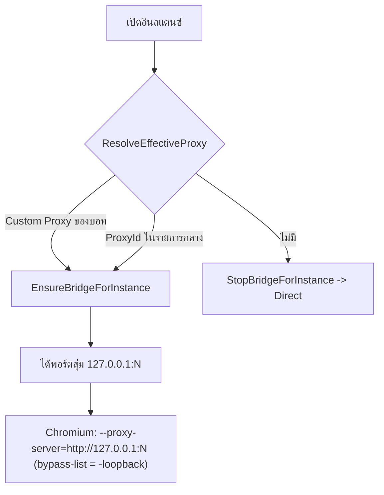

# 03. Network และ Proxy

อัปเดตล่าสุด: 2026-10-20 · เวอร์ชันแอป: 1.7.0 (อ่านจาก [FlowUltraTech.App.csproj](../src/FlowUltraTech.App/FlowUltraTech.App.csproj))

เอกสารนี้อธิบายการส่งทราฟฟิกของแต่ละอินสแตนซ์ผ่าน Proxy ตามโค้ดจริงของเวอร์ชัน 1.7.0 ซึ่งมี 2 กลไก: **Native Proxy Bridge** (กลไกหลัก ไม่ต้องใช้ซอฟต์แวร์เสริม) และ **Proxifier** (ทางเลือก)

เอกสารที่เกี่ยวข้อง: [01 ภาพรวม](01_architecture_overview.md) · [02 การเปิดอินสแตนซ์](02_instance_launch_and_window_control.md) · [04 UI](04_ui_and_user_guide.md)

---

## 1. เปรียบเทียบ 2 กลไก

| หัวข้อ | Native Proxy Bridge | Proxifier (ทางเลือก) |
|---|---|---|
| โค้ด | [LocalProxyBridgeService.cs](../src/FlowUltraTech.Core/Services/LocalProxyBridgeService.cs) | [ProxifierService.cs](../src/FlowUltraTech.Core/Services/ProxifierService.cs) |
| วิธีทำงาน | เปิด Listener `127.0.0.1:<พอร์ตสุ่ม>` ต่ออินสแตนซ์ แล้วส่ง `--proxy-server` ให้ Chromium ของ Studio | เขียนไฟล์ `.ppx` ให้ Proxifier ดักทราฟฟิกตามชื่อโปรแกรม |
| ต้องติดตั้งเพิ่ม | ไม่ต้อง | ต้องมี Proxifier |
| โปรโตคอลที่รองรับ | HTTP, HTTPS, SOCKS5 (+ Username/Password) | SOCKS5 หรือ "HTTPS" (HTTP ก็ถูกเขียนเป็น `HTTPS`) |
| เริ่มทำงานเมื่อ | เปิดอินสแตนซ์ (`ProcessLauncher`) หรือกดบันทึก Proxy | ผู้ใช้กด "ซิงก์ Proxifier (ทางเลือก)" |
| UI | แท็บ "เซสชันบัญชี" + หน้า "Proxy เครือข่าย" | ปุ่ม "ซิงก์ Proxifier (ทางเลือก)" + ช่อง Path ในหน้า "ตั้งค่าระบบ" |

เวอร์ชัน 1.7.0 ใช้ Native Bridge เป็นหลัก (Commit `v1.7.0: add Native Proxy Bridge`) ส่วนเอกสารเก่าที่ระบุว่า Proxifier เป็นวิธีเดียวไม่ตรงกับโค้ดปัจจุบันแล้ว

---

## 2. Model

### `ProxyItem` ([ProxyItem.cs](../src/FlowUltraTech.Core/Models/ProxyItem.cs)) — รายการ Proxy กลาง

| ฟิลด์ | ความหมาย |
|---|---|
| `Id` (Guid) | ใช้อ้างอิงจาก `StudioInstanceProfile.ProxyId` |
| `Name`, `Host`, `Port` | ข้อมูลทั่วไป (ค่าเริ่มต้น `127.0.0.1:1080`) |
| `Username`, `Password` | ถ้า `Username` ว่าง = ไม่ใช้ Auth |
| `Protocol` | `ProxyProtocol`: `Socks5=0`, `Https=1`, `Http=2` |
| `ProxifierId` | ตัวเลข ID ใน XML ของ Proxifier (เริ่มที่ 100) |
| `IsActive` | ปิดใช้งานแล้วจะไม่ถูกเลือกและไม่ถูกเขียนลง Proxifier |

### ฟิลด์ Proxy ใน `StudioInstanceProfile`

| ฟิลด์ | ความหมาย |
|---|---|
| `UseCustomProxy` | เปิดใช้ Proxy เฉพาะบอทนี้ |
| `ProxyProtocol`, `ProxyHost`, `ProxyPort` (ค่าเริ่มต้น 8080), `ProxyUsername`, `ProxyPassword` | รายละเอียด Proxy เฉพาะบอท |
| `ProxyId` | อ้าง Proxy จากรายการกลาง (`ProxyItem.Id`) |

---

## 3. การจับคู่ Proxy กับอินสแตนซ์

`LocalProxyBridgeService.ResolveEffectiveProxy(profile, settings)` เลือกตามลำดับ:

1. `UseCustomProxy = true` และ `ProxyHost` ไม่ว่าง และ `ProxyPort > 0` → สร้าง `ProxyItem` ชั่วคราวจากฟิลด์ของโปรไฟล์ (ชื่อ `<Name>-CustomProxy`)
2. มี `ProxyId` และพบใน `settings.Proxies` ที่ `IsActive` ทั้ง Host ไม่ว่างและ Port > 0 → ใช้ตัวนั้น
3. ไม่เข้าเงื่อนไข → เชื่อมต่อตรง (Direct)

**การกำหนด Proxy ให้อินสแตนซ์ใน UI:**

- Proxy เฉพาะบอท: ตั้งได้ในแท็บ "เซสชันบัญชี" ของการ์ด (ช่อง Protocol / Host / Port / Username / Password)
- Proxy จากรายการกลาง: ไม่พบ UI สำหรับเลือก `ProxyId` ให้อินสแตนซ์ ค่านี้มาจาก Config เริ่มต้น (บัญชี `Acc01` ผูก "SOCKS5 Proxy #1", `Acc02` ผูก "SOCKS5 Proxy #2"), การซิงก์ Cloud (`ProfileSyncDto.ProxyId`) หรือแก้ `config.json` เอง

---

## 4. Native Proxy Bridge ทำงานอย่างไร

### วงจรชีวิต

| เหตุการณ์ | ผล |
|---|---|
| `ProcessLauncher.LaunchInstanceAsync` (มี Proxy) | `EnsureBridgeForInstance(instance.Id, proxy)` → เปิด `TcpListener(IPAddress.Loopback, 0)` ได้พอร์ตสุ่ม แล้วส่งพอร์ตให้ Chromium |
| `LaunchInstanceAsync` (ไม่มี Proxy) | `StopBridgeForInstance` |
| `KillInstance` | `StopBridgeForInstance` |
| ติ๊ก "เปิดใช้งาน Proxy สำหรับบอทนี้" / กด "บันทึก Proxy" | `ApplyAndSaveInstanceProxy` → `EnsureBridge...` หรือ `StopBridge...` + บันทึก Config |
| กด "บันทึก & เปิดใช้ Native Proxy" (หน้า Proxy เครือข่าย) | วนทุกการ์ด: เปิด/ปิด Bridge ตามผล `ResolveEffectiveProxy` + บันทึก Config |

- Bridge มี 1 Session ต่อ 1 `Instance.Id` (เก็บใน `ConcurrentDictionary`); ถ้ามี Session อยู่แล้ว `EnsureBridge...` จะอัปเดต Upstream โดย **คงพอร์ตเดิม**
- แต่ละการเชื่อมต่อที่เข้ามาถูกจัดการใน Task แยก (`AcceptLoopAsync` → `HandleClientAsync`)

### การจัดการคำขอ

1. อ่านส่วนหัว HTTP ของ Client ทีละไบต์จนถึง `\r\n\r\n` (สูงสุด 16 KB) แล้วแยกบรรทัดแรก (Method, Target, Version)
2. แยกตามโปรโตคอลของ Upstream:

| Upstream | ขั้นตอน |
|---|---|
| `Http` / `Https` | เชื่อมต่อ Upstream (Timeout 10 วินาที; `Https` ครอบด้วย `SslStream`) → เขียนส่วนหัวใหม่โดยแทรก/แทนที่ `Proxy-Authorization: Basic <base64(user:pass)>` เมื่อมี Username → ส่งต่อแล้วท่อสองทางจนปิด |
| `Socks5` | เชื่อมต่อ Upstream → Greeting (เสนอ NoAuth และ User/Pass เมื่อมี Username) → RFC 1929 Auth (ชื่อ/รหัสยาวไม่เกิน 255 ไบต์) → `CONNECT` แบบ Domain Name (ให้ Proxy ทำ DNS) → ถ้าเป็น `CONNECT` ตอบ Client `HTTP/1.1 200 Connection Established`; ถ้าเป็น HTTP ธรรมดาแปลง Target เป็น Path สัมพัทธ์และตัด `Proxy-Connection`/`Proxy-Authorization` แล้วส่งต่อ |

3. ท่อสองทางใช้ Buffer 16 KB (`ArrayPool`) และจบเมื่อฝั่งใดฝั่งหนึ่งปิด
4. ข้อผิดพลาดของ SOCKS5 ตอบกลับเป็น HTTP `502 Bad Gateway` หรือ `407 Proxy Authentication Required`

### Flag ที่ส่งให้ Studio

`--proxy-server="http://127.0.0.1:<พอร์ต>" --proxy-bypass-list="<-loopback>"` (ใส่ในอาร์กิวเมนต์ตามหัวข้อ 3 ของ [เอกสาร 02](02_instance_launch_and_window_control.md))

### ทดสอบ Proxy (`TestProxyAsync`)

ใช้ได้ทั้งปุ่ม "ทดสอบ IP/Ping" (รายการกลาง) และ "ทดสอบ Proxy" (เฉพาะบอท):

1. ตรวจ Host ไม่ว่างและ Port อยู่ระหว่าง 1–65535
2. สร้าง Bridge ชั่วคราวด้วย GUID ใหม่ แล้วเรียกผ่าน `HttpClient` (`WebProxy http://127.0.0.1:<พอร์ต>`; Timeout เชื่อมต่อ 8 วินาที, รวม 10 วินาที)
3. ขอ `http://ip-api.com/json/...` ได้ IP/ประเทศ/ISP; ถ้าล้มเหลวลอง `https://api.ipify.org?format=json` (ได้เฉพาะ IP)
4. คืน `ProxyTestResult` (`Success`, `ExitIp`, `Country`, `Isp`, `LatencyMs`, `Message`) แล้วหยุด Bridge ชั่วคราว

---

## 5. Proxifier (ทางเลือก)

### การสร้างไฟล์ ([ProxifierService.cs](../src/FlowUltraTech.Core/Services/ProxifierService.cs))

`MainViewModel.GenerateProxifierConfig` ใช้ `ProxifierProfilePath` (ถ้าว่างจะตั้งเป็น `%APPDATA%\Proxifier\Profiles\TikTokSandbox.ppx`) แล้วเรียก `UpdateProfileFile`:

| กรณี | พฤติกรรม |
|---|---|
| ไฟล์ยังไม่มี | `GenerateProfileXml` สร้างไฟล์ใหม่ทั้งหมด: `Options` (ResolveViaProxy, ExclusionList `%ComputerName%; localhost; 127.0.0.1; %Network%`), `ProxyList` (เฉพาะ `IsActive`; `SOCKS5` หรือ `HTTPS`, `Options=48`, ใส่ `Authentication` ถ้ามี Username), `RuleList` (1 Rule ต่ออินสแตนซ์ที่มี `ProxyId` + Rule `Default` = Direct) |
| ไฟล์มีอยู่แล้ว | โหลด XML → ลบ Rule ที่ชื่อขึ้นต้น `TikTok_` → เพิ่ม/แก้ Proxy → แทรก Rule ใหม่ก่อน Rule `Default` → บันทึก |

ชื่อ Rule = `TikTok_<ProfileFolderName>` (ถ้าว่างใช้ `Name`) และ Action ชี้ `ProxifierId` ของ Proxy

### `ReloadProxifier`

รัน `Proxifier.exe "<ppx>" /silent-load` และคืน `true` เมื่อสั่งเริ่มโปรเซสสำเร็จ ต้องมีทั้งไฟล์ exe และ `.ppx` ปุ่ม "ซิงก์ Proxifier (ทางเลือก)" = `GenerateProxifierConfig` + `ReloadProxifier`

### ความต่างของ 2 เส้นทางสร้าง Rule (พบจากโค้ด)

| หัวข้อ | `GenerateProfileXml` (ไฟล์ใหม่) | `UpdateProfileFile` (ไฟล์เดิม) |
|---|---|---|
| `Applications` ใน Rule | `TikTok LIVE Studio_<tag>.exe; TikTok LIVE Studio.exe; live-studio.exe` | `TikTok LIVE Studio.exe; live-studio.exe` (ไม่มีชื่อ exe ต่อโปรไฟล์) |
| Proxy ที่มี ID อยู่แล้ว | — | อัปเดตเฉพาะ `Address` และ `Port` (ไม่แก้ Protocol/Auth) |
| Proxy ใหม่ที่เพิ่มเข้าไฟล์เดิม | — | ไม่มี `Authentication` |

ชุดทดสอบ [ProxifierServiceTests.cs](../tests/FlowUltraTech.Tests/ProxifierServiceTests.cs) ตรวจเฉพาะ `GenerateProfileXml`

---

## 6. ซิงก์ Proxy กับ Backend (ฝั่ง Client)

Client เรียกผ่าน `IAuthClientService` ([IAuthClientService.cs](../src/FlowUltraTech.Core/Interfaces/IAuthClientService.cs)) เมื่อมี `AuthToken`:

| เหตุการณ์ | การเรียก |
|---|---|
| เพิ่ม Proxy | `UpsertProxyAsync` (`ClientProxyId` = `Id`, `Protocol` เป็นชื่อ enum ตัวพิมพ์เล็ก) |
| ลบ Proxy | `DeleteProxyAsync` ส่ง `ProxifierId` (เป็นข้อความ) เป็นตัวระบุ |
| "ซิงค์ Cloud" (`SyncWithCloudAsync`) | `GetProxiesAsync` → เพิ่ม Proxy ที่ยังไม่มีในเครื่อง (จับคู่ด้วย `ProxifierId` หรือ `Host+Port`) → ส่งรายการในเครื่องทั้งหมดกลับด้วย `SyncProxiesBatchAsync` |

ข้อสังเกตจากโค้ด:

- ข้อมูลที่ส่งรวม `Username` และ `Password` ของ Proxy
- การดึงจาก Cloud แปลง Protocol เป็น `Http` เฉพาะค่า `"http"` ที่เหลือทั้งหมด (รวม `"https"`) กลายเป็น `Socks5`
- การดึงจาก Cloud เพิ่มได้อย่างเดียว ไม่แก้/ลบรายการเดิมในเครื่อง
- การแก้ค่าในตาราง Proxy ไม่ยิง API ทันที (ไปซิงก์รอบถัดไปตอนกด "ซิงค์ Cloud")
- รายละเอียดฝั่ง Server อยู่นอกขอบเขตเอกสารนี้

---

## 7. ข้อควรระวัง / ข้อสังเกต/ช่องว่าง

1. **เปลี่ยน Proxy ขณะอินสแตนซ์รัน:** `--proxy-server` ถูกกำหนดตอนเปิดโปรเซส หากเปิด Proxy ทีหลัง (Studio เปิดอยู่แบบ Direct) ต้องหยุดและเริ่มใหม่จึงมีผล ส่วนการเปลี่ยน Upstream ของ Bridge ที่มีอยู่ (พอร์ตเดิม) มีผลกับการเชื่อมต่อใหม่
2. **ปุ่ม "บันทึก Proxy" เป็นตัวใช้ค่า:** Setter ของ Protocol/Host/Port/Username/Password แก้ค่าในโปรไฟล์ แต่ไม่เปิด Bridge เอง (มีเพียงการติ๊กเปิดใช้ที่เรียก `ApplyAndSaveInstanceProxy` ทันที) ต้องกด "บันทึก Proxy" เพื่อใช้และบันทึกค่า
3. **ล็อกอินไม่ใช้ Proxy จากรายการกลาง:** `OpenStudioForLoginAsync` ส่ง `AppSettings` ชั่วคราวที่ไม่มี `Proxies` ทำให้ Proxy ที่อ้างด้วย `ProxyId` ไม่ถูกนำมาใช้ตอนเปิดเพื่อล็อกอิน (Log จะขึ้น "Direct Connection") ส่วน Proxy เฉพาะบอท (`UseCustomProxy`) ยังใช้ได้เพราะอ่านจากโปรไฟล์
4. `--proxy-bypass-list="<-loopback>"` ทำให้ทราฟฟิกไป `localhost`/`127.0.0.1` จาก Chromium ถูกส่งผ่าน Bridge ไป Proxy ด้วย ผลต่อหน้า Overlay ที่เสิร์ฟจาก `127.0.0.1:<พอร์ต Overlay>` เมื่อโหลดภายใน Studio ยังไม่ได้ตรวจสอบ
5. Bridge เป็น HTTP Proxy สำหรับ Chromium ของ Studio เท่านั้น ส่วนทราฟฟิกอื่นของ Studio (เช่น ส่วน Streaming/RTMP ที่เอกสารเก่าอ้างว่าเป็นโปรแกรมแยก) จะผ่าน Bridge หรือไม่ **ยังไม่ยืนยันจากโค้ด** เช่นเดียวกับข้ออ้างว่า Proxifier ครอบคลุมทราฟฟิกนั้น ควรทดสอบกับเครื่องจริงก่อนอ้างอิง
6. ขั้นตอนฝั่ง Upstream แบบ `Http`/`Https`: Bridge ส่งส่วนหัวคำขอแรกของแต่ละการเชื่อมต่อแล้วท่อข้อมูลต่อโดยไม่แยกวิเคราะห์คำขอถัดไป (Keep-alive) คำขอ HTTP ธรรมดาลำดับถัดไปบนการเชื่อมต่อเดียวกันจึงไม่ถูกแทรก `Proxy-Authorization` ใหม่; Tunnel `CONNECT` (HTTPS) ไม่ได้รับผลกระทบ
7. `Https` Upstream ใช้ `SslStream` ที่ยอมรับใบรับรองทุกใบ (Callback คืน `true`) จึงไม่ตรวจความถูกต้องของใบรับรอง Proxy
8. Bridge ผูกกับ Loopback เท่านั้นและไม่มีการยืนยันตัวตนฝั่ง Client: โปรเซสใดในเครื่องที่รู้พอร์ตสามารถใช้งานผ่าน Bridge ได้
9. รหัสผ่านของ `ProxyItem` ถูกเข้ารหัส DPAPI ใน `config.json` แต่ `ProxyPassword` ของ Proxy เฉพาะบอท (ในโปรไฟล์) ไม่ถูกเข้ารหัส ([ConfigStorageService.cs](../src/FlowUltraTech.Core/Services/ConfigStorageService.cs)); และตาราง Proxy ใน UI แสดงรหัสผ่านเป็นข้อความธรรมดา
10. `ProxifierId` และชื่อ Proxy ตอนเพิ่ม (`AddProxy`) ใช้จำนวนรายการ+1 ในการตั้งค่า (`100 + count`, `10800 + count`) หากเคยลบรายการกลางลำดับอาจซ้ำ
11. Rule ของ Proxifier ในเส้นทาง "ไฟล์เดิม" ระบุเพียง `TikTok LIVE Studio.exe; live-studio.exe` ขณะที่อินสแตนซ์ DirectProfile เปิดผ่านชื่อ `TikTok LIVE Studio_<โฟลเดอร์>.exe` จึงอาจไม่ตรงกับ Rule (ยังไม่ได้ทดสอบกับ Proxifier จริง)
12. ไม่พบโค้ดตรวจ DNS/IP Leak ฝั่ง Client นอกจากปุ่มทดสอบ IP ของ Proxy
