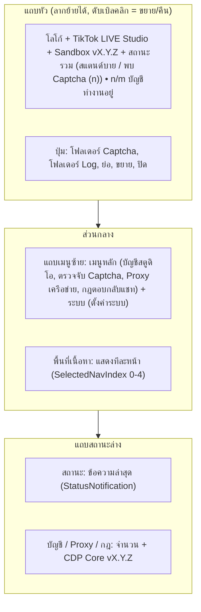

# 04. โครงสร้าง UI และคู่มือใช้งาน

อัปเดตล่าสุด: 2026-10-20 · เวอร์ชันแอป: 1.7.0 (อ่านจาก [FlowUltraTech.App.csproj](../src/FlowUltraTech.App/FlowUltraTech.App.csproj))

อธิบายสิ่งที่ผู้ใช้เห็นและกดได้จริงตาม [MainWindow.xaml](../src/FlowUltraTech.App/MainWindow.xaml), [LoginWindow.xaml](../src/FlowUltraTech.App/Views/LoginWindow.xaml), [UpdateDialog.xaml](../src/FlowUltraTech.App/Views/UpdateDialog.xaml) และ ViewModel ที่ผูกอยู่ ฟีเจอร์ Captcha, แชทสด, Overlay และกฎตอบกลับอธิบายเฉพาะตำแหน่งใน UI (รายละเอียดอยู่ในเอกสารส่วนอื่น)

เอกสารที่เกี่ยวข้อง: [01 ภาพรวม](01_architecture_overview.md) · [02 การเปิดอินสแตนซ์](02_instance_launch_and_window_control.md) · [03 Network และ Proxy](03_network_and_proxy.md)

---

## 1. หน้าต่างทั้งหมดของแอป

| หน้าต่าง | ไฟล์ | บทบาท |
|---|---|---|
| Login | [LoginWindow.xaml.cs](../src/FlowUltraTech.App/Views/LoginWindow.xaml.cs) | หน้าแรกเสมอ (Program เปิดด้วย `app.Run(loginWindow)`) |
| หน้าหลัก | [MainWindow.xaml.cs](../src/FlowUltraTech.App/MainWindow.xaml.cs) | จอจัดการทั้งหมด ขนาด 1260×820 (ขั้นต่ำ 1050×700), ไม่มีกรอบ Windows ปกติ (`WindowStyle=None` + แถบหัวเอง) |
| อัปเดต | [UpdateDialog.xaml.cs](../src/FlowUltraTech.App/Views/UpdateDialog.xaml.cs) | Dialog แจ้งเวอร์ชันใหม่ |

ธีมเป็น Dark (WPF-UI `ThemesDictionary Theme="Dark"` ใน [App.xaml](../src/FlowUltraTech.App/App.xaml))

### LoginWindow (เฉพาะส่วน UI)

- แสดง "กำลังตรวจสอบใบอนุญาตใช้งาน..." พร้อมปุ่ม "ยกเลิกและล็อกอินใหม่" เมื่อมี Token เดิมและกำลังตรวจอัตโนมัติ
- ฟอร์ม: ชื่อผู้ใช้, รหัสผ่าน, ช่อง Server Endpoint พร้อมปุ่ม "รีเซ็ต", ปุ่ม "เข้าสู่ระบบ", แสดง Machine HWID แบบย่อ และแถบแสดงข้อผิดพลาด
- Enter ในช่องกรอกเท่ากับกดเข้าสู่ระบบ; ปิดหน้าต่างโดยยังไม่ล็อกอินสำเร็จ = ปิดแอป
- เมื่อผ่าน จะเปิด `MainWindow` และปิด LoginWindow
- หมายเหตุ: ค่าใน Server Endpoint ถูกบันทึกลงตอนล็อกอิน แต่ `MainViewModel` ตั้ง `AuthApiEndpoint` กลับเป็น `AppConstants.DefaultServerEndpoint` ทุกครั้งที่เปิดหน้าหลัก

### UpdateDialog

แสดงเวอร์ชันปัจจุบัน/ใหม่, หัวข้อและรายละเอียดรุ่น ปุ่ม "ดาวน์โหลดและอัปเดตทันที" (เปิดลิงก์ดาวน์โหลดในเบราว์เซอร์) และ "ไว้ภายหลัง" ถ้าเป็นอัปเดตบังคับ (Mandatory หรือเวอร์ชันต่ำกว่า `minRequiredVersion`) จะซ่อนปุ่ม "ไว้ภายหลัง" และปิด Dialog = ปิดแอป เรียกใช้ 2 ทาง: ตรวจ `/api/v1/app/latest-release` หลังเปิดหน้าหลัก 2 วินาที และ Event Realtime `OnAppUpdateBroadcast` (ผ่าน `VersionHelper.ShouldPromptUpdate`)

---

## 2. โครงสร้างหน้าหลัก (MainWindow)

ตัวเลขข้างเมนู: จำนวนบัญชี, จำนวน Proxy, จำนวนกฎ ปุ่ม "โฟลเดอร์ Log" เปิด `%APPDATA%\FlowUltraTech\Logs`

### หน้าตาม `SelectedNavIndex`

| Index | เมนู | หน้า |
|---|---|---|
| 0 | บัญชีสตูดิโอ | รายการการ์ดอินสแตนซ์ (ค่าเริ่มต้นเมื่อเปิดแอป) |
| 1 | ตรวจจับ Captcha | ศูนย์ตรวจจับ Captcha (รายชื่อบัญชีซ้าย + รายละเอียดขวา) |
| 2 | Proxy เครือข่าย | ตาราง Proxy กลาง + ปุ่มใช้งาน/ซิงก์ |
| 3 | กฎตอบกลับแชท | ตารางกฎ (`AutomationRule`) |
| 4 | ตั้งค่าระบบ | บัญชีผู้ใช้/สิทธิ์, Captcha & เสียง, Telegram, ที่เก็บข้อมูล/Path/ประสิทธิภาพ |

---

## 3. หน้า "บัญชีสตูดิโอ"

### ปุ่มด้านบน

| ปุ่ม | คำสั่ง | พฤติกรรมจากโค้ด |
|---|---|---|
| เริ่มทุกจอ | `StartAllCommand` | วนเริ่มทีละการ์ดที่ไม่ได้รัน และหยุดเมื่อครบโควต้า `MaxTiktokAccounts` |
| ปิดทุกจอ | `StopAllCommand` | หยุดทีละการ์ด แล้วสั่ง `KillAllStudioProcesses` |
| ซ่อนทุกจอ / แสดงทุกจอ | `HideAllWindowsCommand` / `ShowAllWindowsCommand` | เฉพาะการ์ดสถานะ `Running`/`Starting` |
| สแกน Captcha | `ScanAllCaptchasCommand` | สแกนทุกบัญชีที่ `Running` |
| เพิ่มบัญชีใหม่ | `AddInstanceCommand` | สร้าง `Account NN`, โฟลเดอร์ `AccNN`, พอร์ต `9220 + NN` (โหมด DirectProfile) บันทึก Config และซิงก์ขึ้น Cloud ถ้ามี Token |

มีป้ายแสดงโควต้า "โควต้า: ทำงานอยู่/สูงสุด จอ" (`QuotaStatusSummary`) การ์ดที่ยังไม่รันจะเริ่มไม่ได้เมื่อโควต้าเต็ม (ปุ่มเทา, Tooltip "เปิดครบโควต้าสูงสุดแล้ว")

### การ์ดอินสแตนซ์ (1 ใบ/บัญชี)

| ส่วน | เนื้อหา |
|---|---|
| ข้อมูลหลัก | อวาตาร์ (จากไฟล์ใน `TTStore` หรือ URL), ชื่อ/Nickname, `@handle`, สถานะ (`🟢 กำลังทำงาน` / `⏳ กำลังเริ่ม...` / `🔴 ข้อผิดพลาด` / `⚪ หยุดทำงาน`), ป้าย Proxy (`Proxy: SOCKS5 host:port` หรือ `เชื่อมต่อตรง (Direct)`), ป้ายการมองเห็นหน้าต่าง (`👁️ แสดงปกติ` / `🙈 ซ่อนจอ (SW_HIDE)`) เมื่อรัน, บรรทัดย่อย `สล็อต/ยังไม่เข้าสู่ระบบ • CDP: พอร์ต • โฟลเดอร์` |
| ปุ่มหลัก | ยังไม่ล็อกอิน: **เข้าสู่ระบบ** (ใช้ได้เมื่อไม่ได้รัน) · ล็อกอินแล้ว: **เริ่มทำงาน** และ **หยุด** |
| ปุ่มรอง | สลับซ่อน/แสดงหน้าต่าง (เมื่อรัน), **ไลฟ์ Overlay** (เปิดแท็บ Overlay), **Detail & สคริปต์** (ขยาย/ยุบแผงรายละเอียด), ลบบัญชี (Tooltip "ลบบัญชีนี้" ทำ `StopAsync` ก่อนลบ) |
| แถบข้อผิดพลาด | แสดงเมื่อสถานะ Error หรือข้อความสถานะมีคำว่า "Error" พร้อมปุ่ม "คัดลอก Error" |
| แถบ Captcha | แสดงเมื่อตรวจพบ: "แก้ทันที", "ดูรายละเอียด", ปิด (✕) |

### แผงรายละเอียด (กด "Detail & สคริปต์") — แท็บย่อยตามลำดับ

| # | แท็บ | สิ่งที่ผู้ใช้ทำได้ (ส่วนที่ผูกใน XAML) |
|---|---|---|
| 0 | เซสชันบัญชี | ปุ่มโหมดโปรไฟล์ (สลับ Direct/Default), "คัดลอก Session จากบัญชีหลัก", "เปิดสตูดิโอ"/"เปิดสตูดิโอเพื่อล็อกอิน", "รีเฟรชโปรไฟล์", ดึง Cookies & Tokens (แสดง `sessionid`, `tt_csrf_token` พร้อมปุ่มคัดลอก — ต้องรันอยู่), ตั้งช่องเป้าหมาย (Channel Username: "บันทึกช่อง", "ใช้ช่องของโปรไฟล์นี้", "เปิดหน้าไลฟ์"), ตั้ง Proxy เฉพาะบอท (ติ๊กเปิดใช้, Protocol/Host/Port/Username/Password, "ทดสอบ Proxy", "บันทึก Proxy") |
| 1 | รันสคริปต์ | ช่อง JavaScript + "รันสคริปต์", "ส่งออก Full HTML", "ล้าง Console", "คัดลอกผลลัพธ์", ปุ่มคำสั่งด่วน (URL, Title, LocalStorage, Full HTML) — ใช้ได้เมื่อรันอยู่ |
| 2 | เน็ตเวิร์ก API | สลับ Network Hook, ล้างรายการ, ช่องค้นหา, ตาราง (เวลา/Method/Status/Type/URL) + กล่องแสดง Response Body |
| 3 | ตรวจจับ Captcha | สแกนเดี๋ยวนี้, คัดลอก Full HTML, ส่งออกไฟล์, ติ๊ก Auto Detect / Auto Solve / Auto Copy, แสดงภาพ/ประเภท/นับถอยหลัง, "แก้ Captcha (AI Server)" (รายละเอียดอยู่ส่วน Captcha) |
| 4 | มอนิเตอร์แชทสด | เปิด/ปิด Monitor, ตารางแชท/ของขวัญ, ตัวกรองประเภท, Auto Reply, สตูดิโอตอบกลับ 5 โหมด (ส่งทันที / วนส่ง / กฎคำ / ทักทาย / AI) |
| 5 | บันทึกระบบ | ตาราง Log (เวลา/ระดับ/หมวด/ข้อความ), ช่องค้นหา, ปุ่ม ล้าง Log / คัดลอกทั้งหมด / เปิดไฟล์ Log / โฟลเดอร์ Log |
| 6 | หน้าต่าง (Handles) | รีเฟรช, แสดงทุกหน้าต่าง, ซ่อนทุกหน้าต่าง, ตาราง HWND (ติ๊กแสดง/ซ่อนทีละหน้าต่าง, บทบาท, ขนาด, Title, ปุ่ม "นำขึ้นหน้าสุด") |
| 7 | ไลฟ์ Overlay | พรีวิว WebView2, ดีไซน์นาฬิกา, ลิงก์ Overlay + คัดลอก, ฉีดเข้า Studio, Flash Deal (รายละเอียดอยู่ส่วน Overlay) |

ใน `InstanceCardViewModel` มีคำสั่ง/ฟิลด์เพิ่มเติมที่ **ไม่ได้ผูกกับ UI**: `BindProtocol`, `ForwardCallback`, `OpenLastExportedHtml`, ตัวกรอง Log ตามระดับ/หมวด (`LogLevelFilter`, `LogCategoryFilter`, `ResetLogFilters`), `CopySelectedLog`, ตาราง Cookie/LocalStorage/SessionStorage (UI แสดงเฉพาะ `sessionid` และ `tt_csrf_token`)

### Log ต่ออินสแตนซ์

- ทุกอินสแตนซ์มี `IInstanceLogger` ของตัวเอง (หมวดที่ใช้ เช่น `Process`, `Window`, `Network`, `Proxy`, `Login`, `Lease`, `CDP`, `Profile`, `Chat`) แสดงในแท็บ "บันทึกระบบ" สูงสุด 1,500 แถวและเขียนไฟล์ `%APPDATA%\FlowUltraTech\Logs\<โฟลเดอร์>_debug.log`
- "คัดลอก Error" คัดลอก `StatusMessage` ของการ์ดไปคลิปบอร์ด
- Console ของแท็บสคริปต์เก็บสูงสุด 64 KB (ตัดบรรทัดเก่าออก)

### Debug View (`DebugViewModel`)

มี `DebugViewModel` ([DebugViewModel.cs](../src/FlowUltraTech.App/ViewModels/DebugViewModel.cs)) ซึ่งเปิดเป็น Property `MainViewModel.Debug` (เลือกพอร์ตเป้าหมาย รันสคริปต์ ดักเครือข่าย ดึงคุกกี้/Storage ตรวจ Captcha) แต่ **ไม่พบการผูกใน `MainWindow.xaml`** จึงไม่มีหน้าจอ Debug แยกในแอปเวอร์ชันนี้ ฟังก์ชันใกล้เคียงอยู่ในแผงรายละเอียดของแต่ละการ์ด (แท็บรันสคริปต์/เน็ตเวิร์ก/เซสชัน/Captcha) ชุดทดสอบ [DebugViewModelAndCdpTests.cs](../tests/FlowUltraTech.Tests/DebugViewModelAndCdpTests.cs) ใช้ ViewModel นี้

---

## 4. หน้า "Proxy เครือข่าย (Native Proxy Pool)"

| ปุ่ม/ส่วน | หน้าที่ |
|---|---|
| บันทึก & เปิดใช้ Native Proxy | บันทึก Config และเปิด/ปิด Bridge ของทุกบัญชีตาม Proxy ที่ใช้ได้ |
| ซิงก์ Proxifier (ทางเลือก) | สร้าง/อัปเดตไฟล์ `.ppx` และสั่ง Proxifier โหลด |
| + เพิ่ม Proxy | เพิ่มแถวใหม่ (`Proxy #n`, `127.0.0.1`, SOCKS5) |
| ตาราง | ชื่อ, โพรโทคอล, Host/IP, Port, Username, Password, เปิดใช้งาน และปุ่ม "ทดสอบ IP/Ping" / "ลบ" ต่อแถว |

คำอธิบายในหน้านี้ระบุว่าตั้ง Proxy แยกรายโปรไฟล์ได้ที่แท็บ "เซสชันบัญชี" หรือเลือกจากรายการกลาง แต่ใน UI มีเฉพาะตัวเลือกแบบเฉพาะบอท (ดู [เอกสาร 03](03_network_and_proxy.md) หัวข้อ 3)

---

## 5. หน้า "ตั้งค่าระบบ"

ปุ่ม "บันทึกการตั้งค่า" มุมขวาบน (`SaveSettingsCommand`) เขียนทุกค่ากลับ `config.json` และถ้ามี Token จะส่ง Cloud Settings (Telegram, ค่า Captcha บางส่วน, กฎ)

| การ์ด | เนื้อหา |
|---|---|
| บัญชีผู้ใช้และสิทธิ์ | ชื่อผู้ใช้, Role, แผน, โควต้าจอ, วันหมดอายุ, Server, HWID; ปุ่ม "รีเฟรชสิทธิ์", "ซิงค์ Cloud", "ออกจากระบบ (Logout)" |
| ระบบแก้ Captcha และเสียงเตือน | ทดสอบเชื่อมต่อ AI, Auto Solve + หน่วงเวลา, เสียงเตือน (เปิด/วนซ้ำ/ความดัง/ไฟล์เสียง, ปุ่มทดสอบ/หยุด) |
| Telegram | เปิดใช้, Bot Token, Chat ID, เลือกเหตุการณ์, ปุ่มทดสอบส่ง |
| การจัดเก็บข้อมูลและประสิทธิภาพ | บันทึกภาพ Captcha + โฟลเดอร์, Path ของ `TikTok LIVE Studio.exe`, `Proxifier.exe`, ไฟล์ `.ppx`, ช่องติ๊ก "ซ่อนหน้าต่างอัตโนมัติเมื่อเปิดโปรแกรม (ลดภาระ GPU)" |

Logout: ล้าง Token/สิทธิ์ ตัดการเชื่อมต่อ Realtime แล้วกลับไปหน้า Login (`MainWindow` ปิดพร้อม `KillAllStudioProcesses`)

---

## 6. คู่มือใช้งานตามที่ UI มีจริง

### 6.1 เริ่มใช้งานครั้งแรก
1. เปิดแอป ล็อกอินที่หน้า Login (ถ้ามี Token เดิมระบบตรวจให้อัตโนมัติ)
2. ไปที่ **ตั้งค่าระบบ** ตรวจช่อง `TikTok LIVE Studio.exe` ว่าชี้ถูกต้อง (ระบบพยายามหาให้เองดู [เอกสาร 02](02_instance_launch_and_window_control.md))
3. ถ้ายังไม่มีบัญชี กด **เพิ่มบัญชีใหม่** (Config เริ่มต้นมี `Account 01` และ `Account 02` ให้แล้ว)

### 6.2 ล็อกอิน TikTok ให้แต่ละบัญชี
1. กด **เข้าสู่ระบบ** ที่การ์ด Studio จะเปิดขึ้นมาให้เห็น
2. สแกน QR หรือล็อกอินในหน้าต่าง Studio
3. แอปเฝ้าไฟล์ในโปรไฟล์ พอพบบัญชีจะรอ 1.5 วินาทีแล้วปิด Studio ให้เอง การ์ดจะเปลี่ยนเป็นแสดงชื่อ/อวาตาร์ และปุ่ม **เริ่มทำงาน**/**หยุด**
4. ทางเลือก: ในโหมด Direct กด "คัดลอก Session จากบัญชีหลัก" เพื่อใช้ Session ของ Studio หลักในเครื่อง แล้วกด "รีเฟรชโปรไฟล์"

### 6.3 เริ่ม/หยุดและควบคุมหน้าต่าง
1. กด **เริ่มทำงาน** (หรือ **เริ่มทุกจอ**) รอสถานะ `🟢 กำลังทำงาน` — ระบบขอ Slot Lease (ถ้ามี Token) และเริ่ม Auto Monitor
2. ใช้ปุ่มสลับซ่อน/แสดง หรือ **ซ่อนทุกจอ** เพื่อลดภาระหน้าจอ; ดูหรือบังคับรายหน้าต่างที่แท็บ "หน้าต่าง (Handles)"
3. กด **หยุด** หรือ **ปิดทุกจอ** เมื่อเสร็จ
4. ถ้าสถานะค้าง "กำลังเริ่ม..." เกิน 25 วินาที ระบบจะรีเซ็ตเป็นหยุดทำงานให้

### 6.4 ตั้ง Proxy
- เฉพาะบัญชีนั้น: แท็บ "เซสชันบัญชี" → ติ๊ก "เปิดใช้งาน Proxy สำหรับบอทนี้" → กรอก → "ทดสอบ Proxy" → "บันทึก Proxy" (หยุด/เริ่มบัญชีใหม่เพื่อให้ Studio ใช้ Proxy)
- ตารางกลาง: หน้า Proxy เครือข่าย → "+ เพิ่ม Proxy" → แก้ในตาราง → "ทดสอบ IP/Ping" (การผูกกับบัญชีทำได้ผ่าน `ProxyId` ใน Config เท่านั้น)

### 6.5 ดู Log เมื่อมีปัญหา
- รายบัญชี: แผงรายละเอียด → "บันทึกระบบ" (ค้นหา, คัดลอก, เปิดไฟล์)
- ทั้งระบบ: ปุ่ม "โฟลเดอร์ Log" ที่แถบหัว (ไฟล์ `*_debug.log`); Log ระดับแอปอยู่ที่ `app_debug.log` ข้างโปรแกรม

---

## 7. ข้อสังเกต/ช่องว่าง

1. ช่องติ๊ก "ซ่อนหน้าต่างอัตโนมัติเมื่อเปิดโปรแกรม (ลดภาระ GPU)" บันทึกค่าได้ แต่ไม่พบโค้ดที่นำค่ามาใช้ตอนเปิดอินสแตนซ์ (ดู [เอกสาร 02](02_instance_launch_and_window_control.md) หัวข้อ 7)
2. ไม่มีช่องแก้ชื่อบัญชี/พอร์ต CDP/ชื่อโฟลเดอร์/Chromium flags ใน UI; ต้องแก้ `config.json` ขณะแอปปิด
3. `OpenCaptchaTab` ตั้ง `SelectedDetailTabIndex = 4` (คอมเมนต์ในโค้ดเขียนว่าเป็นแท็บ Captcha) แต่ตามลำดับ `TabItem` ใน XAML ดัชนี 3 คือ "ตรวจจับ Captcha" และดัชนี 4 คือ "มอนิเตอร์แชทสด" ปุ่ม "ดูรายละเอียด" ที่แถบ Captcha จึงอาจพาไปแท็บไม่ตรง (ยังไม่ได้ทดสอบรันจริง); ส่วน `OpenOverlayTab` ใช้ดัชนี 7 ตรงกับแท็บ Overlay
4. หน้าจอ Debug แยกของ `DebugViewModel` ไม่มีใน UI (ดูหัวข้อ 3)
5. ชื่อและข้อความยังไม่เป็นชุดเดียวกัน: แถบหัวใช้ "TikTok LIVE Studio" + "Sandbox v…", Title ของหน้าต่างเป็น `FlowUltraTech v…`, หน้า Login ใช้ "FlowUltraTech Studio", Update Dialog ใช้ "TikTok LIVE Studio Sandbox"
6. ข้อความช่องติ๊ก "Auto Detect ทุก 5 วิ" ใน XAML ถูกกำหนดเป็นข้อความคงที่ ค่าจริงของรอบตรวจอยู่ในโค้ด Captcha (อยู่นอกขอบเขตเอกสารนี้ ไม่ได้ตรวจเทียบ)
7. ตาราง Proxy แสดงคอลัมน์รหัสผ่านเป็นข้อความธรรมดา และคอลัมน์ "โพรโทคอล" เป็นช่องข้อความ ต้องพิมพ์ชื่อ enum เอง (`Socks5`, `Https`, `Http`)
8. ปุ่ม/ฟีเจอร์ใน ViewModel ที่ไม่ได้ผูกกับ UI (หัวข้อ 3) ยังไม่ยืนยันว่าตั้งใจเว้นไว้หรือยังไม่เสร็จ
