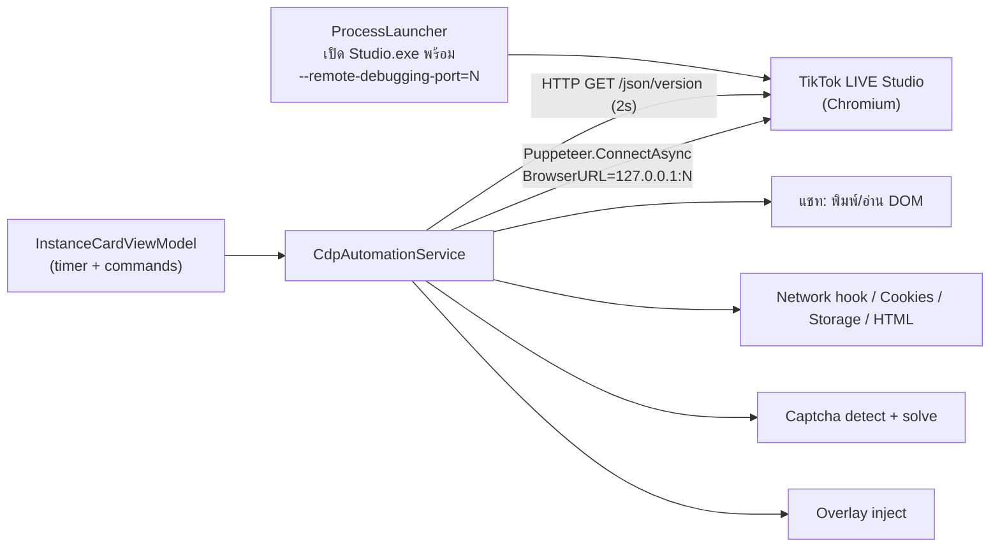

# 05. CDP Automation (การควบคุม TikTok LIVE Studio ผ่าน Chrome DevTools Protocol)

อัปเดตล่าสุด: 2026-10-20 · เวอร์ชันแอป: 1.7.0 (`<Version>` ใน [FlowUltraTech.Core.csproj](../src/FlowUltraTech.Core/FlowUltraTech.Core.csproj) และ [FlowUltraTech.App.csproj](../src/FlowUltraTech.App/FlowUltraTech.App.csproj))

เอกสารนี้เขียนใหม่จากโค้ดจริง แทน `archive/03_cdp_webview_automation.md` ที่ล้าสมัย (เอกสารเก่าอธิบายด้วย Playwright/Python แต่โค้ดจริงใช้ **PuppeteerSharp 25.10.0** ใน C#)

ไฟล์ที่เกี่ยวข้อง (ทุกไฟล์เป็น `partial class CdpAutomationService`):

| ไฟล์ | หน้าที่ |
|---|---|
| [ICdpAutomationService.cs](../src/FlowUltraTech.Core/Interfaces/ICdpAutomationService.cs) | สัญญา (interface) ของบริการทั้งหมด |
| [CdpAutomationService.cs](../src/FlowUltraTech.Core/Services/CdpAutomationService.cs) | connect/cache browser ต่อพอร์ต, `CheckConnection`, `ExecuteScript` |
| [CdpAutomationService.LiveChat.cs](../src/FlowUltraTech.Core/Services/CdpAutomationService.LiveChat.cs) | ส่งแชท, อ่านแชทจาก DOM |
| [CdpAutomationService.NetworkStorage.cs](../src/FlowUltraTech.Core/Services/CdpAutomationService.NetworkStorage.cs) | network hook, cookies/storage, full HTML |
| [CdpAutomationService.Captcha.cs](../src/FlowUltraTech.Core/Services/CdpAutomationService.Captcha.cs) | ตรวจจับ/แก้ Captcha (ดู [06_captcha_system.md](06_captcha_system.md)) |
| [CdpAutomationService.Overlay.cs](../src/FlowUltraTech.Core/Services/CdpAutomationService.Overlay.cs) | One-click inject Overlay (ส่วน CDP เท่านั้นในเอกสารนี้) |
| [InstanceCardViewModel.NetworkStorage.cs](../src/FlowUltraTech.App/ViewModels/InstanceCardViewModel.NetworkStorage.cs) | ฝั่ง UI: เรียก hook/ดึง storage ตามรอบเวลา |

## 1. ภาพรวม

หลักการ: แอปไม่เปิด Chromium เอง แต่ **เปิด `TikTok LIVE Studio.exe` พร้อมแฟลก `--remote-debugging-port`** แล้วใช้ PuppeteerSharp ต่อเข้า endpoint `http://127.0.0.1:{port}` (loopback) จากนั้นมองทุก tab/webview ของ Studio เป็น `IPage`

## 2. การจัดสรรพอร์ต CDP และการเปิดโปรเซส

| หัวข้อ | พฤติกรรมในโค้ด | อ้างอิง |
|---|---|---|
| ค่าเริ่มต้นของโปรไฟล์ | `StudioInstanceProfile.CdpPort = 9221` | [StudioInstanceProfile.cs](../src/FlowUltraTech.Core/Models/StudioInstanceProfile.cs) |
| สร้างบัญชีใหม่ใน UI | `nextPort = 9220 + (Instances.Count + 1)` ตั้งชื่อ `Account NN` / โฟลเดอร์ `AccNN` / `DirectProfile` | `MainViewModel.AddInstance` ([MainViewModel.cs](../src/FlowUltraTech.App/ViewModels/MainViewModel.cs)) |
| Seed เริ่มต้น | ตัวอย่างโปรไฟล์ใช้ 9221 และ 9222 | [ConfigStorageService.cs](../src/FlowUltraTech.Core/Services/ConfigStorageService.cs) |
| Debug tab | `DebugViewModel.TargetPort` เริ่มที่ 9221 | [DebugViewModel.cs](../src/FlowUltraTech.App/ViewModels/DebugViewModel.cs) |
| อาร์กิวเมนต์ที่ส่งให้ Studio | `--remote-debugging-port={port} {proxyFlags} {baseFlags} {CustomChromiumFlags}` และ `--user-data-dir="{profileDir}"` เมื่อเป็น `DirectProfile` | [ProcessLauncher.cs](../src/FlowUltraTech.Core/Services/ProcessLauncher.cs) |
| Anti-throttling | `--disable-background-timer-throttling --disable-renderer-backgrounding --disable-backgrounding-occluded-windows --disable-ipc-flooding-protection` (ใส่ทุกโหมด) | `ProcessLauncher` |
| Ultra-Light | เพิ่ม `--disable-gpu ... --no-sandbox` และเปิดหน้าต่างแบบ Hidden | `ProcessLauncher` |
| Proxy | `--proxy-server="http://127.0.0.1:{localBridgePort}"` ผ่าน `LocalProxyBridgeService` (v1.7.0) | `ProcessLauncher` |
| Profile แยกบัญชี | สร้าง symlink `TikTok LIVE Studio_{folder}.exe` ชี้ไปยัง exe จริง ถ้าสร้างไม่ได้จะใช้ exe เดิม | `ProcessLauncher` |
| ล้าง lock | ลบ `SingletonLock/Socket/Cookie` ใน profile ก่อนเปิด | `ProcessLauncher` |
| รอพอร์ตพร้อม | วนสูงสุด 30 ครั้ง × 500 ms (= 15 วินาที) ด้วย `GetPidListeningOnPort(port)`; ถ้าไม่ตอบแต่โปรเซสยังอยู่ จะเตือนและไปต่อ, ถ้าโปรเซสออกก่อนจะตั้งสถานะ `Error` | `ProcessLauncher` |
| Zombie | พอร์ตมี PID แต่ไม่มี UI → `KillInstance` แล้วเริ่มใหม่ | `ProcessLauncher` |

หมายเหตุ: จากการ grep ใน `src/` **ไม่พบ logic หาพอร์ตว่างอัตโนมัติ** (มี `TcpListener` เฉพาะในชุดทดสอบ/สคริปต์) พอร์ตจึงถูกกำหนดจากสูตรด้านบนหรือผู้ใช้แก้เอง และสูตร `Instances.Count + 1` อาจซ้ำกับพอร์ตเดิมได้หากลบบัญชีกลางลำดับ (เป็นข้อสรุปจากสูตร ไม่ได้ทดสอบ)

พอร์ตเสริมที่ฝั่งแชทใช้ (ไม่ใช่พอร์ตของ Studio):

| พอร์ต | ใช้เมื่อ | อ้างอิง |
|---|---|---|
| `CdpPort + 100` (หรือ 9225 ถ้า `CdpPort <= 0`) | บัญชียังไม่รัน: ปุ่ม "เปิดหน้าไลฟ์" เปิด Edge/Chrome ภายนอกด้วย `--remote-debugging-port={monitorPort}` และ profile `%LOCALAPPDATA%\FlowUltraTech\LiveMonitorProfile` เพื่ออ่านแชทหน้า `tiktok.com/@{user}/live` | [InstanceCardViewModel.LiveChat.cs](../src/FlowUltraTech.App/ViewModels/InstanceCardViewModel.LiveChat.cs) |
| `--remote-debugging-port=0` | `GetOrLaunchHeadlessBrowserAsync()` เปิด headless Edge/Chrome ผ่าน `Puppeteer.LaunchAsync` (profile `%LOCALAPPDATA%\FlowUltraTech\WebMonitorProfile`) เป็นทางเลือกสุดท้ายของการอ่านแชท | [CdpAutomationService.Captcha.cs](../src/FlowUltraTech.Core/Services/CdpAutomationService.Captcha.cs) (ท้ายไฟล์) |

## 3. การ attach และการจัดการ connection

`GetOrConnectBrowserAsync(port)` ([CdpAutomationService.cs](../src/FlowUltraTech.Core/Services/CdpAutomationService.cs)):

| ขั้น | ค่าในโค้ด |
|---|---|
| Cache | `ConcurrentDictionary<int, IBrowser> _connectedBrowsers` ต่อพอร์ต, ใช้ซ้ำถ้า `!IsClosed && IsConnected` |
| Lock | `SemaphoreSlim` ต่อพอร์ต, รอ 5 วินาที; ถ้ารอไม่ได้จะคืน browser เดิมที่ยังไม่ปิด (หรือ `null`) |
| Connect | `Puppeteer.ConnectAsync(BrowserURL="http://127.0.0.1:{port}", DefaultViewport=null, ProtocolTimeout=8000)` |
| Timeout ต่อครั้ง | 4 วินาที (`Task.WhenAny`) |
| Retry | 3 ครั้ง เว้น 250 ms |
| หลังต่อสำเร็จ | ทุก page ที่มีอยู่: `DefaultTimeout=5000`, `SetViewportAsync(null)` (กันหน้าต่างถูกบีบเป็น 800×600), `EvaluateFunctionOnNewDocument` ซ่อน `navigator.webdriver` |
| ล้างเมื่อเสีย | `InvalidateBrowserConnection(port)` ถอด hook, `Disconnect()` + `Dispose()` |
| `CheckConnectionAsync` | HTTP GET `/json/version` timeout 2 วินาที (ไม่ได้ต่อ Puppeteer) |
| `Dispose` | ปิด headless browser, ทุก connection, ทุก lock, HttpClient |

ข้อควรรู้: `ProtocolTimeout = 8000` ตั้งไว้เพื่อไม่ให้ค้าง 180 วินาทีเมื่อหน้าต่าง Studio ถูกซ่อน/ minimize (คอมเมนต์ในโค้ด) การ patch `navigator.webdriver` ทำเฉพาะ page ที่มีอยู่ ณ ตอน connect

### เลือก page ปลายทาง

ไม่มี page selector กลาง แต่ละเมธอดเลือกเองด้วย `Url.Contains(...)` แบบไม่สนตัวพิมพ์:

| เมธอด | ลำดับการเลือก |
|---|---|
| `ExecuteScriptAsync`, `SendChatMessageAsync`, `GetCookiesAndStorageAsync` | URL มี `chat` หรือ `webcast` → ไม่เจอใช้ page แรก |
| `GetChatPageUrlAsync` | URL มี `chat` / `webcast` / `room` (ไม่เจอ = `null`) |
| `GetFullHtmlAsync` | `chat` / `webcast` / `studio` → page ที่ไม่ใช่ `devtools://` และไม่ใช่ `about:blank` → page แรก |
| `DetectCaptchaElementsAsync` | ทุก page (ยกเว้น `devtools://`, `chrome-extension://`) × ทุก frame |
| `FetchLiveChatMessagesAsync(targetChannel)` | page ที่ URL มีชื่อช่อง → ไม่เจอใช้ page `chat`/`webcast` → ไม่เจอ = ไม่อ่านเลย |

## 4. ส่งแชท (`SendChatMessageAsync`)

1. ต่อ browser ตาม `cdpPort`; เลือก page ตามตารางข้างบน
2. ลองหา input ตามลำดับ selector (อันแรกที่เจอชนะ):
   `textarea[placeholder*='chat']` → `textarea[placeholder*='แชท']` → `textarea` → `div[contenteditable='true']` → `input[placeholder*='chat']`
3. เจอ: `FocusAsync` → `TypeAsync(message)` → หน่วง 100 ms → กด `Enter` คืน `true`
4. ไม่เจอ (fallback): `fetch('/webcast/room/chat/', POST, {content: msg})` ภายใน page แล้วคืน `res.ok`
5. exception ใดๆ คืน `false` (ไม่ log ถึงไฟล์ ใช้แค่ `Debug.WriteLine`)

ข้อจำกัด: selector เป็นแบบกว้าง (`textarea` ตัวแรกในหน้า) จึงอาจพิมพ์ผิดช่องถ้า Studio มี textarea อื่นก่อนช่องแชท; endpoint ใน fallback เป็น path สมมติ ยังไม่ยืนยันจากโค้ดฝั่ง TikTok ว่ารองรับจริง

## 5. อ่านแชทจาก DOM (`FetchLiveChatMessagesAsync`)

ลำดับการหา browser:

1. `GetOrConnectBrowserAsync(cdpPort)` (ถ้า `cdpPort > 0`)
2. **Fallback 1:** browser ใดก็ได้ใน `_connectedBrowsers` ที่ยังไม่ปิด (ข้ามพอร์ต)
3. **Fallback 2:** ถ้ามี `targetChannel` เปิด headless browser (`WebMonitorProfile`)

ใน page: dismiss `[data-e2e="scroll-switch-guide"]`, วนตาม selector (`[data-e2e="chat-item"]`, `div[class*="chatItem"]`, `chat-item`, `message-item`, `comment-item`, `ChatMessage`, `li[class*="chat"]`, `live-chat-item`, `div[data-index]`), ข้ามแท็ก `XG-*`, dedupe ด้วยข้อความ; ถ้าไม่เจอสักรายการ ใช้ fallback สแกน leaf node ใน `[data-e2e="live-chat-container"]` / `public-screen-live-chat-slot` / `.overflow-y-scroll` (ข้อความ < 300 ตัวอักษร)

การจำแนกชนิดเป็นการเดาจากข้อความ (heuristic): มี `gift`/`diamond` หรือคำ `ส่งของขวัญ/sent/Gift` → `Gift`; `กดถูกใจ/liked` → `Like`; `ติดตาม/followed` → `Follow`; `แชร์/shared` → `Share`; `joined/เข้าร่วม/Welcome/Viewers` หรือไม่มีชื่อผู้ใช้ → `Other` ค่า `diamonds` ตั้งเป็น 0 เสมอ (ไม่ได้ parse จำนวนเพชร)

หมายเหตุ: Fallback 1 อาจอ่านแชทจากบัญชีอื่นที่ต่ออยู่ ถ้าพอร์ตของบัญชีนั้นต่อไม่สำเร็จ (พฤติกรรมตามโค้ด ยังไม่ทราบว่าตั้งใจหรือไม่)

## 6. Network hook

`StartNetworkHookAsync(port, onRequest, onResponse)`:

| รายละเอียด | ค่า |
|---|---|
| ผูก event | `page.Request`, `page.Response`, `page.RequestFailed` ของทุก page ที่มี + `browser.TargetCreated` (เฉพาะ `TargetType.Page`) |
| กันซ้ำ | `_hookedPorts[port]`; ถ้าเปิดอยู่แล้วคืนทันที |
| Key จับคู่ request/response | `Url + "_" + Method` ใน `_activeRequests` (request ซ้ำ URL/เมธอดเดียวกันที่ซ้อนกันจะชนกัน) |
| กัน memory | เมื่อ `_activeRequests.Count > 500` ลบรายการเก่า > 30 วินาที ครั้งละไม่เกิน 100 |
| เก็บ | method, URL, resourceType, post data, request/response headers, `Cookie` (request) และ `Set-Cookie` (response), duration, status |
| Response body | อ่านเฉพาะ `xhr`/`fetch` หรือ URL มี `/webcast/` และ **ไม่ใช่** endpoint auth (`/passport/`, `/ucenter`, `/login`, `/onetap_auth`, `/auth/`) รอไม่เกิน 300 ms |
| หยุด | `StopNetworkHookAsync` ลบ flag, **`Disconnect()` + `Dispose()` browser ของพอร์ตนั้น** และล้าง `_activeRequests` (ฟีเจอร์อื่นจะ reconnect เองเมื่อเรียกครั้งต่อไป) |

ฝั่ง UI ([InstanceCardViewModel.NetworkStorage.cs](../src/FlowUltraTech.App/ViewModels/InstanceCardViewModel.NetworkStorage.cs)): `StartAutoMonitoringAsync()` เริ่มอัตโนมัติเมื่อสถานะ `Running` เก็บรายการล่าสุดไม่เกิน 1,000 แถว (เกินแล้วลบแถวแรก) handler ของ `TargetCreated` ไม่มีการถอด subscription ตอน stop

## 7. Cookies / session / storage (`GetCookiesAndStorageAsync`)

| ลำดับ | วิธี | timeout |
|---|---|---|
| 1 | `page.CreateCDPSessionAsync()` → `Network.getAllCookies` (ได้ cookie ทุกโดเมนของ profile) แล้ว detach | 3 วินาที |
| 2 | ถ้าได้ 0 รายการ: `page.GetCookiesAsync()` ทีละ page (dedupe ด้วย name+domain) | 2 วินาทีต่อ page |
| 3 | `localStorage`/`sessionStorage` ของทุก page (ยกเว้น `devtools://`, `about:blank`) ผ่าน `EvaluateFunction` รวมเป็น dictionary | 2 วินาทีต่อ page |

- ทำเครื่องหมาย `IsAuthToken` สำหรับชื่อ: `sessionid`, `sessionid_ss`, `tt_csrf_token`, `passport_csrf_token`, `msToken`, `access_token` (+ `sid_guard`, `odin_tt` เฉพาะเส้นทางที่ 1)
- ดึงค่าเด่นเข้า `StorageDumpResult.SessionIdToken` (`sessionid`), `CsrfToken` (`tt_csrf_token`), `MsToken` (`msToken`)
- ฝั่ง UI รีเฟรชอัตโนมัติทุก **15 วินาที** (DispatcherTimer) และดึงครั้งแรกหลังเริ่มทำงาน 1 วินาที มีคำสั่งคัดลอก cookie/session/CSRF ได้
- ค่า cookie/storage เป็นข้อมูลอ่อนไหว (session จริง) การแสดงผลและคัดลอกไปยัง Clipboard ทำแบบข้อความดิบ ยังไม่พบการปกปิด/เข้ารหัสในโค้ดที่อ่าน

`GetFullHtmlAsync`: `page.GetContentAsync()` → ถ้าว่างใช้ `document.documentElement.outerHTML` → คืน `PageHtmlResult` (HTML, URL, Title, จำนวน page, เวลา)

`ExecuteScriptAsync`: `page.EvaluateExpressionAsync<object>(script)` แล้ว serialize เป็น JSON (indent) คืนเป็น string; error คืนข้อความ `JavaScript Exception: ...` (ไม่ throw)

## 8. Overlay inject (เฉพาะส่วน CDP)

`InjectOverlaySourceAsync(port, url)` ตรวจ `port` 1–65535 และ URL ขึ้นต้น `http(s)://` → ต่อ browser (ถ้ายังไม่เคยต่อจะเช็ก `CheckConnection` ก่อน) → รวบรวมทุก frame ของทุก page → รันสคริปต์ DOM 3 ขั้น (`open_add_source` → `select_link` → `fill_and_confirm`, หน่วง 450 ms ระหว่างขั้น) คืน `OverlayInjectResult` พร้อม `StepFailed` (`Validation`/`ConnectCdp`/`FindAddSource`/`SelectLinkSource`/`FillUrlAndConfirm`) รายละเอียด overlay อยู่ในเอกสารส่วนอื่น

## 9. รอบเวลาอัตโนมัติ (ฝั่ง `InstanceCardViewModel`)

| งาน | รอบ | หมายเหตุ |
|---|---|---|
| Captcha auto-detect | 2 วินาที | UI เขียนว่า "Auto Detect ทุก 5 วิ" แต่ `DispatcherTimer.Interval = 2s` (ดู 06) |
| Live chat poll | 2 วินาที | เริ่มเมื่อ login แล้วและมี `StreamerUsername` ที่ไม่ขึ้นต้น `Account` |
| Storage refresh | 15 วินาที | |
| Network hook | ต่อเนื่อง | เริ่มใน `StartAutoMonitoringAsync` |

## 10. ข้อจำกัดและข้อสังเกต

- ผูกกับโครงสร้าง DOM/ข้อความของ TikTok (class obfuscate เช่น `captcha-modal-content-UBaIok`, `countdown-EXaokG`) จึงเปราะเมื่อ TikTok อัปเดต
- ทุกการเรียกที่ใช้ `Task.WhenAny`+`Delay` ทิ้ง task เดิมไว้ (มี `ContinueWith` กลืน exception) ไม่มี cancellation จริงไปยัง CDP
- หน้าต่าง Studio ที่ถูกซ่อน/occluded ทำให้ CDP ตอบช้า จึงมี timeout ต่ำทั่วทั้งไฟล์ (1–8 วินาที) และแอป bring window to front ตอนพบ Captcha
- `ExecuteScript`/Debug tab รัน JavaScript ใดก็ได้ใน Studio ของบัญชีนั้น ใช้เพื่อ debug เท่านั้น
- ไม่พบการตรวจพอร์ตชนกันหรือหาพอร์ตว่างอัตโนมัติ (ดูหัวข้อ 2)
- ยังไม่ยืนยันจากโค้ด: endpoint จริงของ fallback ส่งแชท `/webcast/room/chat/`; ว่า Fallback 1 ของการอ่านแชทตั้งใจให้ข้ามบัญชีหรือไม่
