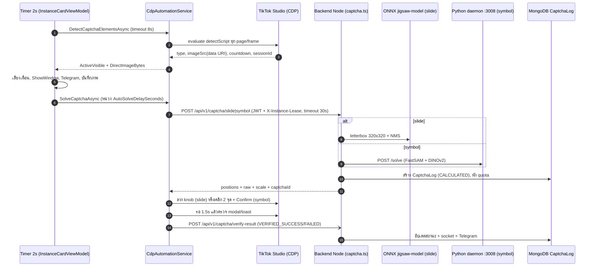

# 06. ระบบ Captcha (Client + Backend Solver)

อัปเดตล่าสุด: 2026-10-20 · เวอร์ชันแอป: 1.7.0 (`<Version>` ใน [FlowUltraTech.Core.csproj](../src/FlowUltraTech.Core/FlowUltraTech.Core.csproj))

เขียนใหม่จากโค้ดจริงแทน `archive/07_*`, `08_*`, `DEBUG_Symbol_*`, `Jigsaw_vs_Symbol_*` และส่วน Captcha ของ `incomplete_and_pending_features` (เอกสารเก่าเขียนผิดหลายจุด สรุปไว้ท้ายไฟล์)

อ้างอิงโค้ด:
- **Client repo** (ลิงก์ relative): [CdpAutomationService.Captcha.cs](../src/FlowUltraTech.Core/Services/CdpAutomationService.Captcha.cs), [InstanceCardViewModel.Captcha.cs](../src/FlowUltraTech.App/ViewModels/InstanceCardViewModel.Captcha.cs), [DebugModels.cs](../src/FlowUltraTech.Core/Models/DebugModels.cs), [Enums.cs](../src/FlowUltraTech.Core/Models/Enums.cs)
- **Backend repo** (`d:/Script/java-script/FlowUltraTech`): [captcha.ts](file:///d:/Script/java-script/FlowUltraTech/src/routes/captcha.ts), [slide.ts](file:///d:/Script/java-script/FlowUltraTech/src/ml/slide.ts), [symbol.ts](file:///d:/Script/java-script/FlowUltraTech/src/ml/symbol.ts), [onnx.ts](file:///d:/Script/java-script/FlowUltraTech/src/ml/onnx.ts), [symbol_service.py](file:///d:/Script/java-script/FlowUltraTech/python/symbol_service.py), [python/symbol/](file:///d:/Script/java-script/FlowUltraTech/python/symbol), [CaptchaLog.ts](file:///d:/Script/java-script/FlowUltraTech/src/models/CaptchaLog.ts), [auth.ts (middleware)](file:///d:/Script/java-script/FlowUltraTech/src/middlewares/auth.ts)

## 1. ภาพรวม end-to-end

## 2. ฝั่ง Client: ตรวจจับ

### 2.1 ชนิดและสถานะ ([Enums.cs](../src/FlowUltraTech.Core/Models/Enums.cs))

| Enum | ค่า |
|---|---|
| `CaptchaType` | `None`, `Jigsaw`(1), `Symbol`(2), `Rotate`(3), `InactivityModalWaiting`(4), `Unknown`(99) |
| `CaptchaState` | `NotPresent`, `HiddenOrUnmounted` (พบใน DOM แต่ซ่อน/exited), `ActiveVisible` |
| `CaptchaSolverType` | `LocalApiServer`(0, ค่าเริ่มต้น), `MockResponse`(1, ยังอยู่ใน enum แต่ไม่มีโค้ดรองรับแล้ว ดู §8) |

### 2.2 วิธีสแกน (`DetectCaptchaElementsAsync`, L82–795)

- วน **ทุก page** (ยกเว้น `devtools://`, `chrome-extension://`) × **ทุก frame** (รวม iframe ข้าม origin เพราะประเมินผลต่อ frame ผ่าน CDP) ข้าม frame ที่ซ่อน (ตรวจ ancestor ด้วย `FrameElementAsync`: `display/visibility/opacity`, ขนาด 0, อยู่ใน `.tt-live-modalv2-wrapper-exited`/`exit-done`)
- สคริปต์ต่อ frame timeout 3 วินาที; หา element ที่ "เข้าข่าย Captcha" ด้วย id/class (`captcha`, `secsdk`, `verify-bar`, `verify_container`, `verify-image`, `whirl`), attribute, และข้อความ (เช่น "detected inactivity during your current LIVE", "LIVE will end in:", "Select 2 objects that are the same shape", "drag the puzzle piece"); เก็บเฉพาะ element บนสุด (ไม่ถูก element อื่นที่เข้าข่ายครอบ)
- **Inactivity modal**: `.captcha-modal-content-UBaIok` / `[class*="captcha-modal-content"]` หรือ fallback จากข้อความ; wrapper `.tt-live-modalv2-wrapper` (สถานะปิด = `...-exited`); countdown จาก `.countdown-EXaokG` / `[class*="countdown"]` หรือ regex `LIVE will end in[:\s]*(\d{1,2}:\d{2})`; session/challenge id จาก regex `\b(20\d{12}[A-Za-z0-9]{12,})\b`
- ถ้า modal เปิดแต่ widget ยังไม่ render → `InactivityModalWaiting` (`IsActive=true`, `HasWidgetLoaded=false`)

| ชนิด | เงื่อนไขตรวจ (สรุป) | Selector หลักของภาพ/ตัวควบคุม |
|---|---|---|
| **Jigsaw** | ข้อความ `drag the puzzle piece into place` / `drag...puzzle` / `ลาก...จิ๊กซอว์` หรือ (ภาพ slide + knob ที่มองเห็น) | ภาพ `#captcha-verify-image, img.captcha_verify_img_slide, canvas.captcha_verify_img_slide, [class*="captcha-verify-image"], img[alt="Captcha"]`; knob `.secsdk-captcha-drag-icon, .captcha_verify_slide--drag-icon, [role="slider"], [class*="drag-icon"], [class*="slider-btn"]` (+ fallback เมื่อมีข้อความ: `button:has(svg)` ฯลฯ); ถ้าไม่เจอภาพจะเลือก `img/canvas` ที่มองเห็นขนาด ≥ 150×100 |
| **Symbol** | regex `select 2 objects ... same shape`, `choose 2 objects`, `same shape`, ไทย `เลือก...วัตถุ...2...เหมือนกัน`, `รูปทรงเดียวกัน` ฯลฯ + (ภาพที่มองเห็น หรือปุ่มยืนยัน หรือ container) | `SymbolImageSelector` (L23): `#captcha-verify-image, #symbol-img-box, .captcha_verify_img_symbol, .captcha_verify_img--bg, img.cap-cursor-pointer, ... img[src^="data:image/"]` ใน `#captcha-verify-container-main-page`/`.captcha-verify-container`/`#captcha-mount-point`; ปุ่ม `SymbolSubmitSelector` (L30): `#symbol-submit-btn, .secsdk-captcha-submit-button, button[class*="verify-btn"], ... button.TUXButton--primary`; ถ้าไม่มี selector ใช้ปุ่มที่ข้อความ `confirm`/`ยืนยัน` |
| **Rotate** | ข้อความ `rotate ... upright` / `หมุนภาพ` หรือ element `rotate`/`whirl` + knob | ตรวจพบได้ แต่ **ไม่มี action อัตโนมัติ** (log "ยังไม่มีการจำลอง Action") |

ลำดับดึงภาพ: (1) `imageSrc` เป็น data URI → decode เป็น `DirectImageBytes` (คงขนาดต้นฉบับ WebP/PNG; อ่านขนาดจาก header ด้วย `GetImageDimensions` รองรับ PNG, WebP VP8/VP8L/VP8X, JPEG) (2) ถ้าไม่มี: element screenshot (timeout 1.5 วินาที) เป็น `CroppedImageBytes`; auto-scan จะหยุดทันทีเมื่อได้ widget ที่ active + ภาพ

### 2.3 ลูปอัตโนมัติ ([InstanceCardViewModel.Captcha.cs](../src/FlowUltraTech.App/ViewModels/InstanceCardViewModel.Captcha.cs))

- `DispatcherTimer` ทุก **2 วินาที** (ป้าย UI เขียน "Auto Detect ทุก 5 วิ" ซึ่งไม่ตรงกับโค้ด) ทำงานเมื่อ `IsRunning && IsCaptchaAutoDetect && !_isCheckingCaptcha && !IsSolvingCaptcha`
- **Concurrency guard (ฝั่ง client)**: flag `_isCheckingCaptcha` กันสแกนซ้อน, `IsSolvingCaptcha` กันแก้ซ้อน (และ `SolveCaptchaInternalAsync` คืน `null` ถ้ากำลังแก้อยู่); timeout สแกน 8 วินาที (auto) / 15 วินาที (manual) — เป็นผลของ commit v1.5.5
- เมื่อ `IsActive`: เล่นเสียง (`EnableCaptchaSoundAlert`, volume, loop) → `_orchestrator.ShowWindow` (ดึงหน้าต่างขึ้นหน้า เพื่อให้ compositor ไม่ throttle) → อัปเดต UI/รูป → Telegram (`TelegramAlertOnDetected`, ครั้งเดียวต่อ HTML/คีย์ที่ต่างกัน) → บันทึกภาพอัตโนมัติ (`AutoSaveCaptchaImage` ค่าเริ่มต้น true → `Pictures\TikTokStudioCaptures` หรือ `CaptchaSaveDirectory`)
- Auto solve: `IsAutoSolveCaptcha` ของการ์ดแต่ละบัญชี (ค่าเริ่มต้น true, checkbox "Auto Solve" ในการ์ด) → `Task.Run(SolveCaptchaInternalAsync)`; ค่าสวิตช์รวม `AppSettings.AutoSolveCaptcha` ในโค้ดที่อ่านถูกใช้แค่ข้อความ Telegram ไม่ได้บล็อกการเรียก solve
- เมื่อ Captcha หาย: หยุดเสียง, ล้าง UI แล้วรายงานว่าผ่าน

## 3. Client → Backend: การเรียก Solver

`SolveCaptchaAsync` (L900–1799). ขั้นตอนก่อนส่ง: ตรวจสอบ browser/detection ใหม่หากยังไม่ active → หน่วง `delaySeconds` → หา page/frame ที่มี widget (probe `#captcha-verify-container-main-page, .captcha-verify-container, #captcha-verify-image, .secsdk-captcha-drag-icon, #jigsaw-slider-knob, #symbol-submit-btn, img.cap-cursor-pointer`) → วัด `BoundingBox` ของภาพ (ได้ `displayWidth/Height`)

> `SolveCaptchaInternalAsync` ส่ง `delaySeconds = AppSettings.AutoSolveDelaySeconds` (ค่าเริ่มต้น 5, slider 0–30) **ทุกครั้งรวมการกดแก้ด้วยมือ** ส่วน retry หลัง refresh token ใช้ 0

| รายการ | ค่า |
|---|---|
| Endpoint | `POST {endpoint}/api/v1/captcha/slide` (Jigsaw) หรือ `/api/v1/captcha/symbol` (Symbol); ถ้า 404 ลองซ้ำ `/captcha/slide|symbol` |
| `endpoint` | `AppSettings.CaptchaSolverEndpoint` (ค่าเริ่มต้น `AppConstants.DefaultServerEndpoint` = `http://<server-host>:8001`) |
| Body (JSON) | `image` (base64/data URI), `displayWidth`, `displayHeight`, `appVersion`, `profileFolder` |
| Headers | `Authorization: Bearer {AuthToken หรือ CaptchaSolverJwtToken}`, `X-App-Version`, `X-Device-Hwid` (จาก `DeepHwidGenerator.GenerateDeepHwid()`), `X-Profile-Folder`, `X-Instance-Lease` (`ActiveLeaseId` จาก slot lease) |
| Timeout | `_solverHttpClient` = **30 วินาที** (แก้ใน v1.5.5 ด้วย commit `330574e`: ก่อนหน้านี้การเรียก solver ใช้ `_httpClient` ตัวเดียวกับ `CheckConnection` ที่ timeout 2 วินาที) |
| Token | ก่อนเรียก: ถ้า JWT หมดอายุภายใน 180 วินาที และมี `RefreshToken` จะ refresh ล่วงหน้า; ถ้าผลตอบกลับมี `Token expired/Unauthorized/Invalid token/401` จะ refresh แล้ว **retry 1 ครั้ง** |
| Parse | `ParseSolverApiResponse`: `captchaId`/`captcha_id`/`id`; `target_x`/`position[0]`, `raw_target_x`; `symbol_positions`, `raw_symbol_positions`; `image_width/height`, `display_width/height`, `scale_x/y` |
| รายงานผล | `POST /api/v1/captcha/verify-result` แบบ fire-and-forget: `captchaId`, `status` (`VERIFIED_SUCCESS`/`VERIFIED_FAILED`), `feedbackText`, `elapsedSeconds`, `appVersion` + headers ชุดเดียวกัน |
| Mock | ลบแล้ว: ถ้า solver ไม่ตอบ/ปฏิเสธ → `Success=false` พร้อมข้อความ **ไม่มีการใช้พิกัดปลอม** |

## 4. Backend: เส้นทางและ middleware

เมานต์ใน [app.ts](file:///d:/Script/java-script/FlowUltraTech/src/app.ts) ทั้ง `/captcha/*` และ `/api/v1/captcha/*` (L98–99) ลำดับ middleware ของ `slide`/`symbol`:

| ลำดับ | ตัวกรอง | พฤติกรรม |
|---|---|---|
| 1 | `captchaLimiter` | 120 คำขอ / 5 นาที ต่อ user id (จาก JWT) หรือ IP |
| 2 | `authenticateToken` | JWT HS256; `401 Invalid token` / `401 Token expired` |
| 3 | `verifyActiveLease` | ต้องมี `X-Instance-Lease` (ยกเว้น `isSystemRoot`); lease ต้องอยู่ใน `ActiveLease` และยังไม่หมดอายุ (cache 15 วินาที) เป็นของ user นั้น และ `X-Device-Hwid` ต้องตรงกับ HWID ที่ผูกกับ lease; ผิดคืน `403` + บันทึก `SecurityEvent` |
| 4 | `captchaLeaseLimiter` | 25 คำขอ / 5 นาที ต่อ lease |
| 5 | `checkIsJson` | ต้องเป็น `application/json` |

`feedback`/`verify-result` (ทั้ง 4 alias: `/captcha/feedback`, `/feedback`, `/captcha/verify-result`, `/verify-result`) ใช้เฉพาะ `authenticateToken` (ไม่ต้องมี lease) ตรวจเจ้าของ `captchaId` (admin/superadmin/root ข้ามได้), idempotent ถ้าสถานะ verified แล้ว

ขนาดภาพ: base64 หรือ data URL (≤ **5 MB**, 413 ถ้าเกิน; `express.json` limit 10 MB). `resolveImageInput` ยังรับ `http(s)://` URL แล้ว `fetch` ให้เอง (ดูข้อสังเกต §9).

### Quota ([captcha.ts](file:///d:/Script/java-script/FlowUltraTech/src/routes/captcha.ts) L169–237)

- `CAPTCHAS_PER_TIKTOK_ACCOUNT = 200` ([User.ts](file:///d:/Script/java-script/FlowUltraTech/src/models/User.ts)); โควต้ารวม = `license.maxTiktokAccounts × 200`; รีเซ็ต `usedToday` เมื่อข้ามวัน **UTC**; ค่า `dailyLimit` เดิม 500/1000 ถูก normalize ให้เป็นสูตรใหม่
- เกินโควต้ารวม → `429 QUOTA_EXCEEDED`; เกิน 200/วันต่อ `profileFolderName` (นับจาก `CaptchaLog` ตั้งแต่ 00:00 UTC ที่ `status != SOLVE_FAILED`) → `429 PROFILE_QUOTA_EXCEEDED`
- **หักโควต้าทันทีเมื่อคำนวณสำเร็จ** (`usedToday += 1`) ไม่รอผล verify; `isSystemRoot` ไม่ถูกจำกัด
- `profileFolderName` ที่ log: จาก lease → body `profileFolder` → header `X-Profile-Folder` → `"Acc01"`

### Response ของ Backend

`status` (`CALCULATED`/`SOLVE_FAILED`), `captchaId` (UUID), `appVersion`, `aiVersion` (`ONNX YOLOv8` สำหรับ slide / `FastSAM + DINOv2` สำหรับ symbol), `position`/`target_x`/`symbol_positions` (**ถูก scale แล้ว** ด้วย `displayWidth ÷ ความกว้างภาพจริง`), `raw_position`/`raw_target_x`/`raw_symbol_positions` (พิกัดบนภาพต้นฉบับ), `hole_box` (slide), `image_width/height`, `display_width/height`, `scale_x/y`, `time`; ผล slide เพิ่ม `slide_x`, `hole_center_x`, `confidence`; ไม่พบ → HTTP 422 พร้อม `error`

## 5. Backend: Solver

### 5.1 Slide (Jigsaw) — ONNX ใน Node ([slide.ts](file:///d:/Script/java-script/FlowUltraTech/src/ml/slide.ts))

| หัวข้อ | ค่า |
|---|---|
| โมเดล | `models/jigsaw-model.onnx` (101,509,385 ไบต์) โหลดผ่าน `onnxruntime-node`, `executionProviders: ["cpu"]`, cache session ต่อไฟล์ ([onnx.ts](file:///d:/Script/java-script/FlowUltraTech/src/ml/onnx.ts)) |
| Preprocess | `sharp` letterbox เป็น 320×320 (พื้น RGB 114), RGB→CHW float32 /255 |
| Postprocess | รูปแบบ YOLOv8 `[1, 4+nc, anchors]`, `CONF_THRESHOLD=0.25`, NMS `IOU=0.45`, ใช้ class 0 ที่ conf สูงสุด |
| ผลลัพธ์ | `slideX = max(0, x1)` (ขอบซ้ายของ hole บนภาพต้นฉบับ), `centerY`; ไม่พบ class 0 → 422 `Invalid slide position` |
| Python | `python/slide/` (YOLO `.pt`, conf 0.8) ใช้กับสคริปต์ benchmark/debug เท่านั้น **เซิร์ฟเวอร์ไม่เรียก** |

### 5.2 Symbol — Python daemon (FastSAM + DINOv2) ([symbol.ts](file:///d:/Script/java-script/FlowUltraTech/src/ml/symbol.ts))

> ไม่ใช่ ONNX ในโหนด (เอกสารเก่าที่บอกว่า "ขาด `detect-symbol-model.onnx`/`siamese-model.onnx` จึงใช้ Mock" **ผิด** — pipeline นี้ไม่ใช้ไฟล์เหล่านั้น)

การเรียกจาก Node:
1. `server.ts` เรียก `ensurePythonSymbolDaemon()` ตอน listen เพื่อ prewarm (เลือก `PYTHON_BIN` → `python`/`python3` ตามระบบ → `/usr/bin/python3`)
2. สปอว์น `python python/symbol_service.py --port 3008` (env `SYMBOL_SERVICE_PORT`), รอ `/health` สูงสุด 25 วินาที (50×500 ms)
3. แต่ละคำขอ: `POST http://127.0.0.1:3008/solve` `{image: base64}` (ไม่มี timeout ฝั่ง Node)
4. daemon ล้ม/ไม่พร้อม → fallback `python symbol_service.py --solve <tmp.png>` (โหลดโมเดลใหม่ทุกครั้ง ช้ากว่ามาก); ล้มเหลวทั้งหมด → `[[0,0],[0,0]]` → 422 `Invalid symbol positions`
5. `SIGTERM` หยุด daemon ตอน graceful shutdown

Pipeline ภายใน ([solver.py](file:///d:/Script/java-script/FlowUltraTech/python/symbol/solver.py), ค่าคงที่ใน [constants.py](file:///d:/Script/java-script/FlowUltraTech/python/constants.py)):

| ขั้น | โมดูล | รายละเอียดจริง |
|---|---|---|
| 0 | solver | ภาพกว้าง < 450 px → upscale เป็นกว้าง 552 (cubic) แล้วแปลงพิกัดกลับตอนจบ |
| 1 | preprocessing | ลบพื้นหลังสว่าง→ขาว (`RGB_BACKGROUND_THRESHOLD=190`; ภาพเกือบเทา ใช้ `c_min ≥ 228`) |
| 2 | detection | **FastSAM-s.pt** (`conf 0.45`, `iou 0.50`, `imgsz 640`, retina masks; GPU ถ้ามี) กรองตามพื้นที่ `650–35,000` px, สัดส่วน, ตัดแถบหัวข้อ/ปุ่ม Confirm ด้านล่าง, ตัด mask เล็ก/ใหญ่ผิดปกติ |
| 2b | detection | แยก mask ที่รวมหลายวัตถุด้วยการลบ child mask, **พาเลต 7 สี** (orange/rose/brown/yellow/green/blue/purple ใน HSV), k-means บนช่อง a,b, และตัดตามคอคอด (neck) + กู้วัตถุสีที่ FastSAM พลาดจากพาเลต; dedupe ชิ้นย่อย; เติมมุมที่ถูกบัง (convex hull) ของทรงตันใหญ่ |
| 3 | features | silhouette ดำ-ขาว → **DINOv2** (`torch.hub dinov2_vits14`; fallback `transformers facebook/dinov2-small`) รวม 3 เวกเตอร์ถ่วงน้ำหนัก 0.72 (224² ปกติ) / 0.64 (padded letterbox) / 0.26 (กริดความหนาแน่น 32×32) แล้ว L2-normalize |
| 4 | matching | ทุกคู่ (combinations) ข้ามคู่ที่ศูนย์กลางห่าง < 32 px หรือ bbox IoU > 0.25; เลือก cosine สูงสุด; เกณฑ์ขั้นต่ำจริง = `min(threshold=0.70, 0.55)` = **0.55** |
| 5 | service | คืน `symbol_positions` = จุดศูนย์กลาง bbox 2 จุด (int), `similarity`, `time`, `image_width/height` |

น้ำหนักในรีโป: [`python/symbol/models/FastSAM-s.pt`](file:///d:/Script/java-script/FlowUltraTech/python/symbol/models) (23.9 MB, ใช้งานจริง) และ `FastSAM-x.pt` (145 MB, **ไม่มี constant ใดอ้างถึง**); ถ้าไม่มี `-s` จะดาวน์โหลดผ่าน Ultralytics. **น้ำหนัก DINOv2 ไม่อยู่ในรีโป** ต้องดาวน์โหลดตอนโหลดครั้งแรก (torch hub / Hugging Face) จึงต้องมีอินเทอร์เน็ตหรือ cache ที่เซิร์ฟเวอร์ ไม่พบ `requirements.txt` (README บอก `pip install ultralytics transformers torch opencv-python numpy Pillow`)

## 6. Action บนหน้าจอและการ scale พิกัด (Client)

**Jigsaw** (L1226–1405):
1. `domW` = ความกว้าง bbox ภาพ (ไม่มี = 340); `origW` = `image_width` จาก API → ขนาดจาก header ภาพ → (`targetX>552 ? 640 : 552`)
2. เลือกพิกัดตามลำดับ: **P1** `raw_target_x × domW/origW` → **P2** ถ้า server scale แล้ว (`scale_x≠1`) ปรับตามอัตราส่วน `domW/display_width` → **P3** ถ้า `targetX > domW` ให้ scale จากภาพดิบ; จากนั้น clamp `0…domW`
3. ระยะลาก knob = `targetX × (usableTrack ÷ domW)` โดย `usableTrack = trackWidth − knobWidth` (สูตรอิงสคริปต์ slider ของ TikTok ตามคอมเมนต์ในโค้ด); มีโหมดพิเศษ "Offset Track" เมื่อ piece เริ่มห่างจากขอบ > 5 px (ใช้กับ mock); clamp `0…usableTrack`
4. ลากเมาส์: down ที่กลาง knob → 24 สเต็ป ease-out cubic (`1-(1-p)^3`), jitter แกน Y ±1 px, 12–22 ms/สเต็ป → หน่วง 60 ms → up

**Symbol** (L1406–1639): ต่อจุด — **P1** `raw × (domW/origW, domH/origH)` (ต้องมี `raw_symbol_positions` ครบจำนวน) → **P2** server-scaled ปรับตามอัตราส่วน DOM → **P3** พิกัดตรง และ scale เฉพาะถ้าเกินขนาด DOM; clamp เว้นขอบ 5 px; คลิกที่ `imgBox.X/Y + (x,y)` (เลื่อนเมาส์ → 30 ms → คลิก delay 35–75 ms → รอ 250–450 ms ระหว่างจุด) แล้วรอปุ่มยืนยันหายจาก disabled (สูงสุด 600 ms) กด `SymbolSubmitSelector` (ไม่เจอ → คลิกปุ่มที่ข้อความ `confirm`/`ยืนยัน` ผ่าน JS)

**ตรวจผล** (L1645–1788): รอ 1.5 วินาที → รัน verify script ใน iframe (เฉพาะ Symbol) และ main page: `isModalHidden` (ไม่พบ modal / `display:none` / `...-exited`) หรือ toast มีคำว่า `Success`/`สำเร็จ` → ถือว่าสำเร็จ (OR ระหว่างสอง frame) แล้วรายงาน backend

## 7. Log / โควต้า / การแจ้งเตือน (Backend)

- `CaptchaLog` ([CaptchaLog.ts](file:///d:/Script/java-script/FlowUltraTech/src/models/CaptchaLog.ts)): `captchaId`, user/username, `profileFolderName`, `captchaType` (`slide`|`symbol`), `appVersion`, `aiVersion`, ชื่อไฟล์ภาพ + `imageBase64` (เก็บภาพใน DB ด้วย), ขนาดภาพ/display, `status` (`CALCULATED` → `VERIFIED_SUCCESS`/`VERIFIED_FAILED`; `SOLVE_FAILED`; `TIMEOUT` มีใน enum), `result` (พิกัดดิบ/scale, `durationSec`, `success` เป็น `true` เฉพาะเมื่อ client รายงานผ่าน), `verification`, `clientIp`; **TTL index 30 วัน** (`expireAfterSeconds: 2592000`)
- ไฟล์ภาพเดิมและภาพซ้อนตำแหน่ง (`*_placed.png` จาก [imageOverlay.ts](file:///d:/Script/java-script/FlowUltraTech/src/utils/imageOverlay.ts): กรอบ/เส้น/จุด สี cyan=คำนวณ, emerald=สำเร็จ, rose=ล้มเหลว) บันทึกใน `storage/captchas/`; `cleanupOldCaptchas(7 วัน)` ถูกเรียกตอนเริ่มเซิร์ฟเวอร์ (`ensureImageDirs`) ในโค้ดที่อ่านไม่พบ timer รอบถัดไป
- `emitCaptchaLogUpdate` ส่ง socket `captcha:status_changed` ไปห้อง `admin_room`; Telegram จากเซิร์ฟเวอร์ (ถ้าผู้ใช้ตั้ง `settings.telegramChatId`) ทั้งตอนคำนวณ (ส่งรูปที่ซ้อนตำแหน่ง) และตอน verify
- Telegram ฝั่ง client เป็นอีกชุดแยก (ตั้งใน AppSettings: detect/solved/failed/ส่งรูป)

## 8. ตัวเลขความแม่นยำ/ความเร็ว (เฉพาะที่พบในไฟล์จริง)

| แหล่ง | ตัวเลข | ข้อจำกัดของตัวเลข |
|---|---|---|
| [python/full_debug/speed_summary.csv](file:///d:/Script/java-script/FlowUltraTech/python/full_debug/speed_summary.csv) (symbol, `images/symbol` 103 รูป) | เวลา solve เฉพาะ solver: min 78.005 / **avg 111.107** / max 700.991 ms | วัดด้วย `python/full_debug.py` ไม่รวม network; ไม่ระบุเครื่อง/GPU; ค่า max 700 ms น่าจะเป็นรอบแรก (ยังไม่ยืนยัน) |
| เดียวกัน (slide, `images/slide` 44 รูป) | min 16.213 / **avg 22.405** / max 168.112 ms | เป็นโมเดล `.pt` ผ่าน Python (ไม่ใช่ ONNX ใน Node) |
| [python/full_debug/summary.csv](file:///d:/Script/java-script/FlowUltraTech/python/full_debug/summary.csv) | สถานะ `success` 103/103 (symbol) และ 44/44 (slide) | หมายถึง "ได้ผลลัพธ์" **ไม่ใช่ความถูกต้อง** (ไม่มี ground truth ในไฟล์) |
| [scripts/benchmark_result.json](file:///d:/Script/java-script/FlowUltraTech/scripts/benchmark_result.json) (2026-09-19, เซิร์ฟเวอร์จริง, `/captcha/slide`) | 25/25 สำเร็จ (100%); server calc min 189 / avg 231.16 / median 203 / max 829 ms; RTT min 225.18 / avg 268.87 / median 240.46 / max 864.95 ms | "สำเร็จ" = HTTP 200 และมี `position` (จาก [benchmark_simulation.py](file:///d:/Script/java-script/FlowUltraTech/scripts/benchmark_simulation.py)) ไม่ได้ยืนยันกับ TikTok; วนใช้ภาพ slide ในรีโป |
| Commit `aa03a22` / `6ae49e0` (2026-10-16) ใน backend | Symbol "93.2% visual win rate" → "95.1% win rate" | มีเฉพาะในข้อความ commit **ไม่พบสคริปต์/ชุดข้อมูล/ไฟล์ผลที่คำนวณตัวเลขนี้** จึงยืนยันวิธีวัดไม่ได้ |
| `python/README.md`, `python/slide/README.md` | Symbol ~95% (2–3 วินาที), Slide ~98% (~50 ms) | ไม่มีที่มา และ README ทั้งชุดอธิบาย API เก่า (`symbol_images=`, `python_tests/jigsaw-model.pt`) อย่าใช้อ้างอิง |

ยังไม่มีตัวเลขอัตรา "TikTok ยอมรับ" จริงในรีโปใดๆ (ข้อมูลนี้จะอยู่เฉพาะในคอลเลกชัน `CaptchaLog` บนเซิร์ฟเวอร์ผ่าน `status`/`verification`; ไม่ได้ตรวจ)

## 9. ปัญหาที่รู้ ข้อสังเกต และ fallback

| เรื่อง | รายละเอียด | Fallback / ผลกระทบ |
|---|---|---|
| Solver ล้ม/ปฏิเสธ | client ไม่มีพิกัดปลอมอีกแล้ว คืน `Success=false` และแจ้งเตือน (Telegram ถ้าเปิด) | สแกนรอบถัดไป (2s) จะตรวจเจอและแก้ใหม่ได้ ไม่มี retry ภายในรอบเดียว ยกเว้น refresh token 1 ครั้ง |
| Symbol daemon ไม่ขึ้น | Node ลอง CLI รายภาพ (ช้า) | ล้มเหลว → 422 |
| Verify อาจ false-positive | `isModalHidden = !modal \|\| ...` และ OR ระหว่าง frame/main: ถ้า selector ไม่เจอ modal ใน page ที่ตรวจ จะถือว่า "ปิดแล้ว" ทั้งที่ widget ใน iframe ยังอยู่ แล้วส่ง `VERIFIED_SUCCESS` ให้ backend | **ยังไม่ยืนยันจากโค้ด/ข้อมูลจริง**; เอกสารเก่า (`DEBUG_Symbol_Captcha_Issues`) เคยตั้งข้อสงสัยนี้ และโค้ดปัจจุบันแก้เป็นตรวจทั้งสองที่แล้ว แต่ยังมีความเสี่ยงนี้ |
| Rotate | ตรวจพบแต่ไม่แก้ | ผู้ใช้ต้องแก้เอง |
| `CaptchaSolverType.MockResponse` | อยู่ใน enum/`AppSettings` แต่ `SolveCaptchaAsync` ไม่มีสาขารองรับ → เลือกโหมดนี้ = ล้มเหลวเสมอ; `SolveCaptchaWithMockAsync` เป็น `[Obsolete]` เรียก solver จริง; ไฟล์ `Config/mock_captcha_response.json` ยังอยู่และใช้ในเทสต์เท่านั้น | |
| โควต้าหักก่อน verify | แก้ผิดก็ถูกนับ (ยกเว้น `SOLVE_FAILED`) | โควต้าต่อจอ 200/วัน นับเฉพาะ log ที่ไม่ใช่ `SOLVE_FAILED` |
| `resolveImageInput` รับ URL | ผู้ใช้ที่ผ่าน auth+lease ส่ง `image` เป็น `http(s)://` ให้เซิร์ฟเวอร์ดึงเองได้ (ความเสี่ยง SSRF) | ควรตรวจสอบ/จำกัด (ข้อสังเกตด้านความปลอดภัย ไม่ได้แก้โค้ด) |
| ข้อมูลลับในรีโป | สคริปต์/เทสต์หลายไฟล์ฝังบัญชี root และ IP เซิร์ฟเวอร์ (เช่น `scripts/test_live_slide_api.py`, `tests/FlowUltraTech.Tests/CaptchaLiveApiSolverTests.cs`, backend `scripts/benchmark_simulation.py`) | ควรย้ายไป env/secret และเปลี่ยนรหัสผ่าน (ไม่ได้คัดลอกค่าลงเอกสาร) |
| Thread-safety | `ThreadingHTTPServer` ใช้ solver อินสแตนซ์เดียวร่วมกัน | ยังไม่ยืนยันจากโค้ดว่าปลอดภัยเมื่อมีคำขอ symbol พร้อมกัน |
| ป้าย UI | "Auto Detect ทุก 5 วิ" แต่ timer 2 วินาที | ควรแก้ป้ายหรือค่า |

## 10. สถานะที่ยังไม่ยืนยันจากโค้ด

- ความถูกต้องจริงของ Symbol/Slide เทียบ ground truth และอัตรายอมรับของ TikTok
- เวลา/สเปกเครื่อง (CPU/GPU) ของเซิร์ฟเวอร์ production และ Python/Node version ที่ใช้จริง
- ว่า DINOv2 ถูกโหลดผ่าน hub หรือ transformers บนเซิร์ฟเวอร์จริง (โค้ดลอง hub ก่อน)
- selector/DOM ของ TikTok ปัจจุบัน (ตรวจได้เฉพาะจาก mock/dump ในรีโป ซึ่ง dump เดิม `docs/Captcha_*.txt` เป็นสถานะ modal ที่ปิดแล้ว)

## 11. สิ่งที่เอกสารเก่าเขียนผิด/ล้าสมัย (สรุป)

1. บอกว่า Symbol "ขาดไฟล์ ONNX จึงตกไปใช้ Mock พิกัด `[[100,110],[215,140]]`" → จริงคือใช้ Python daemon (FastSAM + DINOv2) และ client ลบ Mock fallback แล้ว
2. `CdpAutomationService.Captcha.cs` อ้างบรรทัดเก่า (เช่น L1101, 1269–1520) และโครงสร้างเก่า → ไฟล์ปัจจุบัน 2,090 บรรทัด
3. Verification "ตรวจใน iframe อย่างเดียว/ยังไม่แก้" → โค้ดตรวจทั้ง iframe และ main page แล้ว (มี debug log ครบ)
4. `SimulateHumanDragAsync` ไม่มีในโค้ด (การลากทำใน `SolveCaptchaAsync` โดยตรง)
5. ปุ่ม/ป้ายใน UI และ "สแกนทุก 5 วินาที" ไม่ตรง (timer 2 วินาที)
6. ตัวเลข `X=461.55, Y=198.25` เป็นผลของภาพ fixture ในอดีต ไม่ใช่ค่าคงที่ของระบบ
