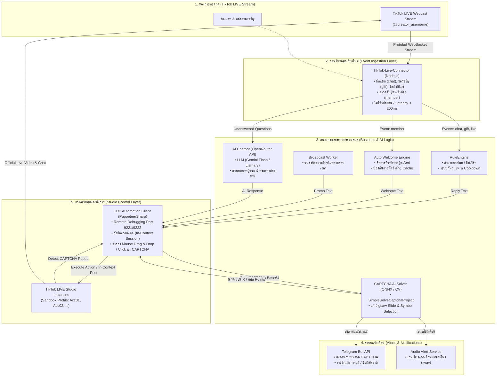

# 08. Full Features & Architecture Roadmap

เอกสารสรุปสถาปัตยกรรม เทคนิคที่ใช้ และแผนผังการพัฒนาระบบอัตโนมัติครบทั้ง 9 ฟังก์ชัน สำหรับ **TikTok LIVE Studio Multi-Instance Sandbox**

---

## 1. แผนผังสถาปัตยกรรมแบบไฮบริด (Hybrid System Architecture)

---

## 2. รายละเอียดเทคนิคและวิธีพัฒนาทั้ง 9 ฟังก์ชัน

### 1. 🧩 ระบบตรวจจับและแก้ CAPTCHA อัตโนมัติ (Watch Mode & Auto Solve)
* **เป้าหมาย:** สแกนหาหน้าต่างยืนยันตัวตน (Popup Verification) บน TikTok LIVE Studio และส่งภาพให้ AI แก้ไขพร้อมลากเลื่อนเมาส์ให้อัตโนมัติ
* **เทคนิคที่ใช้:**
  * **CDP DOM Mutation & Image Capture:** สแกนหา DOM ID `#captcha-verify-image`, `#captcha_slide_button` หรือคลาส `secsdk-captcha` และสั่ง `ElementScreenshotOptions` หรืออ่าน `canvas.toDataURL()` เพื่อดึงภาพ Base64
  * **ONNX Runtime & OpenCV (SimpleSolveCaptchaProject):** ส่งภาพ Base64 ผ่าน REST API `POST /api/v1/captcha/slide` หรือ `POST /api/v1/captcha/symbol` ที่พอร์ต `8001`
  * **Human-like Bezier Mouse Simulation:** ใช้สมการ Cubic Bezier / Ease-out เคลื่อนตำแหน่งเมาส์พร้อม Random Jitter เล็กน้อยเพื่อไม่ให้โดนแอนตี้บอทปฏิเสธ
* **การตั้งค่า:** กำหนดระยะเวลาหน่วงก่อนเริ่มแก้ (`AutoSolveDelaySeconds`) และโหมด Solver API หรือ Mock Mode

---

### 2. 📱 ระบบแจ้งเตือนอัตโนมัติผ่าน Telegram (Telegram Alert Bot)
* **เป้าหมาย:** ส่งการแจ้งเตือนแบบเรียลไทม์เข้าแชทส่วนตัวหรือกลุ่มแอดมินเมื่อเกิดเหตุการณ์สำคัญ
* **เทคนิคที่ใช้:**
  * **Telegram Bot API:** เรียก HTTP POST แบบตรง (Direct HTTPS Request) ไปยัง `https://api.telegram.org/bot<TOKEN>/sendMessage` และ `/sendPhoto`
  * **Multipart Form-Data:** ส่งภาพ Screenshot ของแคปต์ชาพร้อมข้อความกำกับ (Caption) เช่น บัญชีที่พบ, รหัสโปรไฟล์, ชนิดแคปต์ชา, และเวลาที่พบ
  * **Status Reporting:** ส่งรายงานอัปเดตผลลัพธ์ว่าแก้สำเร็จหรือไม่ และใช้เวลาไปกี่วินาที

---

### 3. 🔊 ระบบส่งเสียงแจ้งเตือนอัตโนมัติ (Audio Alert System)
* **เป้าหมาย:** ส่งเสียงเตือนทางลำโพงคอมพิวเตอร์เมื่อมีเหตุฉุกเฉินหรือมีเหตุการณ์ที่ต้องให้ความสนใจ
* **เทคนิคที่ใช้:**
  * **Sound Player Engine:** ใช้ `System.Media.SoundPlayer` หรือ Core Audio APIs สำหรับเล่นไฟล์ Waveform (`.wav`) พร้อมรองรับการวนลูป (Looping) และปรับระดับเสียง (Volume Slider)
  * **Event Triggers:** 
    * `CaptchaDetected`: เล่นเสียงเตือนต่อเนื่องจนกว่าจะปิดหรือแก้เสร็จ
    * `CaptchaSolvedSuccess`: เล่นเสียงสั้นยืนยันความสำเร็จ
    * `CaptchaError`: เล่นเสียงเตือนข้อผิดพลาด

---

### 4. 🪟 ระบบควบคุมและเปิดโปรแกรมอัตโนมัติ (Process & Window Automation)
* **เป้าหมาย:** จัดการเปิด-ปิดโปรแกรม TikTok LIVE Studio หลายๆ หน้าต่าง จัดระเบียบหน้าจอ และซ่อนการทำงานเบื้องหลัง
* **เทคนิคที่ใช้:**
  * **Chromium Remote Debugging Flags:** ส่งอาร์กิวเมนต์ `--remote-debugging-port=922X` และ `--user-data-dir="<Path>"` เพื่อแยกโปรไฟล์อิสระ 100%
  * **Win32 User32 APIs:** 
    * `ShowWindow(hWnd, SW_HIDE / SW_SHOW)` สำหรับซ่อนหน้าต่างหลักแต่ให้โปรเซสเรนเดอร์ทำงานต่อ
    * `SetWindowPos(hWnd, ...)` สำหรับจัดหน้าต่างแบบ Tile Grid (2x2, 3x2) หรือ Cascade
  * **System Tray & Global Hotkeys:** คำสั่งลัดบนคีย์บอร์ด (เช่น `Ctrl+Alt+H` ซ่อนทั้งหมด, `Ctrl+Alt+S` แสดงทั้งหมด)

---

### 5. 📢 ระบบบรอดแคสต์ส่งข้อความวนซ้ำอัตโนมัติ (Broadcast Loop)
* **เป้าหมาย:** ส่งข้อความโปรโมชั่น ปักหมุด หรือแนะนำสินค้าลงในช่องแชทของไลฟ์สดตามรอบเวลาที่กำหนด
* **เทคนิคที่ใช้:**
  * **Background Periodic Timer:** สร้าง Worker Timer หน่วงเวลาระหว่างรอบ (เช่น 60, 120, 300 วินาที)
  * **Rotation & Randomizer:** มีคลังข้อความ (Message Pool) และส่งแบบสลับวน (Round-Robin) หรือสุ่ม เพื่อลดความซ้ำซาก
  * **Legitimate CDP Typing:** สั่ง `page.type()` หรือ In-context dispatch event เพื่อส่งในนามเซสชันบัญชีจริง 100%

---

### 6. 💬 ระบบตอบคอมเมนต์ตามคีย์เวิร์ดอัตโนมัติ (Keyword Auto-Reply)
* **เป้าหมาย:** ตรวจจับคำถามยอดฮิตจากผู้ชมในไลฟ์ เช่น สอบถามราคา วิธีสั่งซื้อ ลิงก์สินค้า แล้วตอบกลับทันที
* **เทคนิคที่ใช้:**
  * **Regex & Substring Pattern Matching:** ตรวจจับคำในข้อความคอมเมนต์
  * **Anti-Spam & User Cooldown:** จำกัดการตอบซ้ำ (เช่น ตอบคนเดิมซ้ำได้หลังจากผ่านไป 10 วินาที)
  * **Dynamic Token Templating:** แท็กชื่อผู้ถามอัตโนมัติผ่าน `{User}`, `{Nickname}`, `{Comment}`

---

### 7. 👋 ระบบส่งข้อความทักทายผู้ชมอัตโนมัติ (Auto Welcome)
* **เป้าหมาย:** ส่งข้อความต้อนรับเมื่อมีผู้ชมใหม่กดเข้ามาดูไลฟ์สด เพิ่ม Engagement และสร้างบรรยากาศที่เป็นกันเอง
* **เทคนิคที่ใช้:**
  * **TikTok-Live-Connector `member` Event:** ดักจับอีเวนต์คนเข้าห้องไลฟ์แบบเรียลไทม์
  * **LRU / TTL Viewer Memory Cache:** บันทึกรายชื่อผู้ชมที่ทักไปแล้วเพื่อไม่ให้ทักซ้ำเมื่อเขาออกแล้วเข้าใหม่
  * **Batch Aggregation Mode:** เมื่อมีผู้ชมเข้าพร้อมกันจำนวนมาก ระบบจะรวมชื่อเป็นกลุ่ม (เช่น *"ยินดีต้อนรับคุณ @User1, @User2, @User3 ครับ!"*) เพื่อไม่ให้แชทรัวเกินเกณฑ์ Rate Limit

---

### 8. 🤖 ระบบตอบคอมเมนต์อัตโนมัติด้วย AI (OpenRouter LLM Integration)
* **เป้าหมาย:** ให้ AI ช่วยตอบคำถามของผู้ชมได้อย่างชาญฉลาดและเป็นธรรมชาติ ตามข้อมูลสินค้าที่ตั้งค่าไว้
* **เทคนิคที่ใช้:**
  * **OpenRouter REST API:** เชื่อมต่อไปยัง Endpoint `https://openrouter.ai/api/v1/chat/completions` ใช้โมเดลที่เร็วและประหยัด เช่น `google/gemini-2.0-flash` หรือ `meta-llama/llama-3-8b-instruct`
  * **Prompt Context Engineering:** ป้อนข้อมูลรายการสินค้า, รายละเอียดราคา, นโยบายร้านค้า, และข้อจำกัดความยาว (ตอบไม่เกิน 60 ตัวอักษร)
  * **Profanity & Community Guidelines Filter:** ตรวจสอบคำต้องห้ามก่อนส่งข้อความ เพื่อความปลอดภัยสูงสุดของช่อง

---

### 9. 📊 ระบบตรวจสอบคุณภาพสตรีมอัตโนมัติ (Stream Quality Monitor)
* **เป้าหมาย:** เฝ้าระวังคุณภาพการไลฟ์สดแบบเรียลไทม์ ตรวจจับอาการกระตุก เฟรมเรตตก หรือเสียงไมค์ดับ
* **เทคนิคที่ใช้:**
  * **Internal Socket.IO Bridge / CDP Metrics:** เชื่อมต่อพอร์ต Socket.IO ภายในของ TikTok LIVE Studio หรืออ่านค่าจาก Chromium Performance APIs
  * **Threshold Triggers:** 
    * `FPS < 24` ติดต่อกันเกิน 5 วินาที -> แจ้งเตือนสตรีมกระตุก
    * `Microphone Input Volume = 0 dB` ขณะสตรีม -> แจ้งเตือนไมค์ดับ/ลืมเปิดไมค์
  * **Auto Recovery / Alert:** ส่งสัญญาณเตือนเข้า Telegram และหน้าต่างโปรแกรมทันที

---

## 3. ตารางสรุปเทคนิคและลำดับการพัฒนา (Tech Stack Matrix)

| ฟังก์ชัน | ไลบรารี / API สำคัญ | โพรโทคอล / ทราฟฟิก | สถานะ |
| :--- | :--- | :--- | :---: |
| **1. CAPTCHA Watch & Solve** | `PuppeteerSharp`, `SimpleSolveCaptchaProject` (ONNX) | CDP WebSocket + HTTP POST REST | ✅ พร้อมติดตั้ง |
| **2. Telegram Alerts** | `HttpClient`, Telegram Bot API | HTTPS REST (Multipart/JSON) | ✅ พร้อมติดตั้ง |
| **3. Sound Alerts** | `System.Media.SoundPlayer` | Windows Core Audio | ✅ พร้อมใช้งาน |
| **4. Process & Windows** | `Win32 APIs`, `ProcessTreeHelper` | Win32 Handle / CLI Flags | ✅ พร้อมใช้งาน |
| **5. Broadcast Loop** | `PeriodicTimer`, `CdpAutomationService` | CDP Target Session | 📋 เฟสถัดไป |
| **6. Keyword Reply** | `RuleEngine`, `Regex` | Webcast WebSocket / CDP | 📋 เฟสถัดไป |
| **7. Auto Welcome** | `TikTok-Live-Connector`, Memory Cache | Webcast Push (Protobuf) | 📋 เฟสถัดไป |
| **8. AI Chatbot** | OpenRouter API, LLM Prompt Engine | HTTPS REST API | 📋 เฟสถัดไป |
| **9. Stream Quality** | Studio Internal Socket.IO / Performance API | Local WebSocket / Socket.IO | 📋 เฟสถัดไป |
