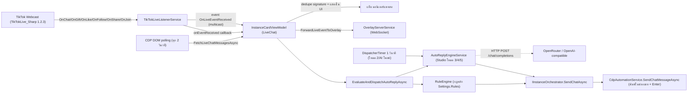

# 08 · ระบบไลฟ์: ดักเหตุการณ์ TikTok, Rule Engine และ Auto-Reply Studio

อัปเดตล่าสุด: 2026-10-20 · เวอร์ชันแอป: 1.7.0 (อ่านจาก `<Version>` ใน [FlowUltraTech.App.csproj](../src/FlowUltraTech.App/FlowUltraTech.App.csproj) และ [FlowUltraTech.Core.csproj](../src/FlowUltraTech.Core/FlowUltraTech.Core.csproj); `VersionHelper` ไม่มีค่าคงที่เวอร์ชัน)

เอกสารนี้เขียนจากโค้ดจริง ไม่ได้อ้างอิงเอกสารเก่าใน `docs/archive/` ส่วนที่ยืนยันไม่ได้อยู่ในหัวข้อ "ข้อสังเกต/ช่องว่าง" ท้ายไฟล์ ดูเรื่อง Overlay ที่ [09](09_overlay_system.md) และ Telegram/เสียงเตือนที่ [10](10_notifications_and_alerts.md)

## 1. ภาพรวม data flow

ไฟล์หลัก: [TikTokLiveListenerService.cs](../src/FlowUltraTech.Core/Services/TikTokLiveListenerService.cs), [RuleEngine.cs](../src/FlowUltraTech.Core/Services/RuleEngine.cs), [AutoReplyEngineService.cs](../src/FlowUltraTech.Core/Services/AutoReplyEngineService.cs), [AutoReplyModels.cs](../src/FlowUltraTech.Core/Models/AutoReplyModels.cs), [InstanceCardViewModel.LiveChat.cs](../src/FlowUltraTech.App/ViewModels/InstanceCardViewModel.LiveChat.cs), [CdpAutomationService.LiveChat.cs](../src/FlowUltraTech.Core/Services/CdpAutomationService.LiveChat.cs)

## 2. Live listener (`TikTokLiveListenerService`)

- ใช้ไลบรารี **TikTokLive_Sharp 1.2.3** (NuGet, C#) ไม่ใช่ Node.js `TikTok-Live-Connector` ตามเอกสารเก่า สร้าง `new TikTokLiveClient(uniqueId, (string?)null)` ต่อช่อง และเรียก `client.Start(token)` เพื่อรับ Room ID
- เก็บ client ใน `_activeClients` (key = username ที่ตัด `@` และช่องว่าง, ไม่สนตัวพิมพ์) `StartAsync` จะ `StopAsync` ช่องเดิมก่อนทุกครั้ง
- API ตาม [ITikTokLiveListenerService](../src/FlowUltraTech.Core/Interfaces/ITikTokLiveListenerService.cs): `StartAsync`, `StopAsync`, `IsConnected`, `GetCurrentRoomId`, `PublishSimulatedEvent`, event `OnLiveEventReceived(channel, item)`
- ผู้ฟังรับ 2 ทาง: callback `onEventReceived` ที่ส่งให้ตอน `StartAsync` และ event `OnLiveEventReceived` ที่ทุก `InstanceCardViewModel` subscribe ไว้ (ใช้ listener ตัวเดียวร่วมกันทั้งแอป สร้างใน [MainWindow.xaml.cs](../src/FlowUltraTech.App/MainWindow.xaml.cs))

### เหตุการณ์ที่ดัก

| Event ของไลบรารี | `LiveChatMessageType` | ข้อมูลที่เก็บ |
|---|---|---|
| `OnChatMessage` | `Chat` | nickname, username, message, RawJson (userId, messageId, roomId, timestamp) |
| `OnGift` | `Gift` | GiftName, `DiamondCount = diamondCost × amount`, `RepeatCount = amount`, RawJson (มี `streakFinished`) |
| `OnLike` | `Like` | ข้อความ "กดถูกใจ N ครั้ง (รวม T ไลก์)", RawJson (count, total) |
| `OnFollow` | `Follow` | ข้อความ "ติดตามช่องแล้ว!" |
| `OnShare` | `Share` | ข้อความ "แชร์ไลฟ์ xN" |
| `OnJoin` | **`Other`** | ข้อความ "เข้าร่วมห้องไลฟ์" (RawJson `type = join`) |
| `OnException`, `OnLiveEnded`, `OnLivePaused`, `OnLiveResumed` | (ไม่สร้าง item) | ส่งข้อความสถานะผ่าน `onStatusChanged` เท่านั้น |

- ไม่พบ handler สำหรับ subscribe/emote/room-user count/question ฯลฯ ในโค้ด
- **ไม่พบโค้ด reconnect อัตโนมัติ, การใช้ proxy, หรือ sessionId/cookie ใน listener** (ต่างจากเอกสารเก่า) ถ้าเชื่อมต่อไม่สำเร็จหรือหลุด จะแจ้งสถานะแล้วไม่ต่อใหม่เอง ต้องกดสลับมอนิเตอร์หรือบันทึกช่องใหม่
- `PublishSimulatedEvent` ยิงเหตุการณ์จำลองผ่าน `OnLiveEventReceived` (ใช้ในเทสต์ ไม่พบการเรียกจาก UI)

## 3. การมอนิเตอร์ในแท็บ "มอนิเตอร์แชทสด" ([InstanceCardViewModel.LiveChat.cs](../src/FlowUltraTech.App/ViewModels/InstanceCardViewModel.LiveChat.cs))

| หัวข้อ | พฤติกรรมจริง |
|---|---|
| ช่องเป้าหมาย | `StreamerUsername` (บันทึกใน `Profile.StreamerUsername`) ถ้าว่างใช้ `LoggedInDisplayId`; `NormalizeUsername` รับทั้ง `@user` และลิงก์ `tiktok.com/@user/live` |
| จุดเริ่มเชื่อมต่อ | `StartLiveChatMonitoringAsync` ถูกเรียกจาก 3 จุด: `OnIsLiveChatMonitoringChanged(true)`, `SaveStreamerUsername` (ถ้ากำลังมอนิเตอร์), `UseCurrentAccountAsChannel` |
| Fallback | ถ้า listener ยังไม่ connected timer `DispatcherTimer` ทุก 2 วินาที เรียก `PollLiveChatInternalAsync` ซึ่งอ่าน DOM ผ่าน `FetchLiveChatMessagesAsync` (selector `data-e2e=chat-item` และคลาสใกล้เคียง, แยกประเภทจากคำใน text เช่น "ติดตาม", "joined") พอร์ต CDP = `CdpPort` ถ้ารันอยู่ หรือ `CdpPort+100` ถ้าไม่ได้รัน; ถ้าไม่มีเบราว์เซอร์และระบุช่องไว้ จะเปิด headless |
| ปุ่ม "เปิดหน้าไลฟ์" | เปิด Edge/Chrome พร้อม `--remote-debugging-port={CdpPort+100}` และโปรไฟล์ `%LOCALAPPDATA%\FlowUltraTech\LiveMonitorProfile` ไปที่ `https://www.tiktok.com/@ช่อง/live` |
| Dedupe | signature `{เวลา HHmmss}_{Type}_{Username}_{Message}_{GiftName}_{RepeatCount}` เก็บล่าสุด 1000 รายการ (`MaxSeenChatSignatures`) แชทซ้ำจากคนเดิมในวินาทีเดียวกันจะถูกทิ้ง |
| ขนาดรายการ | คงไว้ไม่เกิน ~1500 รายการใน UI (`RemoveAt(0)`) |
| ตัวนับ/ตัวกรอง | Chat, Gift (+เพชร), Like/Follow/Share, บอทตอบ, อื่นๆ; ค้นหาข้อความ/RawJson; คัดลอก, คัดลอก JSON, ส่งออก TXT |
| ส่งต่อ Overlay | ทุก item ผ่าน `ForwardLiveEventToOverlay` (ถ้า `EnableLiveEventTicker`) แมป Gift→gift, Like→like, Follow/Share→follow, Other→join, อื่นๆ→chat |

## 4. Rule Engine ("กฎหลัก")

[RuleEngine](../src/FlowUltraTech.Core/Services/RuleEngine.cs) เป็นกฎระดับแอป เก็บใน `AppSettings.Rules` ([AutomationRule](../src/FlowUltraTech.Core/Models/AutomationRule.cs)) ร่วมทุกอินสแตนซ์ จัดการที่เมนู "กฎตอบกลับแชทอัตโนมัติ" (DataGrid + ปุ่ม "+ เพิ่มกฎใหม่"; `AddRule`/`RemoveRule` ใน [MainViewModel.cs](../src/FlowUltraTech.App/ViewModels/MainViewModel.cs))

| `RuleTriggerType` | เงื่อนไข | ตัวแปรแม่แบบ |
|---|---|---|
| `ChatKeyword` | `Pattern` อยู่ในคอมเมนต์ (Contains ไม่สนตัวพิมพ์) หรือ Regex ถ้า `IsRegex` (Regex เสียจะถูกข้าม) | `{User}` `{Nickname}` `{Comment}` |
| `GiftMinDiamonds` | `DiamondCount ≥ MinDiamonds` (เรียงจากเกณฑ์สูงไปต่ำ เลือกกฎแรกที่ผ่าน) | `{User}` `{Nickname}` `{GiftName}` `{Diamonds}` `{Count}` |
| `MemberJoin` | ทุกกฎที่เปิด | `{User}` `{Nickname}` |
| `LikeMilestone` | `TotalLikes` หรือ `LikeCount` ≥ เกณฑ์ (`Pattern` เป็นตัวเลข ถ้า parse ได้จะใช้แทน `MinDiamonds`) | `{User}` `{Nickname}` `{Likes}` `{Count}` |

- กฎต้อง `IsEnabled`; cooldown ต่อกฎ: `CooldownSeconds` (ค่าเริ่มต้น 3) เทียบ `LastTriggered` (เก็บในออบเจ็กต์กฎและถูก serialize ลง config)
- แทนค่าด้วย `{ชื่อ}` ไม่สนตัวพิมพ์ ตัวแปรที่ไม่รู้จักจะคงไว้ตามเดิม
- `{User}` ในกฎหลัก = **username (unique id)** ต่างจาก `{user}` ของ Studio ที่เป็นชื่อแสดง (nickname)
- กฎหลักไม่ผ่านตัวจำกัดอัตรา/anti-spam ของ Studio และไม่ถูกนับในหน้าต่าง "ตอบต่อนาที"
- เทสต์: [RuleEngineTests.cs](../tests/FlowUltraTech.Tests/RuleEngineTests.cs) (chat, gift ผ่าน/ไม่ผ่านเกณฑ์, join, like)

## 5. Auto-Reply Studio 5 โหมด

คอนฟิกต่ออินสแตนซ์ใน `StudioInstanceProfile.AutoReply` ([InstanceAutoReplyConfig](../src/FlowUltraTech.Core/Models/AutoReplyModels.cs)) UI เป็นแท็บย่อยในแท็บ "มอนิเตอร์แชทสด" ของ [MainWindow.xaml](../src/FlowUltraTech.App/MainWindow.xaml) ปุ่ม "บันทึกตั้งค่าตอบกลับ" = `SaveAutoReplyStudioConfig` ตัวสวิตช์รวม "Auto Reply" (`IsAutoReplyEnabled`) ครอบทุกโหมด

| # | โหมด (แท็บ) | Trigger | เปิดเริ่มต้น | ตัวแปรแม่แบบ | ข้อจำกัดหลัก |
|---|---|---|---|---|---|
| 1 | ส่งทันที | กดปุ่ม/ปุ่มแม่แบบด่วน (`SendLiveChatAsync`, `SendQuickTemplate`) | ใช้มือ | ไม่มี | ต้องสถานะ Running; แสดงตัวนับ x/200 |
| 2 | วนส่งอัตโนมัติ | timer 1 วินาที นับถอยหลัง `LoopIntervalSeconds` | **ปิด** | ไม่มี | ส่งเมื่อ Running เท่านั้น; ช่วง 5–3600 วินาที; ตามลำดับหรือสุ่ม (`LoopRandomOrder`); ปุ่ม "ส่งรอบนี้ทันที" |
| 3 | กฎคำ (กันแบน) | คอมเมนต์ `Chat` ที่มีคีย์เวิร์ด | **เปิด** (มีกฎตัวอย่างในค่าเริ่มต้น) | `{user}` `{nickname}` (ชื่อแสดง) | anti-spam ด้านล่าง |
| 4 | ทักทายผู้ชม | event `Other` (join) และ `Follow` | **ปิด** | `{user}` `{nickname}` | ห่างกันอย่างน้อย `GreetingMinIntervalSeconds` |
| 5 | AI ตอบ | โหมดตอบคอมเมนต์: `Chat` ที่ไม่ตรงโหมด 3; โหมดโพสต์เอง: timer | **ปิด** | ไม่มี (ใส่ใน prompt) | ต้องมี API Key; timeout 15 วินาที ไม่ retry |

### โหมด 3: รูปแบบกฎคำ
- 1 บรรทัด = 1 กฎ `คำ1, คำ2 = คำตอบ1 | คำตอบ2` (คั่นคำด้วย `,` หรือ `，`; คั่นคำตอบด้วย `|`; แยกที่ `=` ตัวแรก) บรรทัดขึ้นต้น `#` หรือ `//` เป็นคอมเมนต์
- ตรวจกฎตามลำดับ กฎแรกที่มีคีย์เวิร์ดใดอยู่ในคอมเมนต์ (Contains ไม่สนตัวพิมพ์) ชนะ สุ่มคำตอบ 1 ข้อ ถ้าข้อความไม่มี `{user}`/`{nickname}` และ `RulePrefixWithMention` เปิด จะเติม `@ชื่อแสดง ` นำหน้า
- ผ่านตัวกรองคำต้องห้าม (ใช้ฟิลด์ `AiForbiddenWords` ร่วมกับโหมด AI เปลี่ยนคำเป็น `***`) และตัดที่ **200 ตัวอักษร**

### ตัวจำกัดอัตรา/ป้องกันสแปม (ใช้กับโหมด 3 และ 5)

| ค่า | ฟิลด์ | เริ่มต้น | ช่วงที่ UI ยอมรับ | ความหมาย |
|---|---|---|---|---|
| ห่างระหว่างการตอบ | `RuleMinIntervalSeconds` | 4 | 1–300 | ทั้งอินสแตนซ์ |
| คูลดาวน์ต่อผู้ชม (กฎคำ) | `RuleUserCooldownSeconds` | 30 | 0–3600 | key = username (ถ้าว่างใช้ nickname) |
| สูงสุดต่อนาที | `RuleMaxRepliesPerMinute` | 12 | 1–120 | หน้าต่าง 60 วินาที |
| คูลดาวน์ต่อผู้ชม (AI) | `AiUserCooldownSeconds` | 45 | 0–3600 | แยกจากกฎคำ |
| ห่างระหว่างทักทาย | `GreetingMinIntervalSeconds` | 8 | 2–300 | ใช้ `max(2, ค่า)` |

สถานะอยู่ในหน่วยความจำต่ออินสแตนซ์ (`InstanceRuntimeState`) ไม่ถูกบันทึก ไม่มีตัวแปร/ตัวเลือกคิวหรือ batch

### โหมด 4: การทักทายจริง (Auto Welcome)
- `GreetingFrequency`: `OncePerViewer` (เก็บ username ใน `GreetedUsers` เท่านั้น ไม่มี TTL/LRU) หรือ `EveryJoin`
- ถ้าเข้าห้องในช่วงที่ยังไม่ถึง min interval จะ **ถูกข้ามทันที** ไม่มีคิวและไม่รวมชื่อ
- `GreetingMode`: `RandomMessage` (สุ่มบรรทัดจากรายการ) หรือ `AiGenerated` (เรียก AI; ถ้าไม่มี API Key หรือ AI ล้มเหลว จะ fallback ไปใช้รายการข้อความ)
- กฎหลัก `MemberJoin` ถูกตรวจก่อน ถ้ามีคำตอบจะไม่เข้าโหมด 4

### โหมด 5: AI ตอบ (มีจริง)
- เรียก `POST {AiBaseUrl}/chat/completions` (ค่าเริ่มต้น `https://openrouter.ai/api/v1`, โมเดล `openai/gpt-4o-mini`) แบบ OpenAI-compatible: header `Authorization: Bearer <key>`, `HTTP-Referer`, `X-Title`; body `model`, `messages` (system + user), `max_tokens=120`, `temperature=0.7`
- system prompt = `AiSystemPrompt` + กฎเหล็กให้ตอบไทย ความยาว `AiMinWords–AiMaxWords` คำ (≤160 ตัวอักษร) ไม่ครอบเครื่องหมายคำพูด และห้ามใช้คำใน `AiForbiddenWords`; ผลลัพธ์ถูกกรองคำต้องห้ามซ้ำ, เติม `@ชื่อ` ถ้า `RulePrefixWithMention`, ตัดที่ 200 ตัวอักษร
- `AiFilterMode`: `AllComments` หรือ `QuestionsOnly` (ตรวจด้วยรายการคำถามภาษาไทยที่ฮาร์ดโค้ด ~36 คำ เช่น "?", "ไหม", "ราคา", "ส่งฟรี")
- `AiMode`: `ReplyToComments` หรือ `PeriodicPost` (timer ทุก `AiPeriodicIntervalSeconds` ค่าเริ่มต้น 90, ขั้นต่ำที่ใช้จริง 15; **ไม่มีช่องตั้งค่าใน UI**)
- ปุ่ม "ทดสอบ AI ตอบ" เรียก `TestAiReplyAsync` (ตัวอย่าง "ตัวนี้ราคาเท่าไหร่ ส่งฟรีไหม") แสดง latency
- ข้อผิดพลาดของ AI ถูกกลืน (`null`) ในการใช้งานจริง จึงไม่ตอบและไม่แจ้งใน UI ยกเว้นตอนกดทดสอบ

### ลำดับตัดสินใจเมื่อมี event (`EvaluateAndDispatchAutoReplyAsync`)

| ชนิด item | ลำดับ |
|---|---|
| `Chat` | กฎหลัก `ChatKeyword` (ถ้ามีกฎใน Settings) → Studio โหมด 3 → โหมด 5 |
| `Follow` หรือ `Other` | กฎหลัก `MemberJoin` → Studio โหมด 4 |
| `Gift` | กฎหลัก `GiftMinDiamonds` เท่านั้น |
| `Like` | กฎหลัก `LikeMilestone` เท่านั้น |
| `Share`, `SentMessage`, `AutoReply`, `System` | ไม่ตอบ |

เมื่อได้คำตอบ จะติดธง `IsAutoReplied`/`AutoReplyContent` บนแถวต้นทาง เพิ่มตัวนับ "บอทตอบ" แล้วเรียก `SendChatAsync` ในกรณีที่ `sendToRoom` (ต้องอินสแตนซ์ Running) ข้อความจากโหมด 2 และโหมด AI โพสต์เพิ่มแถวชนิด `AutoReply` ใน UI ด้วย

## 6. การส่งข้อความออก
`InstanceOrchestrator.SendChatAsync` (ต้อง `Status == Running`) → `CdpAutomationService.SendChatMessageAsync(cdpPort, message)`: เลือกหน้า URL ที่มี `chat`/`webcast` (ไม่เจอใช้หน้าแรก) หา input ตามลำดับ `textarea[placeholder*='chat']`, `textarea[placeholder*='แชท']`, `textarea`, `div[contenteditable='true']`, `input[placeholder*='chat']` แล้ว Focus + พิมพ์ + กด Enter ถ้าไม่พบ จะ fallback `fetch('/webcast/room/chat/')` แบบคาดเดา (ตามเอกสารเก่ายังเป็น speculative; ไม่ได้ยืนยันจากโค้ดว่าใช้งานได้จริง) รายละเอียด CDP ดูเอกสารส่วน CDP

## 7. Watchdog / Live session
- `LiveSessionWatchdogE2ETests` **ไม่เกี่ยวกับ live listener** เป็น E2E ของเซิร์ฟเวอร์กลาง (login, slot lease, realtime socket, รายงานผู้ใช้ออนไลน์) และเรียกเซิร์ฟเวอร์จริงโดยฮาร์ดโค้ดบัญชีในไฟล์เทสต์
- Watchdog ที่พบในโค้ดมี 2 ตัว คือ license/quota (`MainViewModel.CheckLicenseAndQuotaWatchdogAsync`) และ slot lease TTL (`SlotLeaseClientService.RunHeartbeatAndWatchdogCycleAsync`) ไม่มี watchdog ที่ต่อ listener ใหม่ให้อัตโนมัติ
- Inactivity Warning Modal: `CdpAutomationService.Captcha.cs` ตรวจจับได้ (`CaptchaType.InactivityModalWaiting`, `HasInactivityModal`, ข้อความ "detected inactivity during your current LIVE", "LIVE will end in:") แต่ไม่พบโค้ดคลิกปุ่มยืนยัน/ปิด modal หรือขยับเมาส์เพื่อรีเซ็ตตัวนับ จึงยังเป็น **ตรวจจับอย่างเดียว**

## 8. การเก็บข้อมูลและค่าเริ่มต้นที่ควรรู้
- ค่าทั้งหมดอยู่ใน `%APPDATA%\FlowUltraTech\config.json` ([ConfigStorageService](../src/FlowUltraTech.Core/Services/ConfigStorageService.cs)) `AutoReply` อยู่ในแต่ละอินสแตนซ์ `Rules` อยู่ระดับแอป
- DPAPI เข้ารหัสเฉพาะ AuthToken, RefreshToken, CaptchaSolverJwtToken, TelegramBotToken และรหัสผ่าน proxy ใน `Proxies` **`AutoReply.AiApiKey` ไม่อยู่ในรายการเข้ารหัส** (เก็บเป็นข้อความธรรมดา)
- `IsAutoReplyEnabled` และ `IsLiveChatMonitoring` เป็นสถานะใน ViewModel ไม่บันทึก เริ่มต้น `true` ทั้งคู่ ดังนั้นโหมด 3 (เปิดเริ่มต้นพร้อมกฎตัวอย่าง) พร้อมตอบทันทีเมื่อมีช่องและอินสแตนซ์ Running
- ตอนหยุดอินสแตนซ์ ViewModel ตั้ง `IsLiveChatMonitoring = false`

## 9. เทสต์ที่เกี่ยวข้อง

| ไฟล์ | ครอบคลุม |
|---|---|
| [RuleEngineTests.cs](../tests/FlowUltraTech.Tests/RuleEngineTests.cs) | กฎ 4 ชนิด |
| [TikTokLiveListenerServiceTests.cs](../tests/FlowUltraTech.Tests/TikTokLiveListenerServiceTests.cs) | ชื่อช่องไม่ถูกต้อง, `IsConnected`/`GetCurrentRoomId` ตอนไม่เชื่อมต่อ, `StopAsync`/`Dispose`, `FormattedJson`, ค่าเริ่มต้นตัวกรอง |
| [OverlaySystemTests.cs](../tests/FlowUltraTech.Tests/OverlaySystemTests.cs) | `OnLiveEventReceived` multicast และการส่ง event เข้า overlay |
| (ไม่มี) | **ไม่พบเทสต์ของ `AutoReplyEngineService` (5 โหมด)** |

## 10. เอกสารเก่าเทียบโค้ดจริง

| หัวข้อ | เอกสารเก่าว่า | โค้ดจริง |
|---|---|---|
| Broadcast Loop | 0% | **มีแล้ว** = โหมด 2 "วนส่ง" (+ AI โพสต์เองเป็นระยะ) แต่เป็น timer ใน ViewModel ไม่ใช่ `BroadcastCampaign`/`PeriodicTimer` |
| AI Chatbot | 0% | **มีแล้ว** = โหมด 5 (OpenRouter/OpenAI-compatible) |
| Auto Welcome | ~50% ขาด LRU/Batch | มีโหมด 4 พร้อมกันทักซ้ำแบบ set ในหน่วยความจำ (ไม่ใช่ LRU/TTL) และ min interval; **ยังไม่มี batch รวมชื่อ** |
| Inactivity modal handler | ตรวจจับอย่างเดียว | ตรงกับโค้ด (ยังตรวจจับอย่างเดียว) |
| ไลบรารีดักเหตุการณ์ | Node.js TikTok-Live-Connector | C# TikTokLive_Sharp 1.2.3 |
| Reconnect / Proxy / sessionId | แนะนำให้ตั้งค่า | ไม่มีในโค้ด listener |
| Keyword Reply | "เฟสถัดไป" | มีทั้งกฎหลัก (`RuleEngine`) และกฎคำใน Studio |

## ข้อสังเกต/ช่องว่าง (ยังไม่ยืนยันหรือน่าสงสัยจากโค้ด)

1. **ไม่พบการเริ่ม listener/timer อัตโนมัติตอน start อินสแตนซ์หรือเปิดแอป** — `StartLiveChatMonitoringAsync` ถูกเรียกเฉพาะ 3 จุดข้างต้น และ `EnsureAutoPostLoopTimer` ถูกเรียกเฉพาะตอนแก้สวิตช์/บันทึก Studio จึงยังไม่ยืนยันว่าหลังรีสตาร์ท โหมด 2 และ AI โพสต์จะทำงานเองโดยไม่ต้องกดบันทึก นอกจากนี้หลังหยุดอินสแตนซ์ ViewModel ตั้ง `IsLiveChatMonitoring = false` และไม่พบจุดตั้งกลับเป็น `true` (ต้องกดสลับมอนิเตอร์เอง)
1a. event จาก WebSocket ถูกส่งเข้า Overlay 2 ทาง (callback → `ForwardLiveEventToOverlay` และ `OnLiveEventReceived` → `OnExternalLiveEventReceived`) จึงส่งซ้ำ 1 item ต่อ 2 ครั้ง; ถ้าการ์ดไม่มีช่องเป้าหมาย `OnExternalLiveEventReceived` จะไม่กรองช่องและส่งต่อทุก event ของ listener
2. ตัวนับเพชรใน UI น่าจะนับเกิน: listener ตั้ง `DiamondCount = cost × amount` และ `RepeatCount = amount` แต่ ViewModel บวก `DiamondCount × RepeatCount` นอกจากนี้ไม่กรอง `StreakFinished` จึงอาจนับของขวัญต่อเนื่องซ้ำ (พฤติกรรม event ของไลบรารียังไม่ยืนยัน)
3. `LikeMilestone` ผ่าน listener: item ไลก์ไม่ได้ตั้ง `RepeatCount` (เป็น 1) และ `TotalLikes` ที่ส่งเข้ากฎคือ `TotalLikeFollowCount` (จำนวนรายการ like/follow/share) ไม่ใช่ยอดไลก์จริงจาก TikTok
4. `Follow` ถูกนับเป็น "เข้าห้อง" ในการตอบ (ทริกเกอร์ทักทาย) และ item ชนิด `Other` จาก DOM fallback (รวมแถวที่ไม่มีชื่อผู้ส่ง) ก็เข้าทางทักทายได้เช่นกัน
5. ไม่พบการกรองข้อความของบัญชีตัวเอง: ถ้าข้อความที่บอทส่งสะท้อนกลับมาเป็น `Chat` อาจไปเข้ากฎคำได้ (ลดผลด้วยคูลดาวน์ต่อ username)
6. `ResetInstanceState` ของ `AutoReplyEngineService` ไม่ถูกเรียกจากที่ใด รายชื่อ `GreetedUsers` และ cooldown จึงอยู่จนปิดแอป (ป้าย UI "ตลอดไลฟ์" ไม่ตรงกับพฤติกรรมนี้) และชุดนี้ไม่มีเพดานขนาด
7. ความหมายของพารามิเตอร์ที่สองของ `TikTokLiveClient(uniqueId, null)` และความสามารถ reconnect/proxy ภายในไลบรารี TikTokLive_Sharp 1.2.3 ยังไม่ยืนยันจากโค้ดของโปรเจกต์ (ตรวจ DLL ไม่ได้)
8. `SendMockChat`, `PublishSimulatedEvent` มีในโค้ดแต่ไม่พบ binding ใน `MainWindow.xaml` (เหตุการณ์จำลองใช้ในเทสต์)
9. ไฟล์ [LiveSessionWatchdogE2ETests.cs](../tests/FlowUltraTech.Tests/LiveSessionWatchdogE2ETests.cs) มีข้อมูลล็อกอินและ URL เซิร์ฟเวอร์ฮาร์ดโค้ด ควรย้ายออกจากซอร์ส (ไม่ได้คัดลอกค่ามาในเอกสาร)
