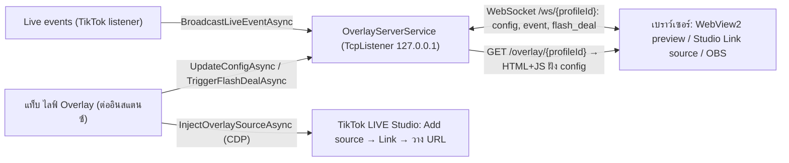

# 09 · ระบบ Overlay: นาฬิกาเรียลไทม์ & Anti-Rebroadcast Live Proof

อัปเดตล่าสุด: 2026-10-20 · เวอร์ชันแอป: 1.7.0 (อ่านจาก `<Version>` ใน [FlowUltraTech.App.csproj](../src/FlowUltraTech.App/FlowUltraTech.App.csproj))

Overlay คือหน้าเว็บโปร่งใสที่แอปเสิร์ฟเองจาก HTTP server ในเครื่อง แสดงนาฬิกาเวลาจริง ป้ายเหตุการณ์สด (ticker) และแบนเนอร์นับถอยหลัง "นาทีทอง" เพื่อใส่เป็น Link/Browser source ในฉากไลฟ์ ฟีเจอร์นี้เพิ่มใน v1.6.0 (commit `589f325`) และปรับ glare/padding ใน v1.7.0 (commit `157a7a7`) ซึ่งเอกสารเก่าใน `docs/archive/` ไม่มี ดู data flow ฝั่งเหตุการณ์ที่ [08](08_live_events_and_auto_reply.md)

ไฟล์หลัก: [OverlayServerService.cs](../src/FlowUltraTech.Core/Services/OverlayServerService.cs), [IOverlayServerService.cs](../src/FlowUltraTech.Core/Interfaces/IOverlayServerService.cs), [OverlayModels.cs](../src/FlowUltraTech.Core/Models/OverlayModels.cs), [CdpAutomationService.Overlay.cs](../src/FlowUltraTech.Core/Services/CdpAutomationService.Overlay.cs), [InstanceCardViewModel.LiveChat.cs](../src/FlowUltraTech.App/ViewModels/InstanceCardViewModel.LiveChat.cs) (ส่วน Overlay), [MainWindow.xaml.cs](../src/FlowUltraTech.App/MainWindow.xaml.cs) (WebView2 preview)

## 1. สถาปัตยกรรม

- 1 โปรเซสแอป = 1 server ใช้ร่วมทุกอินสแตนซ์ แยกข้อมูลด้วย `profileId` (GUID ของ `StudioInstanceProfile`) สร้างใน [MainWindow.xaml.cs](../src/FlowUltraTech.App/MainWindow.xaml.cs) และสตาร์ทแบบ background ใน `MainViewModel` constructor
- เป็น `TcpListener` ที่เขียน HTTP/WebSocket เอง (ไม่ใช้ `HttpListener`/Kestrel) bind เฉพาะ `IPAddress.Loopback` จึงเข้าถึงได้จากเครื่องเดียวกันเท่านั้น

## 2. Server: พอร์ต, endpoint, โปรโตคอล

| รายการ | พฤติกรรมจริง |
|---|---|
| พอร์ตเริ่มต้น | `AppSettings.OverlayServerPort = 19450`; ลอง `base … base+25` ถ้าชนจะใช้พอร์ตชั่วคราว (ephemeral); เลขที่ใช้จริงอ่านจาก `ActivePort` |
| URL ของ overlay | `http://127.0.0.1:{ActivePort}/overlay/{profileId:D}` (`GetOverlayUrl`) |
| `GET /health` | JSON `{status:"ok", port, isRunning}` |
| `GET /api/config…` | JSON config ของ profile (subType `http_config`) |
| `GET /favicon.ico` | `204 No Content` |
| path อื่นทุกอัน | ตอบหน้า HTML overlay (path ที่ไม่มี GUID ได้ profile ว่าง `Guid.Empty`) ไม่มี 404 |
| WebSocket | อัปเกรดจาก path ใดก็ได้ (ปกติ `/ws/{profileId}`); profileId อ่านจาก segment GUID สุดท้ายหรือ query `profileId=`/`id=`; ไคลเอนต์ `Guid.Empty` เป็น wildcard ได้ทุก broadcast; keep-alive 15 วินาที |
| ข้อความ client→server | ข้อความที่มีคำ `sync` หรือ `ping` ทำให้ server ตอบ config (subType `sync`) ข้อความอื่นถูกเมินเฉย |
| Header | `Cache-Control: no-store`, `Access-Control-Allow-Origin: *`, `Connection: close`; ไม่มี auth/token |

ข้อความ server→client (JSON camelCase):

| `type` | เนื้อหา | ส่งเมื่อ |
|---|---|---|
| `config` (`subType`: `config`, `sync`, `flash_deal`, `flash_deal_stop`, `initial`, `http_config`) | ฟิลด์ config ทั้งชุด ทั้งแบบแบนและซ้อนใน `config{}` (clockMode เป็นทั้งเลขและชื่อ) | แก้ค่าใน UI, trigger/stop flash deal, client ส่ง sync |
| `event` | `eventType, nickname, username, message, badgeText, timestamp` (ซ้ำใน `event`/`payload`) | `BroadcastLiveEventAsync` |

ข้อจำกัดการ sanitize: nickname/username ≤120, message ≤300, badge ≤80, brand/subtitle/ชื่อนาทีทอง ≤160 ตัวอักษร, `eventType` ตัวพิมพ์เล็ก (ค่าว่าง = `chat`), ระยะนาทีทองบีบอยู่ที่ 5–86400 วินาที (≤0 = 300) `GetConfig` คืนสำเนา; server เก็บ event ล่าสุดต่อ profile ฝังในหน้า HTML ตอนโหลดครั้งแรกเท่านั้น (ไม่ replay ตอน WS ต่อใหม่)

## 3. หน้า overlay (HTML/JS ฝังในโค้ด)

- ฝั่งเบราว์เซอร์สร้าง WebSocket ไป `ws(s)://{host}/ws/{profileId}` ส่ง `{type:"sync"}` ตอนเปิด; ถ้าหลุดจะ reconnect แบบ backoff เริ่ม 1 วินาที ×1.8 สูงสุด 8 วินาที; ขณะหลุด `data-conn="reconnecting"` (จุดสถานะเปลี่ยน)
- นาฬิกาอัปเดตทุก 250 ms ด้วย `new Date()` ของเบราว์เซอร์ที่เรนเดอร์ แล้วแปลงเขตเวลาด้วย `Intl.DateTimeFormat` ตาม `TimeZoneId` (ถ้าไม่ถูกต้องใช้ `Asia/Bangkok`) วันที่แบบพุทธศักราชไทย (`th-TH-u-ca-buddhist`) เข็มวินาทีเดินต่อเนื่อง
- `?preview=1` เติมคลาส `is-preview-mode` (พื้นหลังเข้มจุด และ `zoom: 0.72`) ใช้เฉพาะในแท็บพรีวิว; ปกติ `html/body` โปร่งใส

### โหมดนาฬิกา 6 แบบ (`OverlayClockMode`)

| ค่า | ชื่อใน UI | รูปแบบ |
|---|---|---|
| 0 `RealisticWall` | นาฬิกาแขวนผนังโมเดิร์น | analog SVG (ค่าเริ่มต้น) |
| 1 `SeikoCustom` | นาฬิกาแขวนคลาสสิก | analog หน้าปัดเข้ม |
| 2 `Desk3D` | นาฬิกาตั้งโต๊ะสตูดิโอ 3D | analog + perspective + ฐานตั้ง |
| 3 `TwinBell` | นาฬิกาปลุกสองกระดิ่งวินเทจ | analog + กระดิ่ง (สั่นเมื่อนาทีทองทำงาน) |
| 4 `WoodBlockLed` | นาฬิกาดิจิทัลบล็อกไม้ LED | ดิจิทัล |
| 5 `DigitalClean` | นาฬิกาดิจิทัลโปร่งใส | ดิจิทัล พร้อมป้ายเขตเวลา |

พื้นหลัง 3 แบบ: `Transparent` (ค่าเริ่มต้น), `GlassDark`, `GlassLight`

### Live Proof ticker และเอฟเฟกต์กล้อง
- แถบ ticker ล่างแสดง badge + ชื่อ + ข้อความของ event ล่าสุด ชนิดที่มีสี badge เฉพาะ: `gift`, `join`/`follow`, `like`, อื่นๆ (chat) ค่าเริ่มต้นแสดง "LIVE / ยืนยันเวลาจริง" แบบนี้ VM ส่งเฉพาะ event ที่ `EnableLiveEventTicker` เปิด
- **เอฟเฟกต์จำลองกล้อง** (CSS): `fx-shadow` เงาตกกระทบ, `fx-jitter` การสั่นเล็กน้อยทุก 5.2 วินาที (`cameraBreathingJitter`), `fx-glare` แสงสะท้อนกวาดผ่านหน้าปัดทุก 7.5 วินาที (clip ตามรูปทรงนาฬิกา)
- **นาทีทอง (Flash Deal)**: แบนเนอร์นับถอยหลังคำนวณจาก `FlashDealEndsAtUtc` (UTC) บน client จนถึง 0 แล้วซ่อนเอง (ไม่มี timer ฝั่ง server ที่ปิด `EnableFlashDealCountdown`)

### ความหมายของ "Anti-Rebroadcast Live Proof"
ชื่อนี้มาจากหัวข้อคอมเมนต์ใน VM, commit และข้อความ "REALTIME VERIFIED" บนหน้าปัด แนวคิดคือใส่เวลาจริงและเหตุการณ์สดไว้ในภาพไลฟ์ให้ผู้ชมเห็นว่าไม่ใช่วิดีโอย้อนหลัง **ในโค้ดไม่มีกลไกยืนยันเชิงเทคนิค** (ไม่มีลายเซ็น, ไม่ sync เวลากับ server/NTP, jitter เป็นเอฟเฟกต์ตกแต่ง) ความน่าเชื่อถือจึงขึ้นกับผู้ชมสังเกตเอง

## 4. การตั้งค่า (`OverlayConfig` ต่ออินสแตนซ์)

เก็บใน `StudioInstanceProfile.Overlay` (config.json) และส่งเข้า server ทุกครั้งที่แก้ (`SyncOverlayConfig` → `UpdateConfigAsync` → broadcast hot-reload)

| ฟิลด์ | เริ่มต้น | มีใน UI |
|---|---|---|
| `IsEnabled` | true (false = ซ่อน stage ด้วยคลาส `is-hidden`) | ไม่มี |
| `ClockMode`, `BackgroundStyle` | RealisticWall, Transparent | มี (ดรอปดาวน์) |
| `TimeZoneId` | `Asia/Bangkok` | **ไม่มี** (แก้ใน config.json) |
| `Use24HourFormat`, `ShowSeconds`, `ShowThaiDate` | true, true, true | มี |
| `PrimaryColorHex`, `AccentColorHex` | `#F8FAFC`, `#EF4444` | มี |
| `BrandText`, `SubtitleText` | `LIVE STUDIO`, `REALTIME VERIFIED` | มี |
| `EnableGlareEffect`, `EnableDynamicShadow`, `EnableMicroJitter` | true ทั้งสาม | มี |
| `EnableLiveEventTicker` | true | มี |
| `EnableFlashDealCountdown`, `FlashDealTitle`, `FlashDealDurationSeconds`, `FlashDealEndsAtUtc` | false, "โปรนาทีทอง ส่งฟรี", 300, null | มี (ปุ่ม "เริ่มนาทีทอง"/"หยุด") |
| `AppSettings.OverlayServerPort` | 19450 | **ไม่มี** (แก้ใน config.json) |

## 5. วิธีใช้งาน

แท็บ "ไลฟ์ Overlay" ของแต่ละอินสแตนซ์ (`OpenOverlayTab` = แท็บย่อย index 7): ซ้าย = พรีวิวสด (WebView2), กลาง = ดีไซน์นาฬิกาและฟิสิกส์กล้อง (รูปแบบ/พื้นหลัง/ข้อความหน้าปัด/สี/สวิตช์เอฟเฟกต์), ขวา = ลิงก์ปลายทาง (อ่านอย่างเดียว) + คัดลอกลิงก์ + ส่งเข้าฉาก + ส่งอีเวนต์ทดสอบ + นาทีทอง

1. **ส่งเข้า TikTok Studio อัตโนมัติ** (ปุ่ม "ส่งเข้า TikTok Studio" = `InjectOverlayAsync`): ต้องอินสแตนซ์ Running ผ่าน CDP: (1) หาปุ่ม Add source/เพิ่มซอร์ส แล้วคลิก (2) เลือกประเภท Link/ลิงก์/Webpage (3) กรอก URL ด้วย React native setter แล้วกดปุ่มยืนยัน; หน่วง 450 ms ระหว่างขั้น สแกนทุก frame ของทุกหน้า ใช้การจับคู่ข้อความปุ่ม (อังกฤษ/ไทย) ถ้าล้มเหลวจะคัดลอก URL ลง Clipboard และแจ้งให้เปิดหน้าเตรียมไลฟ์แล้ววางเอง (`StepFailed`: `Validation`, `ConnectCdp`, `FindAddSource`, `SelectLinkSource`, `FillUrlAndConfirm`, `Exception`)
2. **ใส่เอง**: ปุ่มคัดลอกลิงก์ (`CopyOverlayUrl`) แล้ววางที่ Link source ของ TikTok LIVE Studio หรือ Browser Source ของ OBS (OBS ต้องอยู่เครื่องเดียวกัน เพราะ bind loopback) ขนาดภาพ overlay ราว 340 px กว้างสูงสุด (`.overlay-stage max-width: 340px`)
3. **ทดสอบ**: ปุ่ม "ส่งอีเวนต์ทดสอบ" (`SendTestOverlayEventAsync`) ส่ง gift จำลอง; นาทีทองใช้ปุ่มเริ่ม/หยุด (`TriggerFlashDealAsync`/`StopFlashDealAsync`)

### WebView2 preview
- สร้างเมื่อ Border `OverlayPreviewHost` ถูก Loaded ใช้ environment ร่วม โฟลเดอร์ข้อมูล `%LOCALAPPDATA%\FlowUltraTech\WebView2_OverlayPreview` โหลด `{OverlayEndpointUrl}?preview=1` ปิด context menu/DevTools/status bar/zoom; ถ้าเซิร์ฟเวอร์ยังไม่รัน จะสั่ง `StartAsync` ให้
- ปุ่ม "รีเฟรช" (`ReloadOverlayPreview_Click`) push config ใหม่แล้ว Navigate ซ้ำ; "เปิดเว็บ" เปิด URL ใน default browser; ถ้าสร้าง WebView2 ไม่ได้ จะแสดงข้อความให้ใช้ "เปิดเว็บ" แทน
- ปิดหน้าต่างหลักจะ Dispose WebView2 ทั้งหมด และ `MainViewModel.Cleanup` → `OverlayServerService.Dispose`

## 6. เทสต์

[OverlaySystemTests.cs](../tests/FlowUltraTech.Tests/OverlaySystemTests.cs): config clone/JSON round-trip; พอร์ตชนแล้ว fallback; HTML มีครบ 6 โหมดและคลาส fx; GUID ผิดไม่ 500; favicon 204; WebSocket hot-reload (config, event ถูกตัดความยาว, flash deal start/stop); การสร้างสคริปต์ inject และการตรวจ validation/offline; ViewModel sync; เรนเดอร์จริงด้วย Chrome/Edge headless ตรวจว่าไม่มี console error (ต้องมี Chrome/Edge ในเครื่อง)

## ข้อสังเกต/ช่องว่าง (ยังไม่ยืนยันหรือน่าสงสัยจากโค้ด)

1. `MainViewModel` เขียนพอร์ตที่ใช้จริงทับ `Settings.OverlayServerPort` เมื่อ server สตาร์ท ถ้ามีการบันทึกตั้งค่า พอร์ต fallback จะกลายเป็นค่าเริ่มต้นถาวร และลิงก์ที่เคยนำไปวางในฉากไลฟ์อาจใช้ไม่ได้หากพอร์ตเปลี่ยน
2. ลิงก์ overlay ที่วางในฉากไลฟ์ผูกกับพอร์ต; ถ้าตอนสตาร์ทพอร์ตเดิมถูกโปรเซสอื่นใช้อยู่ ลิงก์เดิมในฉากจะชี้ผิดและไม่พบสัญญาณเตือนใน UI
3. ไม่มีการยืนยันตัวตนบน server (CORS `*`, WebSocket ไม่ต้อง token) ปลอดภัยเพราะ bind loopback เท่านั้น แต่ทุกโปรเซสในเครื่องอ่านค่าได้
4. `PrimaryColorHex`/`AccentColorHex` ถูกแทรกลง CSS ของหน้า HTML ตรงๆ โดยไม่ตรวจรูปแบบสี (เสี่ยงต่ำ เพราะค่ามาจาก config ของผู้ใช้เอง) ส่วนข้อความแบรนด์ใช้ `textContent`
5. event ของ ticker ถูกส่งเข้า overlay ซ้ำ 2 ทางจาก ViewModel (ดูข้อสังเกตข้อ 1a ใน [08](08_live_events_and_auto_reply.md)) ไม่กระทบการแสดงผลเพราะแสดงเฉพาะ event ล่าสุด
6. `EVENT_LABELS` ในหน้า overlay มีชนิด `deal` แต่ไม่พบโค้ดฝั่งแอปที่ส่ง event ชนิดนี้
7. การทำงานของ Auto-Inject พึ่งพาข้อความปุ่มใน UI ของ TikTok LIVE Studio (Add source, Link ฯลฯ) ยังไม่ยืนยันว่ารองรับทุกเวอร์ชันของ Studio (ค่าเริ่มต้นใน [AppSettings.cs](../src/FlowUltraTech.Core/Models/AppSettings.cs) ชี้ Studio 1.31.0)
8. เทสต์เรนเดอร์มี path `C:\Users\Prayu\.gemini\...` ฮาร์ดโค้ดสำหรับบันทึกภาพ (ข้ามอัตโนมัติถ้าไม่มีโฟลเดอร์) และเทสต์ต้องมีเบราว์เซอร์ Chromium ติดตั้ง
