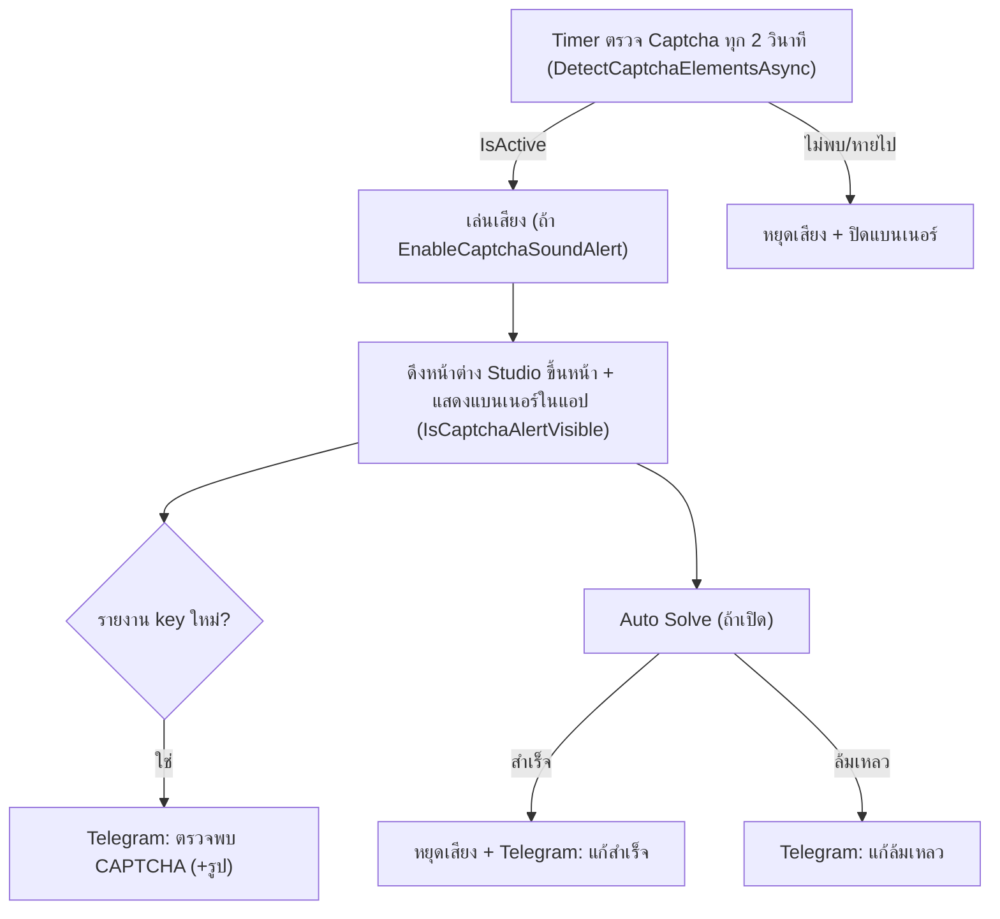

# 10 · การแจ้งเตือน: Telegram, เสียงเตือน และ alert อื่นในแอป

อัปเดตล่าสุด: 2026-10-20 · เวอร์ชันแอป: 1.7.0 (อ่านจาก `<Version>` ใน [FlowUltraTech.App.csproj](../src/FlowUltraTech.App/FlowUltraTech.App.csproj))

ขอบเขตจริงของระบบแจ้งเตือนในโค้ดปัจจุบันคือ **เหตุการณ์ Captcha** เท่านั้น (ตรวจพบ/แก้สำเร็จ/แก้ล้มเหลว) ไม่พบการแจ้งเตือนจากเหตุการณ์ไลฟ์ (ของขวัญ, ผู้ชม, ไลฟ์จบ) เข้า Telegram หรือเสียง ดูเรื่องดักเหตุการณ์ไลฟ์ที่ [08](08_live_events_and_auto_reply.md) และ Overlay ที่ [09](09_overlay_system.md)

ไฟล์หลัก: [TelegramNotificationService.cs](../src/FlowUltraTech.Core/Services/TelegramNotificationService.cs), [ITelegramNotificationService.cs](../src/FlowUltraTech.Core/Interfaces/ITelegramNotificationService.cs), [AudioAlertService.cs](../src/FlowUltraTech.App/Services/AudioAlertService.cs), [AppSettings.cs](../src/FlowUltraTech.Core/Models/AppSettings.cs), [InstanceCardViewModel.Captcha.cs](../src/FlowUltraTech.App/ViewModels/InstanceCardViewModel.Captcha.cs) (จุดเรียก), [MainViewModel.cs](../src/FlowUltraTech.App/ViewModels/MainViewModel.cs) (ตั้งค่า/ปุ่มทดสอบ)

## 1. ภาพรวมจุดที่ทริกเกอร์

หมายเหตุ: modal เตือน Inactivity ที่ยังรอ widget (`CaptchaType.InactivityModalWaiting`) ถูกนับเป็น `IsActive` จึงเข้าเส้นทางแจ้งเตือนเดียวกัน (เสียง/แบนเนอร์/Telegram) แต่ไม่มีโค้ดปิด modal เอง

## 2. Telegram

### การตั้งค่า (`AppSettings`, หน้า "ตั้งค่าระบบ" การ์ดที่ 3)

| ฟิลด์ | เริ่มต้น | UI |
|---|---|---|
| `EnableTelegramAlert` | false | "เปิดใช้งานการแจ้งเตือนผ่าน Telegram Bot" |
| `TelegramBotToken` | ว่าง | ช่อง Bot Token (เก็บใน config.json แบบเข้ารหัส DPAPI) |
| `TelegramChatId` | ว่าง | ช่อง Chat ID (บุคคลหรือกลุ่ม) |
| `TelegramAlertOnDetected` | true | "แจ้งเตือนเมื่อตรวจพบ Captcha" |
| `TelegramSendPhoto` | true | "แนบรูปภาพ Screenshot ของ Captcha" |
| `TelegramAlertOnSolved` | true | "รายงานเมื่อแก้ Captcha สำเร็จ" |
| `TelegramAlertOnFailed` | true | "แจ้งเตือนเมื่อแก้ Captcha ล้มเหลว" |

ทุกการส่งต้อง `EnableTelegramAlert` เปิด และมีทั้ง Token กับ Chat ID ไม่ว่าง ปุ่ม "ทดสอบส่งข้อความ" (`TestTelegramAsync` → `TestConnectionAsync`) ใช้ได้โดยไม่ต้องเปิดสวิตช์

### Service
- `SendMessageAsync`: `POST https://api.telegram.org/bot{token}/sendMessage` ฟอร์ม `chat_id`, `text`, `parse_mode=HTML`
- `SendPhotoAsync`: `POST .../sendPhoto` แบบ multipart (`chat_id`, `caption`, `parse_mode=HTML`, ไฟล์ `photo` ชื่อ `captcha.png` ชนิด `image/png`)
- `TestConnectionAsync`: `GET .../getMe` ตรวจ token แล้วส่งข้อความทดสอบ "[TikTok LIVE Studio Sandbox] ทดสอบการเชื่อมต่อ Telegram สำเร็จ" พร้อมชื่อบอทและเวลา คืนข้อความผลลัพธ์ภาษาไทย (เช่น ให้กด Start บอทก่อน)
- `HttpClient` timeout 15 วินาที; ทุกเมธอดคืน `false` เงียบๆ เมื่อผิดพลาด ไม่ retry

### ข้อความที่ส่งจริง (parse_mode HTML)

| เหตุการณ์ | จุดเรียก | เนื้อหา |
|---|---|---|
| ตรวจพบ Captcha 🚨 | `CheckCaptchaAsync` (auto-detect) เฉพาะเมื่อ "key รายงาน" เปลี่ยน (HTML ของ captcha หรือ `{Type}_{SessionId}_{Prompt}`) | บัญชี (ชื่อ + Port), โปรไฟล์ (@handle), ประเภท, Session ID, เวลา, วิธีแก้ (Auto Solve หน่วง Ns หรือสั่งมือ); แนบรูป (ครอปก่อน ไม่งั้นรูปเต็ม) ถ้า `TelegramSendPhoto` และมีรูป ไม่งั้นส่งข้อความล้วน |
| แก้สำเร็จ ✅ | `SolveCaptchaInternalAsync` เมื่อ `result.Success` | บัญชี, ใช้เวลา (วินาที), โหมด solver |
| แก้ล้มเหลว ❌ | `SolveCaptchaInternalAsync` เมื่อไม่สำเร็จ | บัญชี, `result.Message`, โหมด solver |

การส่งทำใน `Task.Run` แบบ fire-and-forget ไม่บล็อก UI และไม่แจ้งผลถ้าส่งไม่ผ่าน

### Cloud sync ของค่า Telegram
เมื่อกด "บันทึกการตั้งค่า" ขณะล็อกอิน แอปส่ง `TelegramBotToken`, `TelegramChatId`, `AutoSolveDelaySeconds`, `CaptchaSoundVolume`, `AutoSaveCaptchaImage` และ `Rules` ขึ้น `/api/v1/auth/settings` (`SaveCloudSettingsAsync`) และตอนล็อกอิน ถ้าค่าในเครื่องว่างจะดึง Token/Chat ID จากคลาวด์มาใช้ (`MainViewModel` ส่วน login)

## 3. เสียงเตือน (`AudioAlertService`)

| หัวข้อ | พฤติกรรมจริง |
|---|---|
| ทริกเกอร์ | เล่นทันทีที่พบ Captcha active (ก่อนงาน UI/IO อื่น) ถ้า `EnableCaptchaSoundAlert` (ค่าเริ่มต้น true) |
| หยุดเสียง | แก้สำเร็จ, Captcha หายจากหน้าจอ, กด ✕ (`DismissCaptchaAlert`), "ปิดเสียงเตือน" (`SilenceAlert`), ล้างข้อมูล Captcha, "หยุดเสียง" ในตั้งค่า |
| Loop | `LoopCaptchaSoundAlert` (true) → เล่นซ้ำเมื่อ `MediaEnded` จนกว่าจะ `StopAlert` |
| ความดัง | `CaptchaSoundVolume` 0–100 (ค่าเริ่มต้น 80) แปลงเป็น 0.0–1.0 |
| ไฟล์เสียง | `CaptchaSoundFilePath` (ปุ่ม "เลือกไฟล์..."); ถ้าว่าง/ไม่พบไฟล์ ใช้ `Assets\captcha_alert.wav` ข้างโปรแกรม โดย **สร้างไฟล์ให้เองครั้งแรก** (คอร์ด 880 Hz + 1318.5 Hz ยาว 0.65 วินาที เสียงค่อยๆ ดับ) ถ้าสร้าง/เล่นไม่ได้ fallback `SystemSounds.Exclamation` |
| ทดสอบ | ปุ่ม "ทดสอบเสียง"/"หยุดเสียง" ใน [MainWindow.xaml](../src/FlowUltraTech.App/MainWindow.xaml) (`TestSound`/`StopSound`) |
| เธรด | เรียกจากเธรดใดก็ได้ (marshal ไป Dispatcher); ใช้ `MediaPlayer` ตัวเดียวทั้งแอป (static) ร่วมทุกอินสแตนซ์ |

ไม่มีเสียงสำหรับเหตุการณ์ไลฟ์ (ของขวัญ/แชท) และไม่มีเสียงตอนแก้สำเร็จ (มีแต่หยุดเสียง)

## 4. การแจ้งเตือนอื่นที่พบในโค้ด

| ช่องทาง | รายละเอียด |
|---|---|
| แบนเนอร์ Captcha ในการ์ดอินสแตนซ์ | `IsCaptchaAlertVisible`, `CaptchaAlertTitle/Message` พร้อมตัวนับเวลาถอยหลัง ปุ่ม ✕ และ "ปิดเสียงเตือน" |
| ดึงหน้าต่าง Studio ขึ้นหน้า | `_orchestrator.ShowWindow(Profile)` ทันทีที่พบ Captcha เพื่อให้ Chromium ไม่ throttle |
| แถบสถานะ/ข้อความ | `StatusNotification` (MainViewModel), `StatusMessage` และ console ต่ออินสแตนซ์, ข้อความสถานะแชทสด (`LiveChatStatus`), `OverlayStatusText`, `AutoReplyStudioStatusText` |
| กล่องข้อความ (MessageBox) | เวอร์ชันต่ำกว่าขั้นต่ำ, โควต้าจอถูกลด, ใบอนุญาตหมดอายุ, เปิดโปรแกรมซ้ำ (mutex), ข้อผิดพลาดตอนสตาร์ท |
| แจ้งเตือนจากเซิร์ฟเวอร์ (Realtime) | `RealtimeClientService` มีเหตุการณ์ `OnQuotaReduced`, `OnLicenseKickout`, `OnLicenseUpdated`, `OnAppUpdateBroadcast` (ขอบเขตเอกสารส่วน auth/license) |
| บันทึกไฟล์ภาพ Captcha | ไม่ใช่การแจ้งเตือน แต่ทำพร้อมกัน: `AutoSaveCaptchaImage` เซฟเป็น png/webp ลง `CaptchaSaveDirectory` (ค่าเริ่มต้น `Pictures\TikTokStudioCaptures`) |

## 5. เทสต์

[TelegramNotificationServiceTests.cs](../tests/FlowUltraTech.Tests/TelegramNotificationServiceTests.cs) ใช้ mock `HttpMessageHandler`: payload ของ `SendMessageAsync`, อินพุตว่างต้องไม่เรียกเครือข่าย, `SendPhotoAsync` เป็น multipart, `TestConnectionAsync` กรณี `getMe` ล้มเหลว/สำเร็จ, ค่าเริ่มต้นของ `AppSettings`; ไม่พบเทสต์ของ `AudioAlertService`

## ข้อสังเกต/ช่องว่าง (ยังไม่ยืนยันหรือน่าสงสัยจากโค้ด)

1. ข้อความทดสอบ Telegram อ้างว่า "พร้อมรับการแจ้งเตือน CAPTCHA และเหตุการณ์สตรีม" แต่ไม่พบโค้ดส่งเหตุการณ์สตรีมใดๆ เลย (เอกสารเก่าเคยวางแผนแจ้งเตือนสุขภาพสตรีม/Auto Recovery ซึ่งยังไม่มี)
2. `result.Message`, ชื่อบัญชีและค่าอื่นถูกใส่ใน `parse_mode=HTML` โดยไม่ escape (`<`, `&`) ถ้าข้อความมีอักขระเหล่านี้ Telegram API อาจปฏิเสธและแอปจะไม่รู้ (คืน false เงียบๆ) รวมถึงข้อจำกัดความยาว caption ของ Telegram (ยังไม่ได้ทดสอบกับกรณีจริง)
3. `SendPhotoAsync` ตั้ง content-type เป็น `image/png` เสมอ ทั้งที่รูป Captcha อาจเป็น WebP (ส่วนบันทึกไฟล์ตรวจ header เองได้) ยังไม่ยืนยันว่า Telegram แสดงผลถูกต้อง
4. เสียงเตือนถูกเรียกในทุกรอบสแกนที่ Captcha ยัง active (ทุก 2 วินาที) และ `PlayAlertInternal` ทำ `Stop → Open → Play` ใหม่ทุกครั้ง จึงน่าจะเริ่มเสียงซ้ำทุกรอบสแกนแม้ไม่เปิด Loop ยังไม่ยืนยันพฤติกรรมในใช้งานจริง
5. Bot Token ถูกซิงก์ขึ้นคลาวด์พร้อม Chat ID (ในรูปที่ส่งผ่าน API) ผู้ดูแลควรทราบว่าข้อมูลนี้ออกจากเครื่อง ส่วนการเข้ารหัสฝั่งเซิร์ฟเวอร์ไม่ได้ยืนยันจากโค้ดไคลเอนต์
6. `AutoReply.AiApiKey` (ดู [08](08_live_events_and_auto_reply.md)) ไม่ถูกเข้ารหัสเหมือน Telegram token
7. ไฟล์ `Assets\captcha_alert.wav` ไม่ได้ประกาศใน `.csproj` (มีแต่ `app.ico`, โลโก้) จึงถูกสร้างตอนรันครั้งแรกใต้โฟลเดอร์โปรแกรม ถ้าติดตั้งในที่ที่เขียนไม่ได้จะ fallback เป็นเสียงระบบ
