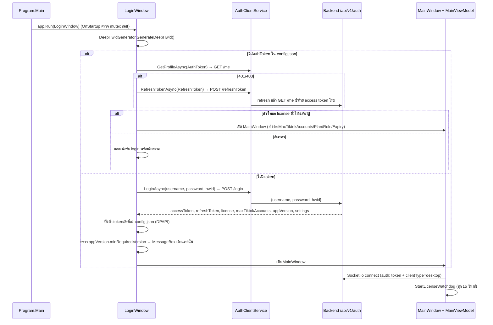
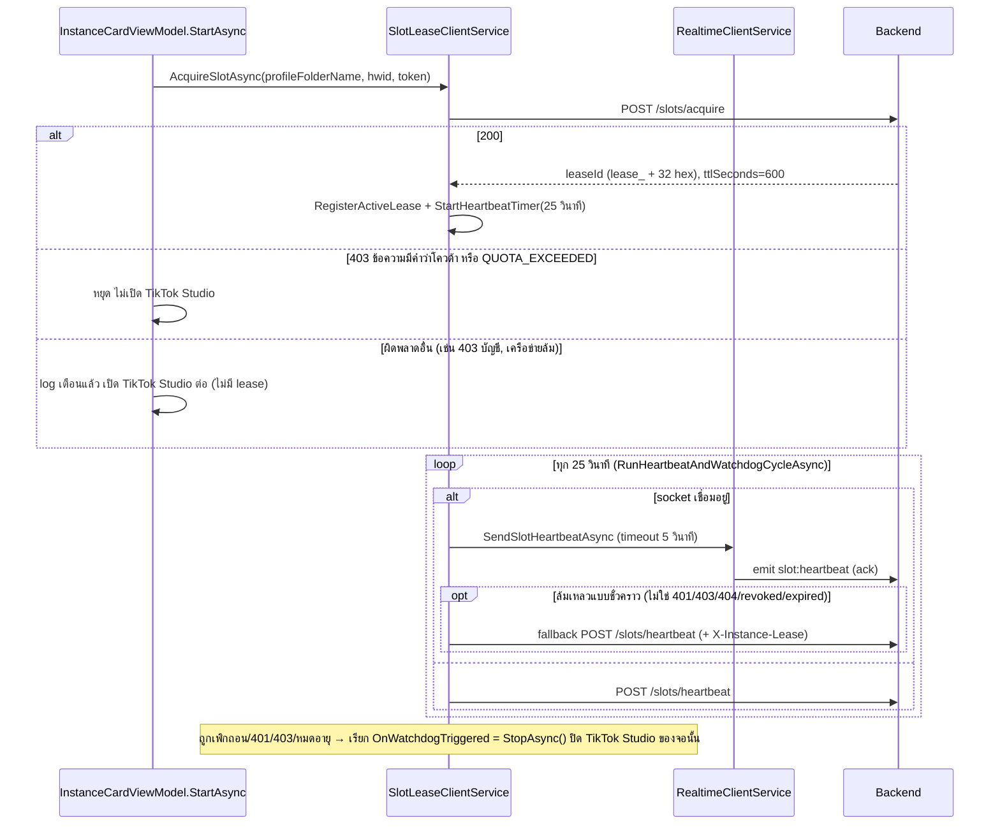
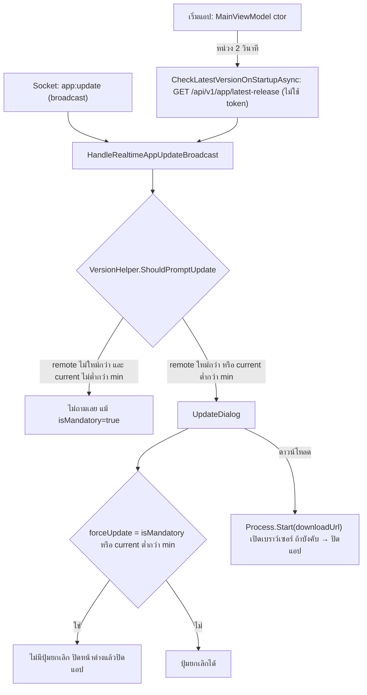

# 11. Auth, License, Slot และ Security (client + backend)

อัปเดตล่าสุด: 2026-10-20 · เวอร์ชันแอป: 1.7.0 (`FlowUltraTech.App.csproj` / `FlowUltraTech.Core.csproj`) · เวอร์ชัน backend: 1.0.0 (`package.json`)

เอกสารนี้อธิบายสิ่งที่โค้ดทำจริงตอนนี้ (อ่านจาก client repo นี้ และ **backend repo** ที่ `d:\Script\java-script\FlowUltraTech`) เอกสารเก่า `docs/archive/09_*` และ `10_*` ล้าสมัยหลายจุด (ดูท้ายไฟล์) — เอกสารฝั่ง backend ละเอียดอยู่ที่ [README](file:///d:/Script/java-script/FlowUltraTech/docs/README.md), [api_reference](file:///d:/Script/java-script/FlowUltraTech/docs/api_reference.md), [data_model](file:///d:/Script/java-script/FlowUltraTech/docs/data_model.md)

## 1. สรุป: อะไรบังคับที่ไหน

หลักการของระบบปัจจุบัน: **จำกัด "จำนวนจอ" (`maxTiktokAccounts`) ไม่ได้จำกัด "จำนวนเครื่อง"** — git log ของ client ระบุ v1.3.0 "unbind HWID machine limit, enforce pure screen quota" และโค้ดยืนยัน: login/refresh ไม่ตรวจ HWID เลย

| ข้อกำหนด | บังคับที่ | กลไกจริง | หมายเหตุ |
| --- | --- | --- | --- |
| ชื่อผู้ใช้/รหัสผ่าน, สถานะ `suspended`, license หมดอายุตอน login | **Server** | `POST /auth/login` ([auth.ts](file:///d:/Script/java-script/FlowUltraTech/src/routes/auth.ts)) | root ข้ามเช็ค license; rate limit 25 ครั้ง/5 นาที/IP |
| จำนวนเครื่อง / Device limit | **ไม่บังคับ** | server เก็บ HWID ใน `RefreshToken`/`ActiveLease` แต่ไม่ปฏิเสธ; `license.deviceLimit` ไม่ถูกอ่านตัดสินใจ; client ไม่ใช้ | UI Backoffice ส่ง `deviceLimit: 9999` ตายตัว |
| จำนวนจอพร้อมกัน | **Server** (หลัก) + Client (UI/ตามเหตุการณ์) | `slots/acquire` นับ lease ที่ยัง active เทียบ `maxTiktokAccounts`; heartbeat เพิกถอน lease ส่วนเกิน; admin ลดโควต้า → ลบ lease + push `quota:reduced` | client: ปุ่มเริ่มถูกล็อกเมื่อ `RunningInstancesCount >= MaxTiktokAccounts` (ค่าจาก `config.json` — แก้ได้ในเครื่อง จึงเป็นแค่ UX) และปิดจอส่วนเกินเมื่อโควต้าลด |
| ต้องมี lease ที่ valid ถึงแก้ captcha ได้ | **Server** | `verifyActiveLease` ตรวจ `X-Instance-Lease` + เจ้าของ lease + HWID | จุดบังคับสิทธิ์ที่แข็งที่สุดของระบบ — แอปที่ถูกแก้ยังเปิด TikTok Studio ได้ แต่แก้ captcha ผ่าน server ไม่ได้ถ้าไม่มี lease |
| HWID ผูกกับ lease | **Server** (เฉพาะ path captcha) | ถ้า lease มี HWID จริง และ request ส่ง `X-Device-Hwid`/`hwid` ไม่ตรง → 403 + `SecurityEvent` | heartbeat **อัปเดต** HWID ของ lease โดยไม่ปฏิเสธ จึงไม่ป้องกันการย้าย lease ไปเครื่องอื่นที่ส่ง heartbeat เอง |
| โควต้า captcha รายวัน (200 ครั้ง × จำนวนจอ, และ 200 ครั้ง/โปรไฟล์) | **Server เท่านั้น** | `handleCaptcha` → 429 `QUOTA_EXCEEDED` / `PROFILE_QUOTA_EXCEEDED`; รีเซ็ตเวลา 00:00 UTC | ไม่พบโค้ด client ที่อ่าน `captchaQuota` หรือ branch เฉพาะสำหรับ 429 (แสดงข้อความ error ทั่วไป) |
| License หมดอายุ/ถูกระงับระหว่างใช้งาน | **Server + Client** | server: heartbeat 403 + ลบ lease, `license:kickout`; client: watchdog 15 วินาที (เทียบ `LicenseExpiresAt` ในเครื่อง + `GET /me`) | client ปิด TikTok Studio ทั้งหมด + logout + รายงาน `SecurityEvent` |
| รันแอปได้ครั้งละ 1 โปรเซส | **Client เท่านั้น** | Global named mutex (หัวข้อ 4) | ถูกข้ามได้ด้วยการแก้ไบนารี |
| ตรวจ VM/Sandbox | **ไม่บังคับ** | มี `VmDetector` แต่ **ไม่มีโค้ดเรียกใช้** นอกชุดทดสอบ | หัวข้อ 4.3 |
| เวอร์ชันขั้นต่ำ/บังคับอัปเดต | **Client ตัดสิน** | server เพียงประกาศ (`minRequiredVersion`, `isMandatory`); client แสดง `UpdateDialog` | server ไม่ปฏิเสธ client เวอร์ชันเก่า (หัวข้อ 6) |

## 2. ข้อมูลที่ client เก็บ

[`ConfigStorageService`](../src/FlowUltraTech.Core/Services/ConfigStorageService.cs) เก็บ `AppSettings` ที่ `%APPDATA%\FlowUltraTech\config.json` (ย้ายอัตโนมัติจาก `%APPDATA%\TiktokStudioSandbox` ถ้ามีของเก่า) ฟิลด์ที่เกี่ยวข้อง: `AuthToken`, `RefreshToken`, `CaptchaSolverJwtToken`, `AuthApiEndpoint`, `CaptchaSolverEndpoint`, `MaxTiktokAccounts`, `LicenseRole`, `LicensePlan`, `LicenseExpiresAt`, `LoggedInUsername`

- `AuthToken`, `RefreshToken`, `CaptchaSolverJwtToken`, `TelegramBotToken` และรหัสผ่าน proxy ถูกเข้ารหัสด้วย **Windows DPAPI** (ขอบเขตผู้ใช้ปัจจุบัน) ก่อนเขียนไฟล์ในรูป `enc:dpapi:<base64>` และถอดตอนโหลด (ค่า plaintext เก่าจะถูกอ่านได้และเขียนกลับแบบเข้ารหัส)
- `MaxTiktokAccounts`, `LicenseExpiresAt` และ `LicensePlan` เก็บเป็น plaintext — เป็นเพียง cache แสดงผล/ตัดสินใจเบื้องต้น ค่าจริงมาจาก server ทุกครั้งที่ login, `GET /me`, หรือ event `license:updated`
- `AppConstants.DefaultServerEndpoint` ([AppConstants.cs](../src/FlowUltraTech.Core/AppConstants.cs)) เป็น URL แบบ `http://` ที่ฝังตายตัว (ไม่ใช่ HTTPS)

## 3. Flow การเข้าสู่ระบบและ token

| หัวข้อ | พฤติกรรม | โค้ด |
| --- | --- | --- |
| Payload login | ส่งเฉพาะ `username`, `password`, `hwid` (ไม่ส่ง `deviceName`/`appVersion` ดังนั้น server เก็บ `deviceName="Unknown Device"`, `appVersion="1.0.0"` ใน `RefreshToken.device`) | [`AuthClientService.LoginAsync`](../src/FlowUltraTech.Core/Services/AuthClientService.cs#L40) |
| อายุ token | access token 24 ชม. (ผู้ใช้ทั่วไป) / 30 วัน (admin, root); refresh token 30 วัน แบบ sliding และ **ไม่หมุน token** (ค่าเดิมกลับมาทุกครั้ง) | backend [auth.ts](file:///d:/Script/java-script/FlowUltraTech/src/routes/auth.ts) |
| เมื่อไหร่ refresh | ตอน `GetProfileAsync` ล้มเหลว: ที่ `LoginWindow_Loaded`, `RefreshLicenseAsync`, license watchdog และก่อนส่ง captcha เมื่อ JWT ใกล้หมดอายุ (buffer 180 วินาที ใน `InstanceCardViewModel.Captcha.cs`) | [`RefreshTokenAsync`](../src/FlowUltraTech.Core/Services/AuthClientService.cs#L206) |
| Endpoint | หน้า login แก้ช่อง Server endpoint ได้ แต่ `MainViewModel` ตั้ง `AuthApiEndpoint`/`CaptchaSolverEndpoint` กลับเป็น `DefaultServerEndpoint` ตอนสร้าง (ดูข้อสังเกต) | [LoginWindow.xaml.cs](../src/FlowUltraTech.App/Views/LoginWindow.xaml.cs#L55), [MainViewModel.cs](../src/FlowUltraTech.App/ViewModels/MainViewModel.cs#L313) |
| Logout | `LogoutAsync` ตัด socket, ล้าง token/สิทธิ์ใน settings, เรียก `RequestLogoutRedirect` (ไม่เรียก `POST /logout` ของ server ดังนั้น refresh token ฝั่ง server ยังอยู่จนหมดอายุ/admin reset) | [`LogoutAsync`](../src/FlowUltraTech.App/ViewModels/MainViewModel.cs#L1341) |
| Cloud sync | `GET/PUT /auth/settings` (Telegram, กฎ), `/profiles*`, `/proxies*` ผ่าน `AuthClientService`; ตอน login เติมค่าจาก cloud เฉพาะเมื่อค่าในเครื่องว่าง | `SyncWithCloudAsync` ใน MainViewModel |

## 4. มาตรการป้องกันฝั่ง client

### 4.1 Deep HWID

[`DeepHwidGenerator.GenerateDeepHwid`](../src/FlowUltraTech.Core/Security/DeepHwidGenerator.cs#L29): SHA-256 (hex ตัวพิมพ์เล็ก) ของ `mbSerial|cpuId|diskSerial|machineGuid` โดยอ่าน WMI `Win32_BaseBoard.SerialNumber`, `Win32_Processor.ProcessorId`, `Win32_DiskDrive.SerialNumber` (แถวแรกที่ไม่ว่าง) และรีจิสทรี `HKLM\SOFTWARE\Microsoft\Cryptography\MachineGuid` (ลอง view 64 แล้ว 32 บิต) cache ไว้ในโปรเซส

- ถ้า WMI คืนค่าว่างทั้ง 3 ตัว → ใช้ `GenerateFallbackHwid`: `MachineGuid | MAC ที่ใช้งานอยู่ (เรียง) | MachineName | UserName | ProcessorCount | OS` — ค่านี้เปลี่ยนได้เมื่อเปลี่ยนชื่อเครื่อง/ผู้ใช้/การ์ดเครือข่าย
- ไม่ได้ตรวจกรณีซีเรียลเป็นค่า placeholder (เช่น ของผู้ผลิตที่ไม่ได้กรอก) — ใช้ค่าตามที่ WMI ให้
- HWID ถูกส่งไปที่: login (`hwid`), `slots/acquire`, `slots/heartbeat` (และ socket `slot:heartbeat`), header `X-Device-Hwid` ของ captcha/verify-result, telemetry `client:instances_report`, และ `SecurityEvent` ที่ client รายงาน
- ฝั่ง server ไม่ตรวจรูปแบบ HWID (ไม่ส่ง → `unknown-hwid`) และไม่ใช้ตัดสินการ login

### 4.2 Single instance (Global Mutex)

[`App.OnStartup`](../src/FlowUltraTech.App/App.xaml.cs#L55): สร้าง `Mutex` ชื่อ `Global\FlowUltraTech_SingleInstance_Mutex_2026`; ถ้า `createdNew == false` → แสดงข้อความ "โปรแกรมกำลังทำงานอยู่แล้ว" แล้ว `Shutdown()`; ปล่อย mutex ใน `OnExit` ถ้ามีข้อผิดพลาดตอนสร้าง mutex แอปจะ log แล้วทำงานต่อโดยไม่มีการป้องกัน ชื่อ mutex เป็น `Global\` จึงมีผลข้าม session ของ Windows ในเครื่องเดียว (ชื่อใหม่ ต่างจากเอกสารเก่าที่ระบุ `TiktokStudioSandbox`) `OnExit`/`ProcessExit` เรียก `ProcessLauncher.KillAllStudioProcesses()` ปิด TikTok Studio ที่แอปเปิดไว้ ไม่มีกลไก anti-multi-process อื่นนอกจาก mutex นี้ และ manifest ตั้ง `requestedExecutionLevel = highestAvailable`

### 4.3 VM / Sandbox detection

[`VmDetector.Detect()`](../src/FlowUltraTech.Core/Security/VmDetector.cs#L35) ตรวจ 4 อย่าง: (1) Sandboxie (`SbieDll.dll` ในโปรเซส, `SbieDrv.sys`), (2) ไดรเวอร์ VirtualBox/VMware ใน `System32\drivers`, (3) โปรเซส VirtualBox/VMware/Sandboxie, (4) WMI `Win32_ComputerSystem` (VMware / innotek / VirtualBox / QEMU) และ `Win32_BIOS` — คืน `VmDetectionResult{IsVirtualMachine, HypervisorType, DetectedIndicators}`

**สถานะจริง: ไม่ถูกเรียกใช้งานในแอป** (ค้นทั้ง `src/` ไม่พบ caller; เรียกเฉพาะ `VmDetectorTests`) จึงไม่มีการบล็อกหรือรายงาน VM ใด ๆ ซึ่งสอดคล้องกับที่แอปรองรับโหมดเปิดแบบ Sandboxie (`LaunchMode`) เอง — เอกสารเก่าที่บอกว่า "ตรวจ VM แล้วบล็อก/เปิดปิดตามนโยบายแอดมิน" ไม่ตรงกับโค้ด

## 5. Slot lease, heartbeat และ watchdog

[`RunHeartbeatAndWatchdogCycleAsync`](../src/FlowUltraTech.Core/Services/SlotLeaseClientService.cs#L342) ตัดสินใจเมื่อ heartbeat ล้มเหลว:

| ผล | การตัดสินใจ client |
| --- | --- |
| `IsRevoked` / 401 / 403 / `IsExpired` (`SLOT_REVOKED`, `LEASE_EXPIRED`, `LICENSE_EXPIRED`, `ACCOUNT_INACTIVE`) | เพิกถอนทันที → `OnWatchdogTriggered` → `StopAsync()` ของจอนั้น |
| 404 (server ไม่รู้จัก lease เช่นหลัง restart/TTL) และมี token | พยายาม `AcquireSlotAsync` ใหม่แบบเงียบ แล้วสลับ `leaseId` ใน dictionary; ถ้าไม่สำเร็จ → เพิกถอน |
| เครือข่ายล่ม / 5xx (status 0 หรือ ≥ 500) | **ไม่ฆ่า TikTok Studio** (กันสตรีมเมอร์หลุดกลางไลฟ์) จนกว่าจะนานเกิน `OfflineDowntimeGracePeriod` = **10 นาที** นับจาก heartbeat สำเร็จครั้งล่าสุด แล้วจึงเพิกถอน |

ค่าที่เกี่ยวข้อง: TTL lease ฝั่ง server 10 นาที (ต่ออายุทุก heartbeat), timer client 25 วินาที, WebSocket heartbeat timeout 5 วินาที, HTTP timeout 10 วินาที, ป้องกันรอบซ้อน (`SemaphoreSlim`), เตือน lag ถ้ารอบใช้ > 500 ms

`Release`: ตอนหยุดจอ (`StopAsync` และเส้นทางล้มเหลวตอนเริ่มใน `InstanceCardViewModel`) เรียก `POST /slots/release` (พร้อม `X-Instance-Lease`) แล้วล้าง `ActiveLeaseId`

### License watchdog (ระดับแอป)

[`CheckLicenseAndQuotaWatchdogAsync`](../src/FlowUltraTech.App/ViewModels/MainViewModel.cs#L1429) ทุก **15 วินาที** (ทำงานเมื่อมี token): (1) ถ้า `LicenseExpiresAt` ในเครื่องผ่านแล้ว → kickout; (2) `GET /me`; ล้มเหลว → ลอง refresh; `LICENSE_EXPIRED`/`User inactive` → kickout; ข้อผิดพลาดอื่นถือเป็นชั่วคราว (ไม่เตะ); (3) สำเร็จ → อัปเดตวันหมดอายุ/โควต้า และถ้าจอที่รัน > โควต้าใหม่ ปิดจอส่วนเกิน (ท้ายรายการก่อน)

`HandleLicenseExpiredKickoutAsync`: ส่ง `POST /security/event` (`LICENSE_EXPIRED_KICKOUT`) → หยุดทุก instance → kill โปรเซส "TikTok LIVE Studio" → `LogoutAsync` → MessageBox

## 6. Realtime (Socket.io) ฝั่ง client

[`RealtimeClientService`](../src/FlowUltraTech.Core/Services/RealtimeClientService.cs#L27) (`SocketIOClient` 4.0.5): เชื่อม `serverUrl` ด้วย `Auth{token, clientType:"desktop"}` + query `clientType=desktop`, reconnect ไม่จำกัดจำนวนครั้ง; เชื่อมใหม่ทุกครั้งที่ login สำเร็จ / `RefreshLicenseAsync` refresh token ได้ / เริ่มแอปด้วย token เดิม

| ทิศทาง | Event | เมื่อไหร่ | client ทำอะไร |
| --- | --- | --- | --- |
| server → client | `connected` | ผ่าน handshake | ไม่ทำอะไร |
| server → client | `quota:reduced` `{newMax, revokedLeaseIds[]}` | admin ลด `maxTiktokAccounts` | อัปเดต `MaxTiktokAccounts`, บันทึก config, ปิดจอส่วนเกิน + MessageBox ([L1630](../src/FlowUltraTech.App/ViewModels/MainViewModel.cs#L1630)) |
| server → client | `license:kickout` `{reason}` | ระงับ/หมดอายุ/ลบบัญชี/reset-devices | ส่ง `REALTIME_LICENSE_KICKOUT` แล้ว kickout เต็มรูป (ปิด Studio + logout) ([L1664](../src/FlowUltraTech.App/ViewModels/MainViewModel.cs#L1664)) |
| server → client | `license:updated` `{expiredAt, maxTiktokAccounts, status, plan}` | admin แก้ license/ต่ออายุ/grace period | อัปเดตวันหมดอายุ/โควต้า/plan และบันทึก (ไม่ปิดจอใด ๆ — การลดโควต้าจริงมาทาง `quota:reduced`/watchdog) |
| server → client | `app:update` `{release{...}}` | superadmin broadcast รุ่นใหม่ (ส่งถึงทุก socket) | เข้า flow อัปเดต (หัวข้อ 7) |
| server → client | `cmd:get_instance_logs` `{requestId, profileFolderName, accountName, cdpPort, maxLines}` | แอดมินกดดู log ใน Backoffice | อ่านไฟล์ log ผ่าน `InstanceLogManager.ReadLogs` แล้วตอบ |
| client → server | `slot:heartbeat` `{leaseId, hwid}` (+ack) | ทุกรอบ heartbeat ถ้า socket เชื่อมอยู่ | ack มี `success, statusCode, isRevoked, isExpired, expiresAt` |
| client → server | `client:instances_report` | ตอน connect และเมื่อสถานะ/ข้อมูล instance เปลี่ยน (debounce) | payload: `appVersion, hwid, hostname, isProgramOpen, runningCount, totalCount, instances[]` (ชื่อโปรไฟล์, port, PID, proxy `protocol://host:port`, สถานะล็อกอิน TikTok, `activeLeaseId`, สถานะ captcha) |
| client → server | `client:instance_logs_response` | ตอบ `cmd:get_instance_logs` | `{requestId, success, logs, fileName, ...}` |

ไม่พบตัวจัดการ event `ping:check` ฝั่ง client (server รองรับแต่ client ไม่ได้ใช้)

## 7. อัปเดตและ Force Update

- เวอร์ชันปัจจุบันมาจาก `AppConstants.CurrentVersion` = `AssemblyInformationalVersion` (ตัดส่วนหลัง `+`) ซึ่งมาจาก `<Version>` ใน csproj (fallback `0.1.7`); การเปรียบเทียบใช้ [`VersionHelper`](../src/FlowUltraTech.Core/VersionHelper.cs#L39) (ตัด `v`, 4 ส่วน)
- `downloadUrl` ที่ขึ้นต้น `/` จะถูกต่อด้วย `DefaultServerEndpoint`; ถ้าว่างใช้ `<default>/api/v1/app/download`
- **client ไม่ดาวน์โหลด/ติดตั้งเอง และไม่ตรวจ `fileHash`/`fileSize`** — รับค่ามาใน `AppUpdateEventArgs` แต่ไม่ถูกใช้; ผู้ใช้ต้องรันตัวติดตั้งที่เบราว์เซอร์โหลดมาเอง
- ตอน login (`LoginWindow` และ `MainViewModel.LoginAsync` ของฟอร์มล็อกอินในแอป) มีการเทียบ `appVersion.minRequiredVersion` เช่นกัน แต่แสดง MessageBox เตือนเท่านั้น แล้วเข้าใช้งานต่อได้
- ฝั่ง server `minRequiredVersion`/`isMandatory` มาจากการ broadcast (Backoffice/สคริปต์) — ดู [12_build_release_and_testing.md](12_build_release_and_testing.md) และ backend [operations_and_backoffice.md](file:///d:/Script/java-script/FlowUltraTech/docs/operations_and_backoffice.md)

## 8. Captcha: การแนบสิทธิ์และโควต้า

[`CdpAutomationService.SolveCaptchaAsync`](../src/FlowUltraTech.Core/Services/CdpAutomationService.Captcha.cs#L900) (ส่วนเรียก API ที่ [L1094](../src/FlowUltraTech.Core/Services/CdpAutomationService.Captcha.cs#L1094)) (โหมด `LocalApiServer` — โหมด mock ถูกถอด fallback ออกแล้ว): ส่ง `POST <endpoint>/api/v1/captcha/slide|symbol` (ถ้า 404 ลอง `/captcha/slide|symbol`) ด้วย body `{image, displayWidth, displayHeight, appVersion, profileFolder}` และ header `Authorization: Bearer`, `X-Instance-Lease` (= `ActiveLeaseId` ของจอ), `X-Device-Hwid`, `X-App-Version`, `X-Profile-Folder` แล้ว client คลิก/ลากตามพิกัดที่ได้ และหลังเห็นผลจาก TikTok เรียก [`ReportCaptchaVerificationAsync`](../src/FlowUltraTech.Core/Services/CdpAutomationService.Captcha.cs#L1801) → `POST /api/v1/captcha/verify-result` (`VERIFIED_SUCCESS`/`VERIFIED_FAILED`, `captchaId`, เวลารวม)

สิ่งที่ server ตัดสิน: 403 (ไม่มี/ผิด lease, HWID ไม่ตรง), 429 (โควต้ารายวัน/รายโปรไฟล์ — หักโควต้าทันทีเมื่อ AI คำนวณได้ ไม่รอ feedback), 422 (แก้ไม่ได้) client แปล 401/403 เป็นข้อความ "Token expired หรือไม่มีสิทธิ์" ส่วนสถานะอื่นแสดงข้อความล้มเหลวทั่วไป

## 9. เหตุการณ์ความปลอดภัยที่ client รายงาน

[`ReportSecurityEventAsync`](../src/FlowUltraTech.Core/Services/AuthClientService.cs#L351) → `POST /api/v1/security/event` มีผู้เรียก 2 จุดเท่านั้น: `LICENSE_EXPIRED_KICKOUT` (watchdog/ตอน kickout) และ `REALTIME_LICENSE_KICKOUT` (event `license:kickout`) ส่วนเหตุการณ์ฝั่ง server (`MULTIPLE_INSTANCE_ATTEMPT`, `EXPIRED_LEASE_ABUSE`, `ROOT_PROTECTION_TRIGGERED`) ดูใน backend [operations_and_backoffice.md](file:///d:/Script/java-script/FlowUltraTech/docs/operations_and_backoffice.md)

## 10. สิ่งที่เอกสารเก่าเขียนผิด/ล้าสมัย (ตรวจกับโค้ดแล้ว)

| เอกสารเก่าระบุ | โค้ดจริง |
| --- | --- |
| Login ตรวจ `deviceLimit`/HWID และปฏิเสธเมื่อเกิน | ไม่มีการตรวจ (ยกเลิกตั้งแต่ v1.3.0); `deviceLimit` เป็นฟิลด์ที่ไม่ถูกใช้ (default 9999) |
| access token อายุ 1 ชั่วโมง, refresh token หมุน | access 24 ชม. / 30 วัน (admin); refresh คงค่าเดิมแบบ sliding 30 วัน |
| Lease อายุ 60 วินาที + `leaseToken` JWT | lease อายุ 10 นาที, ไม่มี `leaseToken` จริง (client อ่านได้แต่ server ไม่ส่ง) |
| Heartbeat watchdog ปิดจอถ้า server เงียบเกิน 60 วินาที | ปิดทันทีเฉพาะ 401/403/revoked; ล่ม/เครือข่ายให้เวลา 10 นาที |
| มี VM Detection เป็นนโยบายที่เปิด/ปิดได้ | มีคลาส แต่ไม่ถูกเรียกใช้เลย |
| Mutex `Global\TiktokStudioSandbox_...` | `Global\FlowUltraTech_SingleInstance_Mutex_2026` |
| MongoDB 5 collection, proxies มี unique index | 9 collection; index proxies ไม่ unique (ดู backend data_model) |

## ข้อสังเกต/ช่องว่าง (ยังไม่ยืนยันจากโค้ด)

- **Token ใน lease ไม่ถูกอัปเดตหลัง refresh**: `ActiveSlotLease.AuthToken` ถูกตั้งตอน `RegisterActiveLease` และไม่มีที่ใดอัปเดต; ถ้าแอปรันเกิน 24 ชม. แล้ว WebSocket หลุดจน heartbeat ต้อง fallback เป็น HTTP จะได้ 401 → watchdog ปิดจอ (อนุมานจากโค้ด ไม่ได้รันยืนยัน) ในทางปฏิบัติ heartbeat ผ่าน socket ซึ่งตรวจ JWT เพียงครั้งเดียวตอน handshake จึงไม่เจอปัญหานี้ตราบที่ socket เชื่อมอยู่
- Socket ที่ reconnect อัตโนมัติใช้ `Auth.token` เดิมที่ตั้งตอน `ConnectAsync`; ถ้า access token หมดอายุก่อน reconnect handshake น่าจะถูกปฏิเสธจนกว่าแอปจะเรียก `ConnectAsync` ใหม่ (watchdog refresh แล้ว **ไม่ได้** reconnect socket; เฉพาะ `RefreshLicenseAsync` ที่ reconnect) — ยังไม่ได้ทดสอบ
- ช่อง endpoint ในหน้า login แก้ได้ แต่ `MainViewModel` ตั้ง endpoint กลับเป็นค่า default ตอนสร้าง ขณะที่ `InstanceCardViewModel` ใช้ `_settings.AuthApiEndpoint` — ถ้าผู้ใช้เปลี่ยน endpoint พฤติกรรมของส่วนต่าง ๆ อาจชี้คนละเซิร์ฟเวอร์ (ไม่พบกรณีใช้งานที่ตั้งใจให้เปลี่ยน)
- ไม่ทราบว่าเซิร์ฟเวอร์จริงอยู่หลัง TLS/reverse proxy หรือไม่; client ส่งรหัสผ่านและ token ผ่าน `http://`
- ข้อสังเกตความปลอดภัยจากฝั่ง client: ตัวติดตั้ง/ไบนารีไม่มีหลักฐานการเซ็นรหัส (code signing) ใน `installer/*.iss` และ client ไม่ตรวจ hash ของไฟล์อัปเดต; ไฟล์ทดสอบและสคริปต์ใน repo นี้ฝังรหัสผ่านบัญชี root จริงและ IP เซิร์ฟเวอร์ (ดู [12_build_release_and_testing.md](12_build_release_and_testing.md)) — ไม่ได้คัดลอกค่าใด ๆ ลงเอกสาร
