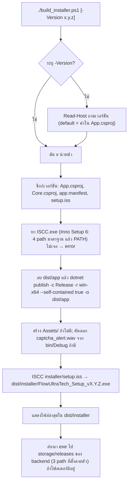
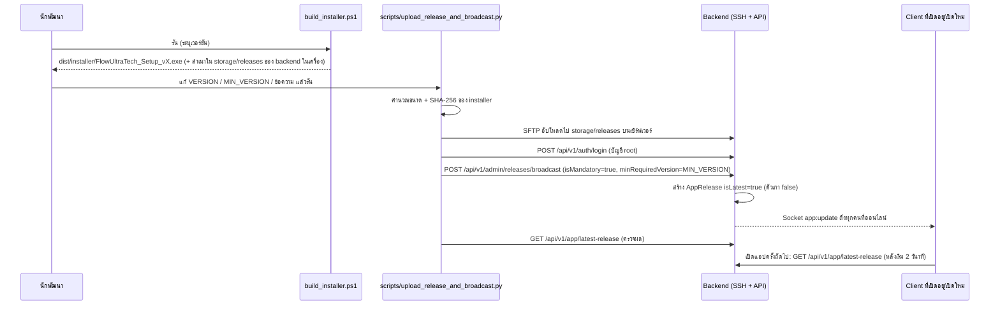

# 12. Build, Release, Deploy และ Testing

อัปเดตล่าสุด: 2026-10-20 · เวอร์ชันแอป: 1.7.0 (`FlowUltraTech.App.csproj` / `FlowUltraTech.Core.csproj`) · เวอร์ชัน backend: 1.0.0 (`package.json`)

เอกสารนี้อธิบายขั้นตอน build/แพ็กเกจ/เผยแพร่เวอร์ชันของ client และชุดทดสอบ ตามสคริปต์และโค้ดที่มีอยู่จริง **ไม่ได้รันสคริปต์ใดและไม่ได้เชื่อมต่อเซิร์ฟเวอร์** ฝั่ง backend อ่านต่อที่ backend repo [operations_and_backoffice.md](file:///d:/Script/java-script/FlowUltraTech/docs/operations_and_backoffice.md)

## 1. โครงสร้างโซลูชัน

| โปรเจกต์ | Target | หน้าที่ | อยู่ใน `FlowUltraTech.slnx` |
| --- | --- | --- | --- |
| [`src/FlowUltraTech.App`](../src/FlowUltraTech.App/FlowUltraTech.App.csproj) | `net8.0-windows` (WinExe, WPF, `StartupObject = FlowUltraTech.App.Program`) | UI, ViewModel, LoginWindow/UpdateDialog | ใช่ |
| [`src/FlowUltraTech.Core`](../src/FlowUltraTech.Core/FlowUltraTech.Core.csproj) | `net8.0` | บริการทั้งหมด (Auth, Slot, Realtime, CDP, Security ฯลฯ) | ใช่ |
| [`tests/FlowUltraTech.Tests`](../tests/FlowUltraTech.Tests/FlowUltraTech.Tests.csproj) | `net8.0-windows` (WPF) | xUnit | ใช่ |
| [`tests/FlowUltraTech.Captcha.E2E`](../tests/FlowUltraTech.Captcha.E2E/FlowUltraTech.Captcha.E2E.csproj) | `net8.0` (Exe) | E2E ของ symbol captcha กับหน้า mock | **ไม่** (รันผ่าน `scripts/test_symbol_e2e.ps1`) |

แพ็กเกจหลัก: App — `CommunityToolkit.Mvvm 8.4.2`, `Microsoft.Web.WebView2 1.0.2792.45`, `WPF-UI 4.3.0`; Core — `PuppeteerSharp 25.10.0`, `SocketIOClient 4.0.5`, `System.Management 8.0.0`, `Microsoft.Win32.Registry 5.0.0`, `TikTokLive_Sharp 1.2.3`; Tests — `xunit 2.5.3`, `Microsoft.NET.Test.Sdk 17.8.0`, `coverlet.collector 6.0.0`, `WPF-UI 4.3.0`

ไฟล์เสริม: [`Directory.Build.targets`](../Directory.Build.targets) นิยาม target ว่างชื่อ `SixLabors_ValidateLicense` (ก่อน `CoreCompile`) — สาเหตุที่ต้องมียังไม่ยืนยันจากโค้ด (ดูท้ายไฟล์); `run_app.bat` (ฆ่า `FlowUltraTech.App.exe` เดิมแล้วเปิด `dist\publish\FlowUltraTech.App.exe` ถ้ามี ไม่งั้นเปิดรุ่น Debug ใน `src\FlowUltraTech.App\bin\Debug\net8.0-windows`)

## 2. Build และรันบนเครื่อง dev

| งาน | คำสั่ง | หมายเหตุ |
| --- | --- | --- |
| Restore/Build | `dotnet build FlowUltraTech.slnx` | ต้องเป็น Windows (WPF, WMI, DPAPI); เครื่องที่ตรวจมี .NET SDK 10.0.400 |
| รันแอป (dev) | `dotnet run --project src/FlowUltraTech.App` หรือ `run_app.bat` | ล็อกไฟล์ log ที่ `app_debug.log` ข้างไฟล์ exe (gitignored) |
| ข้อมูลผู้ใช้ | `%APPDATA%\FlowUltraTech\config.json` | token ถูกเข้ารหัส DPAPI (ดู [11](11_auth_license_and_security.md#2-ข้อมูลที่-client-เก็บ)) |
| Mock captcha (jigsaw) | `./start_mock_jigsaw.ps1` | เปิด Chrome/Edge พอร์ต CDP 9221 โหลด `docs/mocks/mock_captcha_jigsaw.html` |
| Mock captcha (symbol) | `./start_mock_symbol.ps1 [-Port] [-Headless] [-UserDataDirectory] [-PassThru]` | ใช้ `docs/mocks/mock_captcha_symbol.html`; ถ้ามี browser ที่เปิด debug port แล้วจะเปิดแท็บใหม่แทน |
| เสิร์ฟ mock ผ่าน HTTP | `node docs/mocks/serve_mocks.mjs [--port=8899]` | หน้ารวมสำหรับ mock ทั้งสองแบบ (default พอร์ต 8899 หรือ env `PORT`) |

## 3. Version bump

แหล่งความจริงของเวอร์ชันคือ `<Version>` ใน `FlowUltraTech.App.csproj` — `AppConstants.CurrentVersion` อ่านจาก `AssemblyInformationalVersion` (ตัดส่วนหลัง `+`) จึงตรงกับ csproj ที่ build ออกมา `build_installer.ps1` ซิงก์เวอร์ชันให้อัตโนมัติ 4 จุด:

| ไฟล์ | สิ่งที่ถูกเขียน |
| --- | --- |
| `src/FlowUltraTech.App/FlowUltraTech.App.csproj` | `<Version>` (3 ส่วน), `<AssemblyVersion>` และ `<FileVersion>` (4 ส่วน เช่น `1.7.0.0`) |
| `src/FlowUltraTech.Core/FlowUltraTech.Core.csproj` | เหมือนข้างบน |
| `src/FlowUltraTech.App/app.manifest` | `assemblyIdentity version` |
| `installer/setup.iss` | `#define MyAppVersion` |

**จุดที่ไม่ถูกซิงก์** (ต้องแก้มือ): ค่า `VERSION` / `MIN_VERSION` และข้อความ title/description ใน [`scripts/upload_release_and_broadcast.py`](../scripts/upload_release_and_broadcast.py)

## 4. Build ตัวติดตั้ง (`build_installer.ps1`)



รายละเอียดสำคัญ:

- ใช้ `dotnet` จาก `%USERPROFILE%\.dotnet\dotnet.exe` ถ้ามี (ตั้ง `DOTNET_ROOT`) ไม่งั้นใช้ `dotnet` ใน PATH
- publish แบบ **self-contained win-x64** (ตัวติดตั้งจึงไม่ต้องมี .NET บนเครื่องผู้ใช้)
- ขั้นสำเนาไป backend: สร้างโฟลเดอร์ `D:\Projects\FlowUltraTech\FlowUltraTechServer\storage\releases` เองถ้าไม่มี แล้วคัดลอกไปยัง path นั้น, `D:\Script\java-script\FlowUltraTech\storage\releases` และ `D:\Script\java-script\SimpleSolveCaptchaProject\storage\releases` (อันหลังเป็นชื่อโปรเจกต์เก่า) เฉพาะที่มีอยู่จริง — เป็นการ copy ในดิสก์เท่านั้น **ไม่ได้อัปโหลดขึ้นเซิร์ฟเวอร์และไม่ได้ประกาศเวอร์ชัน**
- สคริปต์ไม่ commit/tag (repo ไม่มี git tag; ข้อความ commit ของ release ใช้รูป `feat(v1.7.0): ...` หรือ `chore(release): v1.5.5 - ...`)
- `captcha_alert.wav` ไม่อยู่ใน `src/FlowUltraTech.App/Assets` (มีแค่ไอคอน/โลโก้) — build ที่ไม่เคยมี `bin\Debug` จะไม่มีไฟล์เสียงนี้ในตัวติดตั้ง

### Inno Setup

| ไฟล์ | สถานะ | สาระสำคัญ |
| --- | --- | --- |
| [`installer/setup.iss`](../installer/setup.iss) | **ใช้งานจริง** | ชื่อแอป `FlowUltraTech` v1.7.0, `AppId` คงที่, ติดตั้งที่ `{autopf}\FlowUltraTech`, `PrivilegesRequired=lowest` (ผู้ใช้เลือกยกระดับได้ด้วย dialog), 64-bit, บีบอัด `lzma2/ultra64`, ภาษาอังกฤษอย่างเดียว, ตัวเลือกไอคอนเดสก์ท็อป (ไม่ติ๊กเป็น default), เปิดแอปหลังติดตั้ง, ต้นทางไฟล์ `..\dist\app\*`, เอาต์พุต `..\dist\installer\FlowUltraTech_Setup_v{ver}` |
| [`installer/setup_script.iss`](../installer/setup_script.iss) | **เก่า ไม่ถูกเรียก** | v0.1.0 ชื่อ "TikTok LIVE Studio Sandbox Manager", ต้นทาง `..\publish\win-x64\*`, `PrivilegesRequired=admin`, เอาต์พุต `..\dist` |

ข้อสังเกตของ `setup.iss`: ไม่มี `SignTool`/การเซ็นรหัส, ไม่มี `AppMutex`/`CloseApplications` (ตัวติดตั้งไม่ตรวจว่าแอปกำลังรันอยู่)

## 5. ขั้นตอนเผยแพร่เวอร์ชัน (release + broadcast)



สิ่งที่ [`upload_release_and_broadcast.py`](../scripts/upload_release_and_broadcast.py) ทำจริง (ลำดับ): (0) หา `dist\installer\FlowUltraTech_Setup_v{VERSION}.exe` ไม่พบ → ออก (1–2) SSH/SFTP ไปที่ `/root/FlowUltraTech/storage/releases/` ด้วยบัญชี root (3) login API ด้วยบัญชี root ของแอป (4) broadcast ด้วย `isMandatory: true` และ `minRequiredVersion = MIN_VERSION` (ในไฟล์ตอนนี้ = `1.7.0` คือ **บังคับให้ทุกเครื่องอัปเดตเป็น 1.7.0**), `downloadUrl = /storage/releases/<ไฟล์>` (5) GET latest-release พิมพ์ผล

พฤติกรรมของ client ต่อประกาศนี้ (ดู [11 หัวข้อ 7](11_auth_license_and_security.md#7-อัปเดตและ-force-update)): ถ้ามี `minRequiredVersion` สูงกว่าเวอร์ชันที่ติดตั้ง หรือรุ่นใหม่กว่าและ `isMandatory` → `UpdateDialog` แบบบังคับ (ปิดไม่ได้ ปุ่ม "ดาวน์โหลด" เปิดเบราว์เซอร์แล้วปิดแอป); ถ้าไม่บังคับ ผู้ใช้กดยกเลิกได้; แอปไม่ติดตั้งเองและไม่ตรวจ hash

ทางเลือกอื่นที่มีในระบบ (ไม่ใช่สคริปต์ของ repo นี้): Backoffice แท็บ "อัปเดตเวอร์ชัน & บรอดแคสต์" (อัปโหลดไฟล์ + กำหนด min version/บังคับ) และ `npm run deploy` ของ backend ซึ่งจะ sync ตัวติดตั้งและ **ตั้งรุ่นล่าสุดเป็น `isMandatory: true`** ทุกครั้งที่รัน (ดู backend [operations_and_backoffice.md](file:///d:/Script/java-script/FlowUltraTech/docs/operations_and_backoffice.md))

## 6. สคริปต์ใน `scripts/` และ root (client repo)

อธิบายตามโค้ด — **อย่ารันโดยไม่ตรวจเป้าหมาย** ส่วนใหญ่ชี้เซิร์ฟเวอร์ production ตายตัว และมี credential ฝังในไฟล์

| ไฟล์ | ชนิด | ทำอะไร | ผลกระทบ |
| --- | --- | --- | --- |
| `build_installer.ps1` | PowerShell | หัวข้อ 4 | แก้ไฟล์โปรเจกต์ 4 ไฟล์ + สร้าง `dist/` |
| `scripts/upload_release_and_broadcast.py` | Python (paramiko, requests) | หัวข้อ 5 | อัปโหลด + ประกาศบังคับอัปเดตบน production |
| `scripts/deploy_remote_server.py` | Python (paramiko) | SFTP ส่ง 5 ไฟล์ backend (`auth.ts`, `slots.ts`, `User.ts`, `adminController.ts`, `socketHub.ts`) จาก `d:\Script\java-script\FlowUltraTech` และ `backoffice/dist` ขึ้นเซิร์ฟเวอร์ แล้ว `npm run build && pm2 restart flowultratech-backend` | แก้โค้ด production โดยตรง |
| `scripts/check_remote_server.py` | Python | SSH → `mongosh` นับ/ดูเอกสารล่าสุดของ `captchalogs` (ไม่รวม `imageBase64`) | อ่านอย่างเดียว |
| `scripts/inspect_captcha_log.py` | Python | SSH → รัน Node อ่าน `captchalogs` 3 รายการล่าสุดจาก Mongo บนเซิร์ฟเวอร์ | อ่านอย่างเดียว |
| `scripts/check_admin_logs.py` | Python (urllib) | login root → `GET /admin/captcha-logs` แล้วพิมพ์รายการ | อ่านอย่างเดียว |
| `scripts/test_live_slide_api.py` | Python | login root → อ่านภาพจริงจาก `extracted_sources/CaptchaJigsaw.html` → `POST` slide | ใช้โควต้า captcha ของ root (root ข้ามโควต้า) |
| `scripts/test_model.py` | Python | SSH ส่งสคริปต์ Node ไปรัน `findPositionDetails` กับไฟล์ใน `storage/captchas` บนเซิร์ฟเวอร์ | เขียนไฟล์ชั่วคราวบนเซิร์ฟเวอร์ |
| `scripts/test_e2e_hwid_and_screen_quota.py` | Python (requests) | E2E 10 ขั้น กับเซิร์ฟเวอร์จริง: สร้าง user โควต้า 2 จอ → login 3 เครื่อง (3 HWID) **ต้องสำเร็จทั้งหมด** → acquire 2 จอ → จอที่ 3 ต้องถูกปฏิเสธ 403 → heartbeat → admin ปลด lease → จอที่ 3 acquire ได้ → ลบ user ทดสอบ | สร้าง/ลบ user บน production (เอกสารยืนยันนโยบาย "ไม่จำกัดเครื่อง จำกัดจอ") |
| `scripts/benchmark_simulation.py` | Python | จำลอง login/lease/แก้ slide captcha หลายรอบวัด latency (รุ่นใกล้เคียงกับ backend) | ยิงโหลดจริง |
| `scripts/simulate_live_user_app.js` | Node | จำลอง client: login → acquire → socket report/heartbeat → ตอบ `cmd:get_instance_logs` | ทำให้ปรากฏเป็นผู้ใช้ออนไลน์ใน Backoffice |
| `scripts/inspect_dom.py` | Python (bs4) | พิมพ์ DOM รอบ `#captcha-verify-image` จาก `extracted_sources/CaptchaJigsaw.html` | local เท่านั้น |
| `scripts/test_symbol_e2e.ps1` | PowerShell | เปิด mock symbol แบบ headless บนพอร์ตสุ่ม → `dotnet run` ของ `FlowUltraTech.Captcha.E2E` → บันทึก `TestResults\symbol-e2e\run.log` → ปิดเฉพาะ browser ที่ตัวเองเปิด/ลบโปรไฟล์ชั่วคราว | local เท่านั้น |
| `scripts/test_symbol_e2e.ps1` ↔ `start_mock_*.ps1` | PowerShell | ดูหัวข้อ 2 | local |
| `extract_sourcemap.py` | Python | แตกซอร์สจาก source map แล้วจัดรูปโค้ด (HTML/CSS/JS/JSON) ไปไว้ใน `extracted_sources/` (ทั้งสองถูก gitignore) | local |

## 7. ชุดทดสอบ

### 7.1 `tests/FlowUltraTech.Tests` (xUnit, ~186 test method)

รัน: `dotnet test tests/FlowUltraTech.Tests/FlowUltraTech.Tests.csproj` (ต้องเป็น Windows เพราะ WPF) เลือกบางกลุ่มด้วย `--filter "FullyQualifiedName~SlotLeaseClientServiceTests"` ฯลฯ ไม่มีการใช้ `Skip`/`Trait` ในไฟล์ใด จึงไม่มีการข้ามอัตโนมัติ — เทสต์ที่ต้องพึ่งภายนอกจะ **ล้มเหลว** ถ้าไม่มีทรัพยากร

รันเฉพาะส่วนที่ไม่แตะเซิร์ฟเวอร์จริง (ตัดชื่อที่เป็น live/E2E ออก):

```powershell
dotnet test tests/FlowUltraTech.Tests/FlowUltraTech.Tests.csproj --filter "FullyQualifiedName!~E2E&FullyQualifiedName!~RealTikTok&FullyQualifiedName!~Returns401"
```

| ไฟล์ทดสอบ (จำนวน) | ครอบคลุม | ต้องการ |
| --- | --- | --- |
| `AuthClientServiceTests` (7) | refresh สำเร็จ/ว่าง/หมดอายุ, parse login (`appVersion`, settings), cloud settings, `ReportSecurityEventAsync` | mock HTTP |
| `SlotLeaseClientServiceTests` (10) | acquire ok/โควต้าเต็ม, header `X-Instance-Lease`, release, watchdog (401, เกิน grace, server redeploy ภายใน grace ไม่ฆ่าสตรีม), heartbeat ผ่าน socket / fallback HTTP / revoked ผ่าน socket | mock HTTP + fake realtime |
| `AppUpdateBroadcastTests` (3) | `AppUpdateEventArgs`, เทียบเวอร์ชัน, `ShouldPromptUpdate` | – |
| `DeepHwidGeneratorTests` (6) | รูปแบบ SHA-256, คงที่ข้ามการเรียก, fallback, WMI/registry ไม่ throw | Windows |
| `VmDetectorTests` (2) | `Detect()` ไม่ throw, คุณสมบัติของ result | Windows |
| `LoginWindowAndMandatoryAuthTests` (3) | ค่าเริ่มต้นไม่ล็อกอิน, solve ล้มเหลวเมื่อ server ล้ม (ไม่ fallback mock), `LogoutAsync` ยิง redirect + ล้าง auth | WPF |
| `MaxTiktokAccountsQuotaTests` (2) | default 1 จอ, ถึงโควต้าแล้วการ์ดอื่นเริ่มไม่ได้ | WPF |
| `CaptchaLeaseHeaderTests` (1) | `SolveCaptchaAsync` รับ `instanceLeaseId` | – |
| `ConfigStorageServiceTests` (4), `ProfileManagerServiceTests` (4), `ProxifierServiceTests` (2), `RuleEngineTests` (5), `TelegramNotificationServiceTests` (6), `TikTokLiveListenerServiceTests` (10), `WindowControllerTests` (7) | บริการอื่น ๆ ของแอป | Windows/WPF บางส่วน |
| `DebugViewModelAndCdpTests` (41), `InstanceDebugLogTests` (8), `MainViewModelNavigationTests` (5), `OverlaySystemTests` (7), `WpfUiReflectionTests` (1) | ViewModel/Debug/Overlay/UI | WPF; `OverlaySystemTests` ใช้ browser |
| `LongTermPerformanceSoakTests` (4) | log 10,000 รายการ, rotation > 10 MB, จำกัดขนาด console, cleanup logger | – |
| `CaptchaMockDetectionTests` (19), `CaptchaMockSolverTests` (19) | ตรวจจับ/แก้ captcha บนหน้า mock กับ API จำลอง (HttpListener ในเครื่อง) | `CaptchaMockSolverTests` เปิด Chrome/Edge |
| `CaptchaLiveApiSolverTests` (8) | 4 ตัว offline (ค่า default, URL ว่าง, พอร์ตปิด) + 4 ตัว **ใช้เซิร์ฟเวอร์จริงและ browser** (`RealLiveE2E_AgainstPort9221`, `RealTikTokStudioDOM...`, `Returns401TokenExpired`, `RealTikTokSymbolDOM_AgainstLiveServer`) | เครือข่ายถึง production + Chrome/Edge |
| `RealtimeClientE2ETests` (1) | login แล้วเชื่อม Socket.io จริงและส่ง `client:instances_report` | **production server** |
| `LiveSessionWatchdogE2ETests` (1) | Backoffice socket ไม่ถูกนับเป็นผู้ใช้ออนไลน์ + desktop รายงาน instance ที่รัน | **production server** |

> ทดสอบที่เรียก production ใช้บัญชี root จริงที่ฝังในไฟล์ทดสอบ (`CaptchaLiveApiSolverTests`, `RealtimeClientE2ETests`, `LiveSessionWatchdogE2ETests`) — ไม่ได้ย้ายไป env/secret store

### 7.2 `tests/FlowUltraTech.Captcha.E2E`

โปรแกรมคอนโซลที่เชื่อม Chrome ผ่าน CDP กับหน้า `mock_captcha_symbol.html` และใช้ `FlowUltraTech.Core` (CDP service จริง) โดยเอา solver เป็น fixture server ในโปรเซส ตรวจการตรวจจับ/คลิกตอบ/กดยืนยัน/รีเซ็ต และถ่ายภาพไว้ที่ `TestResults\symbol-e2e` รันผ่าน `scripts/test_symbol_e2e.ps1` (`-DotnetPath` ปรับ path ของ dotnet ได้)

### 7.3 ทดสอบฝั่ง backend

สคริปต์ทดสอบของ backend (`npm run test:*`, `tests/*.py`, `tests/*.ts`) อยู่ใน backend repo — สรุปในส่วน "ชุดทดสอบ" ของ [operations_and_backoffice.md](file:///d:/Script/java-script/FlowUltraTech/docs/operations_and_backoffice.md)

## 8. ข้อสังเกตด้านความปลอดภัยของกระบวนการ build/release

- สคริปต์ deploy/ทดสอบทั้ง client และ backend ฝังข้อมูลเข้าสู่ระบบจริง (SSH root ของเซิร์ฟเวอร์, รหัสผ่านบัญชี root ของแอป) และ IP เซิร์ฟเวอร์ ไว้ในไฟล์ที่ track ใน git (ใน client repo: 10 ไฟล์ใน `scripts/` และไฟล์ทดสอบ C# 3 ไฟล์; ใน backend repo: 12 ไฟล์ — `scripts/` 5, `tests/` 6, `simulate_live_user_app.cjs`; remote ชี้ GitHub ไม่ทราบสถานะ private) — ควรหมุนรหัสและย้ายไป env ไม่ได้คัดลอกค่าใดลงเอกสาร
- สคริปต์ใช้ `AutoAddPolicy` (ไม่ตรวจ host key) และ SSH ด้วยรหัสผ่านของผู้ใช้ root
- ตัวติดตั้งไม่มีการเซ็นรหัสและ client ไม่ตรวจ `fileHash` ของไฟล์ที่ดาวน์โหลด (ดาวน์โหลดผ่านเบราว์เซอร์จาก `http://`)

## ข้อสังเกต/ช่องว่าง (ยังไม่ยืนยันจากโค้ด)

- `Directory.Build.targets` มี target ว่าง `SixLabors_ValidateLicense` — น่าจะเป็นการปิด target ตรวจ license ของแพ็กเกจ SixLabors ที่ถูกดึงมาทางอ้อม แต่ไม่พบเอกสารยืนยัน
- เวอร์ชัน .NET SDK ขั้นต่ำสำหรับไฟล์ `.slnx` ไม่ได้ระบุใน repo (ไม่มี `global.json`)
- README ที่ root ของ client repo ยังลิงก์ไปยัง `docs/09_*`, `docs/10_*` และเอกสารอื่นที่ย้ายเข้า `docs/archive/` แล้ว (ลิงก์เสีย) — ไม่ได้แก้เพราะอยู่นอกขอบเขตงานนี้
- ไม่ทราบว่าเซิร์ฟเวอร์จริงรันเวอร์ชันโค้ดใดอยู่ (deploy ทำมือผ่านสคริปต์ ไม่มี CI/CD ใน repo)
- ไม่พบ CI pipeline (GitHub Actions ฯลฯ) ใน repo ทั้งสอง จึงไม่มีการรัน `dotnet test` อัตโนมัติ
